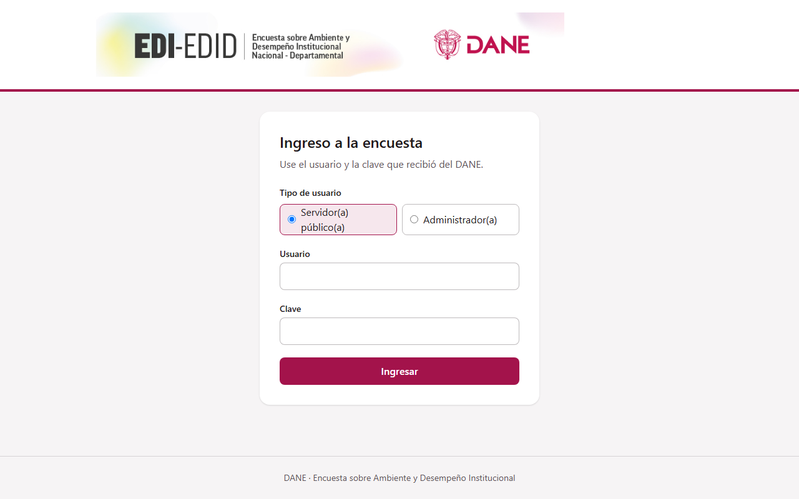
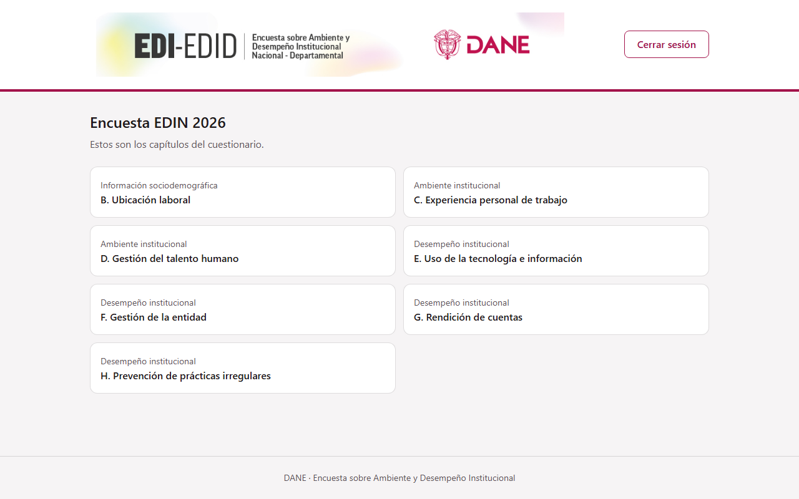
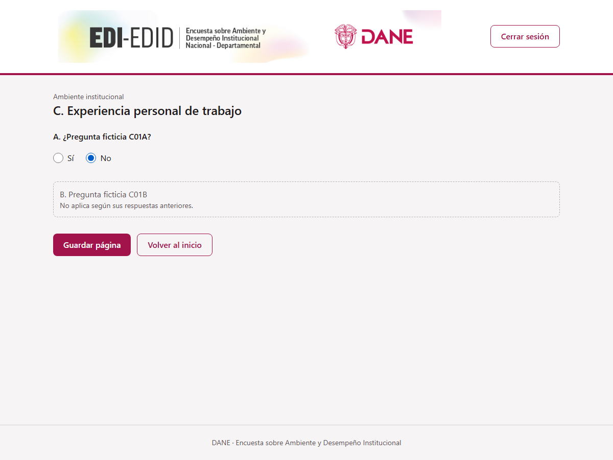
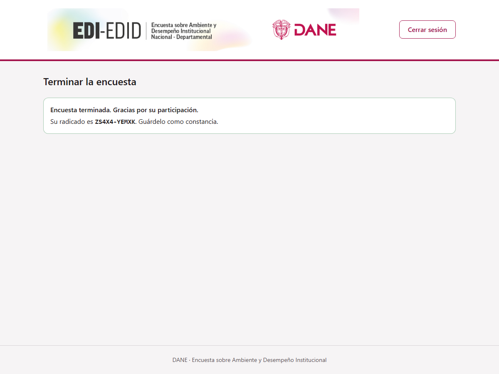

# Formulario Web EDI/EDID

Aplicación web para que los servidores públicos diligencien la Encuesta de Desarrollo Institucional
(EDI/EDID) del DANE, y para que los administradores gestionen el cuestionario. Reemplaza al sistema
PHP heredado (`FORMULARIO_WEB`) sobre la misma base Oracle (`DANE_DIRPEN`), sin DDL nuevo.

La Fase 1 entrega la base técnica: inicio y cierre de sesión (encuestados y administradores), lectura
del cuestionario (capítulos B–H) y lista de capítulos. La Fase 2 agrega el flujo del encuestado:
avance por página, saltos en vivo, guardado único confirmado, observaciones y radicado. Monorepo con
dos aplicaciones independientes: `backend/` (Spring Boot) y `frontend/` (React).

## Enlaces de documentación del proyecto
 - [Especificación de diseño](docs/superpowers/specs/2026-10-14-formulario-web-design.md)
 - [Plan de la Fase 1](docs/superpowers/plans/2026-10-14-fase-1-base.md)
 - [Diagrama de arquitectura](docs/diagramas/arquitectura.md)
 - [Diagrama de secuencia del inicio de sesión](docs/diagramas/secuencia-inicio-sesion.md)
 - [Diagrama de secuencia de guardar una página](docs/diagramas/secuencia-guardar-pagina.md)
 - [Reglas de EDIN 2026](docs/reglas/edin-2026.md)
 - [MER de las tablas usadas](docs/diagramas/mer-tablas-usadas.md)
 - [Contrato OpenAPI](docs/api/openapi.yaml)
 - [Changelog](CHANGELOG.md)

## Referencias de API
Prefijo `/api/v1`; errores en RFC 7807 (`application/problem+json`). Swagger UI en
`/swagger-ui.html`: abierto en dev y QA y solo para `ADMIN_NACIONAL` en producción
(`SWAGGER_ENABLED` / `SWAGGER_PUBLIC`). Contrato completo en [docs/api/openapi.yaml](docs/api/openapi.yaml).

| Verbo | Ruta | Descripción |
| :-- | :-- | :-- |
| `GET` | `/api/v1/auth/csrf` | Entrega la cookie `XSRF-TOKEN` |
| `POST` | `/api/v1/auth/login` | Inicia sesión (cookie `EDI_SESSION`); cuerpo `username`, `password` y `accountType` (`RESPONDENT` \| `ADMINISTRATOR`) |
| `POST` | `/api/v1/auth/logout` | Cierra la sesión |
| `GET` | `/api/v1/auth/me` | Consulta la sesión actual |
| `GET` | `/api/v1/survey/chapters` | Lista los capítulos del cuestionario |
| `GET` | `/api/v1/survey/chapters/{chapterCode}` | Consulta un capítulo con sus preguntas |
| `GET` | `/api/v1/survey/progress` | Avance por página (`finished`: las 9 guardadas) |
| `GET` | `/api/v1/survey/rules` | Reglas vigentes (saltos y validaciones) |
| `GET` | `/api/v1/survey/pages/{pagina}` | Consulta una página con sus respuestas guardadas |
| `PUT` | `/api/v1/survey/pages/{pagina}/answers` | Guarda una página, una sola vez |
| `POST` | `/api/v1/survey/finish` | Registra las observaciones opcionales; entrega el radicado |

Todo método distinto de `GET`/`HEAD` exige la cabecera `X-XSRF-TOKEN`.

Límites de `PUT .../answers`: como máximo 200 respuestas por página (400 «Envíe como máximo 200
respuestas por página») y 4000 caracteres por valor (422 con «La respuesta es demasiado larga.» en
`errors`). Las claves desconocidas se devuelven en `errors` recortadas a 30 caracteres.
`POST /finish` es idempotente: con las 9 páginas guardadas siempre devuelve el mismo radicado y
`OBS` solo se escribe la primera vez que llega texto.

## Autores

- Oscar Dueñas, con asistencia de Claude (Anthropic); la trazabilidad está en el trailer
  `Co-Authored-By` de cada commit.

## Distintivos


El pipeline está en [.github/workflows/ci.yml](.github/workflows/ci.yml): secretos, lint, pruebas,
cobertura, SAST (Semgrep), SCA, Trivy y E2E.

> **Pendiente:** insertar los distintivos de estado del CI y de cobertura cuando exista el repositorio
> remoto (su URL aún no está definida). Licencia: no hay archivo `LICENSE`.

Cobertura mínima exigida: 80 % en `co.gov.dane.edi.security`, 60 % en el resto del backend y 60 % en el
frontend.

## Ambiente de pruebas
Entorno local con datos **ficticios** (`db/dev/`), nunca contra la Oracle institucional.

> **Pendiente:** URL del ambiente de QA.

```bash
cp .env.example .env        # cambie TODAS las claves y genere JWT_SECRET
docker compose up --build   # http://localhost:8081
```

Usuarios ficticios de `db/dev/data.sql`:

| Perfil | Usuario | Notas |
| :-- | :-- | :-- |
| Encuestado | `PRUEBA01` | Activo |
| Encuestado | `PRUEBA02` | Inactivo (debe rechazarse) |
| Encuestado | `PRUEBA03` | Año 2025 (no pertenece a la encuesta activa; debe rechazarse) |
| Encuestado | `PRUEBA04` | Para pruebas de bloqueo |
| Encuestado | `PRUEBA05` | Flujo E2E (Chromium) |
| Encuestado | `PRUEBA06` | Pruebas de integración y E2E móvil |
| Administrador | `adm.nacional` | ROL 1 |
| Administrador | `adm.bogota` | ROL 2, departamento 11 |
| Administrador | `adm.edid` | Otra encuesta (EDID); no debe ingresar a EDIN |

Las claves de prueba están en `db/dev/data.sql`. El bloqueo ocurre tras 5 fallos en 15 minutos por
usuario + IP.

**Cada página se guarda una sola vez.** Para repetir el flujo completo hay que reiniciar el
backend, que recarga `db/dev/data.sql`. Con compose también hace falta `docker compose down -v`,
para que se vuelva a sembrar el volumen de reglas. Las pruebas E2E (Playwright) corren con un solo
worker y sin reintentos, porque los datos son de escritura única y el inicio de sesión se bloquea
tras 5 fallos. Cada proyecto de Playwright usa su propio usuario (`PRUEBA05` en Chromium,
`PRUEBA06` en móvil); se cambian con `E2E_FLOW_USER_CHROMIUM` / `E2E_FLOW_PASSWORD_CHROMIUM` y
`E2E_FLOW_USER_MOVIL` / `E2E_FLOW_PASSWORD_MOVIL`.

Pruebas automatizadas:

```bash
cd backend && ./mvnw -B verify          # requiere Docker (Testcontainers + Oracle Free)
cd frontend && npm run test:coverage    # unitarias con cobertura
cd frontend && npm run e2e              # Playwright contra E2E_BASE_URL (stack levantado)
```

Solución de problemas:
- El arranque de Oracle Free en Testcontainers tarda 50–90 s (timeout de 5 min); si falla por tiempo,
  reintente.
- Windows: si el backend falla con "Unable to establish loopback connection", la carpeta temporal
  tiene nombre corto 8.3 (`C:\Users\NOMBRE~1.XXX\...`). Apunte `TEMP`/`TMP` a una ruta corta y use
  `-Djdk.net.unixdomain.tmpdir=C:\edi-tmp`.
- Hook de secretos (una vez por desarrollador): `git config core.hooksPath .githooks` (usa gitleaks o,
  en su defecto, Docker; la allowlist solo cubre datos ficticios).

## Deployment

Imágenes (usuario no root, versión base fija, healthcheck, etiquetas de responsable):

- `backend/Dockerfile`: multi-stage, `eclipse-temurin:21.0.12.1_1` (JDK para compilar, JRE para ejecutar).
- `frontend/Dockerfile`: multi-stage, `node:22.23.3-slim` para compilar y
  `nginxinc/nginx-unprivileged:1.30.3-alpine3.23` para servir; nginx hace de proxy de `/api` hacia
  `BACKEND_URL` y es el borde (`X-Forwarded-For`). No arranca si el host de `BACKEND_URL` no resuelve.
- Volumen `rules-data` (`/data/rules`, variable `RULES_DIR`): JSON de saltos y validaciones. Si no
  existe `EDIN-2026.json`, el backend siembra el de la imagen. El backend corre en **una sola
  instancia** (decisión D6).

**Local con contenedores**

```bash
cp .env.example .env
docker compose up -d --build --wait
docker compose down -v
```

**Local sin contenedor de aplicación** (Java 21, Node 22+; probado con Node 24). El `DB_URL` de
`.env.example` usa el host `oracle`, que solo resuelve dentro de compose; aquí se usa `localhost`.

```bash
# 1. Oracle Free de desarrollo (datos ficticios; reemplace los placeholders)
docker run -d --name edi-oracle-dev -p 1521:1521   -e ORACLE_PASSWORD=<clave-admin-dev> -e APP_USER=EDI_DEV -e APP_USER_PASSWORD=<clave-app-dev>   gvenzl/oracle-free:23-slim-faststart

# 2. Backend: ejecutar desde backend/ (las rutas ../db/dev son relativas a esa carpeta)
cd backend && ./mvnw -B package
export DB_URL=jdbc:oracle:thin:@//localhost:1521/FREEPDB1 DB_USER=EDI_DEV DB_SCHEMA=EDI_DEV
export DB_PASSWORD=<clave-app-dev> JWT_SECRET=<secreto-de-32-o-mas-caracteres>
export SURVEY_CODE=EDIN SURVEY_YEAR=2026 RULES_DIR=./rules-data COOKIE_SECURE=false
export SWAGGER_ENABLED=true SWAGGER_PUBLIC=true CORS_ALLOWED_ORIGIN=http://localhost:5173
export SPRING_SQL_INIT_MODE=always   SPRING_SQL_INIT_SCHEMA_LOCATIONS=file:../db/dev/schema.sql   SPRING_SQL_INIT_DATA_LOCATIONS=file:../db/dev/data.sql
java -jar target/formulario-edi-backend.jar

# 3. Frontend (proxy /api -> 8080)
cd ../frontend && npm ci && npx vite
```

`CORS_ALLOWED_ORIGIN` solo importa si el frontend no se sirve por el proxy de Vite (acceso directo al
backend); en ese caso debe ser el origen del frontend.

**Actualizar las reglas.** Si `RULES_DIR/EDIN-2026.json` ya existe con `"version": 1`, hay que
respaldarlo y borrarlo para que se siembre la versión 2 de la imagen. Hasta la Fase 3 (editor de
reglas) es la única forma de actualizarlo. En la primera carga, el backend registra un WARN si la
semilla trae una `version` mayor que la del archivo vigente.

**Cambios en las tablas `FRM_*`.** Las preguntas de cada página y las reglas efectivas se guardan en
memoria (una sola instancia, D6). Hasta la Fase 3, un cambio en el cuestionario (`FRM_*`) o en las
columnas de las tablas de respuesta exige reiniciar el backend.

**QA y producción.** Entran por el pipeline (lint, build, pruebas, SAST/SCA, imagen, staging,
aprobación manual, producción, smoke tests). El paso a producción exige el formato FR-FT-GST-02
(`Requisitos_Entrega.xlsx`, versión vigente), RFC y aprobación del CAB. Cada ambiente usa credenciales
propias (`DB_SCHEMA=DANE_DIRPEN` en el institucional, `COOKIE_SECURE=true`, `SWAGGER_PUBLIC=false`).

> **Pendiente:** las etapas de *staging* y producción del pipeline aún no están implementadas; hoy
> `ci.yml` cubre hasta imágenes y E2E.

**`CORS_ALLOWED_ORIGIN` y nginx.** Debe ser exactamente el origen público con el que el navegador abre
la aplicación (esquema + host + puerto), incluso cuando entra por nginx. nginx reenvía
`X-Forwarded-Proto` y el `RemoteIpValve` de Tomcat hace que la petición aparente estar en el puerto por
defecto; así el backend aplica CORS también a los POST del mismo origen. Si el valor no coincide, el
ingreso responde 403 «Invalid CORS request».

Detrás de un balanceador delante de nginx, configure los proxies de confianza
(`server.tomcat.remoteip.*`). Como mitigación real contra la inundación de intentos de ingreso, aplique
rate limiting en el proxy o balanceador (el bloqueo en memoria es por instancia).

## Environment Variables
Fuente: [.env.example](.env.example) (copiar como `.env`, que git ignora).

| Variable | Descripción | Requerida | Valor por defecto / ejemplo |
| :-- | :-- | :-- | :-- |
| `DB_URL` | URL JDBC de Oracle | Sí | `jdbc:oracle:thin:@//oracle:1521/FREEPDB1` |
| `DB_USER` | Usuario de aplicación | Sí | `EDI_DEV` |
| `DB_PASSWORD` | Clave del usuario de aplicación | Sí | sin valor real; cámbiela |
| `DB_SCHEMA` | Dueño de las tablas (institucional: `DANE_DIRPEN`) | No | `DANE_DIRPEN` (en `.env.example`: `EDI_DEV`) |
| `DB_POOL_SIZE` | Tamaño máximo del pool Hikari | No | `10` |
| `ORACLE_DEV_ADMIN_PASSWORD` | Clave de administrador de la Oracle de desarrollo (solo compose) | Solo dev | sin valor real; cámbiela |
| `SURVEY_CODE` | Encuesta activa (`EDIN` o `EDID`) | No | `EDIN` |
| `SURVEY_YEAR` | Año de la encuesta | Sí | `2026` |
| `RULES_DIR` | Carpeta de los JSON de reglas | No | `/data/rules` |
| `RULES_SEED_DIR` | Semilla de reglas ficticias; solo desarrollo | No | vacía |
| `RECEIPT_KEY` | Clave del radicado (HMAC, mín. 32), estable por ambiente | Sí | ver nota |
| `JWT_SECRET` | Secreto de firma de la sesión (mínimo 32 caracteres aleatorios) | Sí | genere con `openssl rand -base64 48` |
| `SESSION_MINUTES` | Duración de la sesión | No | `30` |
| `COOKIE_SECURE` | Atributo `Secure` de la cookie; `true` con HTTPS | No | `true` (`false` en localhost) |
| `CORS_ALLOWED_ORIGIN` | Origen público exacto del navegador (esquema+host+puerto), también detrás de nginx; ver Deployment | Sí | `http://localhost:8081` |
| `SWAGGER_ENABLED` | Habilita OpenAPI y Swagger UI | No | `false` (`true` en dev y QA) |
| `SWAGGER_PUBLIC` | Swagger abierto sin rol; `false` limita a `ADMIN_NACIONAL` | No | `false` |
| `LOG_FORMAT` | Formato de logs estructurados | No | `ecs` |
| `BACKEND_URL` | Destino del proxy `/api` en nginx (lo fija compose) | Sí (frontend) | `http://backend:8080` |
| `E2E_BASE_URL` | URL base de las pruebas E2E | No | `http://localhost:8081` |
| `E2E_RESPONDENT_USER` | Usuario ficticio de las pruebas E2E | No | `PRUEBA01` |
| `E2E_RESPONDENT_PASSWORD` | Clave ficticia de las pruebas E2E | No | ver `db/dev/data.sql` |
| `E2E_FLOW_USER_CHROMIUM` | Usuario del flujo completo en Chromium | No | `PRUEBA05` |
| `E2E_FLOW_PASSWORD_CHROMIUM` | Clave de ese usuario | No | ver `db/dev/data.sql` |
| `E2E_FLOW_USER_MOVIL` | Usuario del flujo completo en móvil | No | `PRUEBA06` |
| `E2E_FLOW_PASSWORD_MOVIL` | Clave de ese usuario | No | ver `db/dev/data.sql` |

**`JWT_SECRET` y `RECEIPT_KEY`.** Genere cada una con `openssl rand -base64 48`. Fuera de los
perfiles `dev` y `test`, el backend no arranca si alguna conserva el valor de ejemplo de
`.env.example`.

En CI se requiere además el secreto `NVD_API_KEY` (OWASP Dependency-Check); en PRs desde forks los
secretos no están disponibles.

## Screenshots

Capturadas con Playwright contra el entorno local con datos ficticios.









## Tech Stack

**Client:** React 19.3.0, React Router 7.18.4, TanStack Query 5.104.0, React Hook Form 7.89.0,
openapi-fetch 0.17.0, Tailwind CSS 4.3.3, Vite 7.3.6, TypeScript 5.9.3

**Server:** Java 21, Spring Boot 4.1.1 (webmvc, security, validation, actuator, JDBC),
springdoc-openapi 3.1.1, Tomcat 11.0.26

**Base de datos:** Oracle (`DANE_DIRPEN`, servicio `TRANS21`); Oracle Free 23 en desarrollo; driver ojdbc17

**Infraestructura:** Docker, docker compose, nginx 1.30.3 (unprivileged), GitHub Actions

**Pruebas y calidad:** JUnit 5, Testcontainers (Oracle Free), JaCoCo 0.8.15, Spotless
(google-java-format), Checkstyle, Vitest 4.1.11, Testing Library, MSW 2.15.0, Playwright 1.63.0,
axe-core 4.13.0, ESLint 9.39.5 + jsx-a11y, Prettier 3.9.9, Semgrep, OWASP Dependency-Check, Trivy,
gitleaks

## Usage/Examples

**Ingresar.** Abra `http://localhost:8081` (compose) o `http://localhost:5173` (Vite), vaya a
`/ingresar`, escriba usuario y clave y verá la lista de capítulos de la encuesta. Los administradores
ingresan con su `COD_USUA` y su clave.

**Consultar la API con `curl`** (primero CSRF, luego login). La cabecera `X-XSRF-TOKEN` lleva el valor
de la **cookie** `XSRF-TOKEN`; el campo `token` del JSON está enmascarado y no sirve.

```bash
BASE=http://localhost:8081
curl -s -c cookies.txt "$BASE/api/v1/auth/csrf" > /dev/null
XSRF=$(awk '$6=="XSRF-TOKEN"{print $7}' cookies.txt)
curl -s -b cookies.txt -c cookies.txt -X POST "$BASE/api/v1/auth/login" \
  -H "Content-Type: application/json" -H "X-XSRF-TOKEN: $XSRF" \
  -d '{"username":"PRUEBA01","password":"<clave de db/dev/data.sql>","accountType":"RESPONDENT"}'
curl -s -b cookies.txt "$BASE/api/v1/survey/chapters"
```

**Recorrido del encuestado.** Tras ingresar, el inicio muestra el avance por página. Orden de las
páginas: `B1, C1, C2, D1, D2, E1, F1, G1, H1`; cada una se habilita cuando las anteriores están
guardadas.

1. Progreso: el inicio lista las nueve páginas y cuál sigue.
2. Página: se responde; los saltos ("No aplica…") y los errores aparecen en vivo.
3. Confirmar: "Guardar página" pide confirmar porque la escritura es única.
4. Siguiente: al guardar, el foco pasa a la página siguiente.
5. Terminada: al guardar la novena página la encuesta queda terminada (D18) y se muestra el
   radicado `XXXXX-XXXXX`, derivado y no reversible.
6. Observaciones (opcionales, hasta 1100 caracteres, una sola vez): debajo del radicado, con
   "Enviar observaciones". Mientras no se registren, el inicio ofrece "Agregar observaciones
   (opcional)"; el radicado es siempre el mismo.

Si la sesión vence al guardar una página, la aplicación lo avisa con un enlace para ingresar de
nuevo y conserva las respuestas de esa página en `sessionStorage` (solo los valores, nunca el
`C_C`) hasta volver a abrirla en la misma pestaña.

Consultar el progreso con `curl` (cookie de la sesión iniciada arriba, sin escribir su valor):

```bash
curl -s -b cookies.txt "$BASE/api/v1/survey/progress"
```

**Regenerar el contrato y los tipos.** El contrato lo genera el backend durante `./mvnw verify`
(CI falla si `docs/api/openapi.yaml` no coincide). Los tipos del frontend:

```bash
cd frontend && npm run api:types   # actualiza src/services/api-schema.d.ts
```

## Decisiones de la Fase 1

Detalle en la sección [Desviaciones de implementación](docs/superpowers/specs/2026-10-14-formulario-web-design.md)
y en la tabla de decisiones del spec.

- **D12.** Los administradores ingresan con `COD_USUA` + clave (el PHP usaba solo la clave).
- **D13.** Mapeo de `GRAL_USUARIOS_ADM.ROL` a roles: 1 → `ADMIN_NACIONAL` + `ADMIN_CUESTIONARIO`;
  2 → `ADMIN_TERRITORIAL`; 3 y 4 → `ADMIN_OPERATIVO`; otro → sin acceso.
- **D14.** Códigos de encuesta heredados `EDIN` / `EDID`; ambas comparten las tablas `EDIN_20_CAP_*`.
  Las muestras son `EDIN_MUESTRA` / `EDID_MUESTRA`.
- nginx sobrescribe `X-Correlation-Id` con `$request_id` para evitar identificadores inyectados.
- El proxy de Vite usa `changeOrigin: false` (mismo origen real; con `true` el backend aplica CORS).
- `@testing-library/jest-dom` fijado en 6.9.1 (la 6.10.0 figura como release incorrecta en npm).
- `overrides` de `playwright-core` 1.63.0 en `frontend/package.json` para alinear `@axe-core/playwright`
  con `@playwright/test`.

## Decisiones de la Fase 2

Detalle en la tabla de decisiones del
[spec](docs/superpowers/specs/2026-10-14-formulario-web-design.md).

- **D15.** Las preguntas deshabilitadas por un salto se guardan como `'0'`, igual que el PHP.
- **D16.** Navegación secuencial y guardado por página, una sola vez; sin autoguardado.
- **D17.** El `C_C` va cifrado (AES-GCM) en la sesión y nunca se muestra; el radicado es un HMAC
  no reversible.
- **D18.** La encuesta termina con las nueve páginas guardadas; las observaciones son opcionales y
  se guardan una sola vez en `OBS`. No se escribe `COMPLETA`.
- **D19.** Las reglas JSON se validan estructuralmente al cargarlas; el JSON Schema llega en la
  Fase 3.
- **D20.** Las reglas especiales de `FrmValida.js` se migran por su intención, no por sus índices
  (ver [reglas de EDIN 2026](docs/reglas/edin-2026.md)).

Un test de respuesta conocida (KAT) fija el algoritmo del radicado; no contiene ninguna clave real.

## Excepciones a los lineamientos de nombres

- Paquetes Java en minúscula (`co.gov.dane.edi...`) y clases en PascalCase, según la convención de Java.
- Componentes React en `PascalCase.tsx`; el resto de archivos del frontend en kebab-case.
- Identificadores de código en inglés, con los textos de la interfaz en español.

## Deuda técnica y riesgos

- **Contraseñas en texto plano (D7).** La columna `PSW` es `VARCHAR2(8)` y no se puede cambiar sin DDL.
  Se comparan con `MessageDigest.isEqual` y nunca aparecen en logs ni respuestas. Plan de salida:
  ampliar `PSW` a `VARCHAR2(60)` y migrar a BCrypt.
- **Esquema `FRM_*` deducido del PHP** hasta recibir el DDL real de `DANE_DIRPEN` (ver el
  [MER](docs/diagramas/mer-tablas-usadas.md)).
- **Credenciales del PHP heredado:** se recomienda rotar las que aparecen en ese sistema. Este
  repositorio no incluye nada de su carpeta `Conexion/`.
- **Etapas de despliegue pendientes:** *staging* y producción del pipeline.
- **ESLint 9.39.5** (marcado sin soporte por npm) porque `eslint-plugin-jsx-a11y` 6.10.2 no soporta
  ESLint 10.
- **La EDID no tiene cuestionario 2026 en la base:** la semilla de reglas de la EDID está vacía.
- **Sin navegación interna bloqueada** (`BrowserRouter` declarativo, sin `useBlocker`): con
  respuestas sin guardar solo se confirma al cerrar la pestaña (`beforeunload`), al volver al inicio
  y al cerrar sesión. El botón Atrás del navegador no pide confirmación.
- **Cuestionario en memoria:** un cambio en las tablas `FRM_*` exige reiniciar el backend hasta que
  el editor de la Fase 3 invalide la caché (`QuestionnaireService.evict()`).
- **El radicado depende de `RECEIPT_KEY`:** si se rota, cambian los radicados de quienes ya
  terminaron.
- **Tomcat fijado** en 11.0.26 (`tomcat.version` en `backend/pom.xml`); retirar cuando Spring Boot
  incluya esa versión o superior.
- **Bloqueo de intentos en memoria**, por instancia; ver rate limiting en Deployment.
