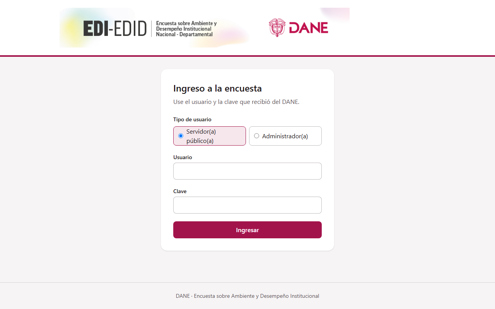
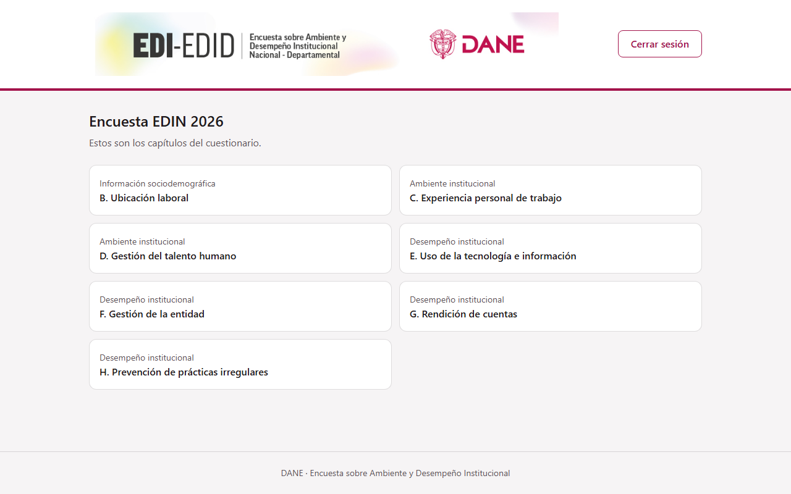
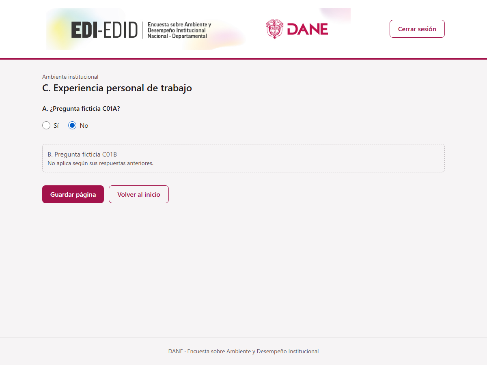
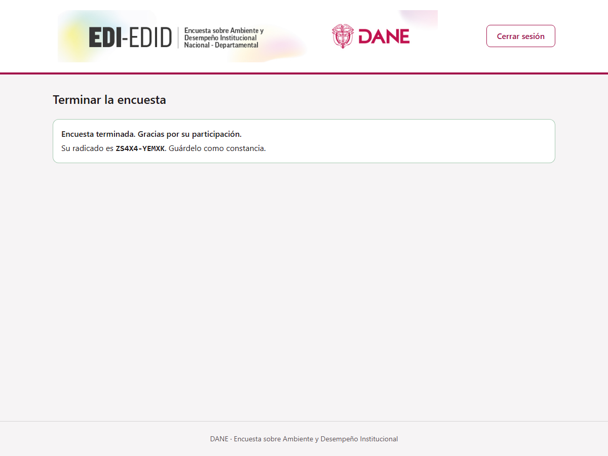

# Formulario Web EDI/EDID

Aplicación web para que los servidores públicos diligencien la Encuesta de Desarrollo Institucional
(EDI/EDID) del DANE, y para que los administradores gestionen el cuestionario. Reemplaza al sistema
PHP heredado (`FORMULARIO_WEB`) sobre la misma base Oracle (`DANE_DIRPEN`), sin DDL nuevo.

La Fase 1 entrega la base técnica: inicio y cierre de sesión (encuestados y administradores), lectura
del cuestionario (capítulos B–H) y lista de capítulos. La Fase 2 agrega el flujo del encuestado:
avance por página, saltos en vivo, guardado único confirmado, observaciones y radicado. Monorepo con
dos aplicaciones independientes: `backend/` (Spring Boot) y `frontend/` (React).

## Enlaces de documentación del proyecto
 - [Especificación de diseño](docs/superpowers/specs/2026-10-14-formulario-web-design.md)
 - [Plan de la Fase 1](docs/superpowers/plans/2026-10-14-fase-1-base.md)
 - [Diagrama de arquitectura](docs/diagramas/arquitectura.md)
 - [Diagrama de secuencia del inicio de sesión](docs/diagramas/secuencia-inicio-sesion.md)
 - [Diagrama de secuencia de guardar una página](docs/diagramas/secuencia-guardar-pagina.md)
 - [Diseño de la Fase 3 (administración del cuestionario)](docs/superpowers/specs/2026-10-26-fase-3-administracion-design.md)
 - [Diagrama de secuencia de crear un año](docs/diagramas/secuencia-crear-anio.md)
 - [Diagrama de secuencia de editar con copia al escribir](docs/diagramas/secuencia-editar-copia-al-escribir.md)
- [Plan de la Fase 3b (reglas, simulador y casos)](docs/superpowers/plans/2026-11-03-fase-3b-reglas-simulador-casos.md)
- [Diagrama de secuencia de guardar una regla](docs/diagramas/secuencia-guardar-regla.md)
- [Plan de la Fase 3c (publicar, corregir y promover)](docs/superpowers/plans/2026-11-04-fase-3c-publicar-corregir-promover.md)
- [Diagrama de secuencia de publicar un año](docs/diagramas/secuencia-publicar.md)
- [Diagrama de secuencia de promover un año o una corrección](docs/diagramas/secuencia-promover.md)
- [Diagrama de secuencia de asignar una novedad (Fase 4)](docs/diagramas/secuencia-asignar-novedad.md)
 - [Diseño de la Fase 4 (reportes, novedades y claves)](docs/superpowers/specs/2026-11-07-fase-4-reportes-novedades-claves-design.md)
 - [Plan de la Fase 4](docs/superpowers/plans/2026-11-07-fase-4-reportes-novedades-claves.md)
 - [Diferencias de los reportes frente al PHP](docs/fase-4-diferencias-reportes.md)
 - [Reglas de EDIN 2026](docs/reglas/edin-2026.md)
 - [MER de las tablas usadas](docs/diagramas/mer-tablas-usadas.md)
 - [Contrato OpenAPI](docs/api/openapi.yaml)
 - [Changelog](CHANGELOG.md)

## Referencias de API
Prefijo `/api/v1`; errores en RFC 7807 (`application/problem+json`). Swagger UI en
`/swagger-ui.html`: abierto en dev y QA y solo para `ADMIN_NACIONAL` en producción
(`SWAGGER_ENABLED` / `SWAGGER_PUBLIC`). Contrato completo en [docs/api/openapi.yaml](docs/api/openapi.yaml).

| Verbo | Ruta | Descripción |
| :-- | :-- | :-- |
| `GET` | `/api/v1/auth/csrf` | Entrega la cookie `XSRF-TOKEN` |
| `POST` | `/api/v1/auth/login` | Inicia sesión (cookie `EDI_SESSION`); cuerpo `username`, `password` y `accountType` (`RESPONDENT` \| `ADMINISTRATOR`) |
| `POST` | `/api/v1/auth/logout` | Cierra la sesión |
| `GET` | `/api/v1/auth/me` | Consulta la sesión actual |
| `GET` | `/api/v1/survey/chapters` | Lista los capítulos del cuestionario |
| `GET` | `/api/v1/survey/chapters/{chapterCode}` | Consulta un capítulo con sus preguntas |
| `GET` | `/api/v1/survey/progress` | Avance por página (`finished`: las 9 guardadas) |
| `GET` | `/api/v1/survey/rules` | Reglas vigentes (saltos y validaciones) |
| `GET` | `/api/v1/survey/pages/{pagina}` | Consulta una página con sus respuestas guardadas y las ayudas (`help`) de cada pregunta y encabezado |
| `PUT` | `/api/v1/survey/pages/{pagina}/answers` | Guarda una página, una sola vez |
| `POST` | `/api/v1/survey/finish` | Registra las observaciones opcionales; entrega el radicado |

Todo método distinto de `GET`/`HEAD` exige la cabecera `X-XSRF-TOKEN`.

**Administración del cuestionario (Fase 3a).** Todas las rutas de `/api/v1/admin/**` exigen el rol
`ADMIN_CUESTIONARIO` (ROL 1 del sistema heredado). Solo un año con `estado: "borrador"` acepta
ediciones, y cada edición lleva la `version` que el cliente leyó (409 si cambió).

| Verbo | Ruta | Descripción |
| :-- | :-- | :-- |
| `GET` | `/api/v1/admin/years/{encuesta}` | Años de la encuesta con estado, versión y año activo |
| `POST` | `/api/v1/admin/years/{encuesta}` | Crea un año en borrador a partir de otro (`year`, `fromYear`) |
| `PUT` | `/api/v1/admin/questionnaire/{encuesta}/{anio}/tables` | Elige la tabla de respuestas de cada capítulo |
| `GET` | `.../tables/{capitulo}/create-script` | Script de creación de la tabla del capítulo (solo texto) |
| `GET` | `/api/v1/admin/questionnaire/{encuesta}/{anio}` | Árbol del año: páginas, preguntas, estado de columna |
| `PUT` | `/api/v1/admin/questionnaire/{encuesta}/{anio}/entries/{capProyId}/text` | Edita el texto de una pregunta |
| `PUT` | `.../headers/{codEnc}` y `.../help/{codPreAyu}` | Edita un encabezado o la palabra enlazada de una ayuda |
| `PATCH` | `.../pages/{pagina}/order` | Reordena las preguntas de una página (dentro de su grupo) |
| `POST` | `.../pages/{pagina}/entries` | Agrega una pregunta propia del año (columna pendiente si no existe) |
| `GET` | `.../entries/{capProyId}/column-script` | Script `ALTER TABLE` de la columna pendiente (solo texto) |
| `DELETE` | `.../entries/{capProyId}` | Desactiva la pregunta solo en ese año |

**Reglas, simulador y casos de prueba (Fase 3b).** Mismas condiciones que la 3a: rol
`ADMIN_CUESTIONARIO`, CSRF en lo que cambia estado y la `version` leída en el cuerpo (en el
`?version=` de los `DELETE`). Solo un año en `borrador` se edita (409 si está publicado); los
`GET` responden también para años publicados. Prefijo `/api/v1/admin/questionnaire/{encuesta}/{anio}`.

| Verbo | Ruta | Descripción |
| :-- | :-- | :-- |
| `GET` | `.../rules` | Reglas efectivas (archivo más heredadas), validaciones, casos con su resultado, análisis y preguntas del año |
| `PUT` | `.../rules/skips/{ruleId}` | Crea o reemplaza una regla de salto |
| `DELETE` | `.../rules/skips/{ruleId}` | Borra una regla del archivo (las heredadas no se borran) |
| `PUT` | `.../rules/validations/{column}` | Crea o reemplaza la validación de una columna |
| `DELETE` | `.../rules/validations/{column}` | Borra la validación de una columna |
| `PUT` | `.../rules/cases/{caseId}` | Crea o reemplaza un caso de prueba |
| `DELETE` | `.../rules/cases/{caseId}` | Borra un caso de prueba |
| `GET` | `.../rules/export` | Descarga `EDIN-AAAA.json` |
| `PUT` | `.../rules/import` | Reemplaza saltos, validaciones y casos (tope de 1 MB: 413) |
| `GET` | `.../simulator` | Reglas efectivas y páginas con sus preguntas, sin respuestas de nadie |

Una edición responde `200` con la nueva `version`, el informe de análisis y el resultado de cada
caso; `422` con el informe cuando el cambio agrega errores que el archivo vigente no tenía (las
advertencias nunca bloquean); `409` si el año está publicado o la versión cambió. Los ids de regla y
de caso admiten hasta 40 caracteres. El respondiente sigue leyendo `GET /api/v1/survey/rules`, que
nunca incluye los casos.

**Publicar, corregir y promover (Fase 3c).** Mismo rol (`ADMIN_CUESTIONARIO`), CSRF y `version` en el
cuerpo que la 3a. Prefijo `/api/v1/admin/questionnaire/{encuesta}/{anio}`. Sobre un año publicado,
agregar, desactivar, reordenar y elegir tablas responden 409 «El cuestionario de AAAA está publicado:
solo se permiten correcciones de textos, saltos y validaciones.»; las correcciones (textos,
encabezados, ayudas, saltos, validaciones y casos) llevan además `motivo` (10 a 500 caracteres, 422
«Indique el motivo de la corrección (entre 10 y 500 caracteres).»).

| Verbo | Ruta | Descripción |
| :-- | :-- | :-- |
| `GET` | `.../publication` | Lista de comprobación: análisis sin errores, casos en verde, columnas creadas y tablas válidas (avisos aparte) |
| `POST` | `.../publication` | Publica el año si la lista está completa (422 con la lista si no; 409 si ya está publicado o la versión cambió) |
| `GET` | `.../history` | Versiones guardadas: quién, cuándo, operación y, en correcciones, el motivo |
| `GET` | `.../history/{version}` | Archivo de reglas tal como estaba en esa versión (alimenta la comparación) |
| `POST` | `.../history/{version}/restore` | Restaura saltos, validaciones, casos y tablas de una versión como versión nueva; solo en borrador y sin restaurar `FRM_*` |
| `GET` | `.../package?tipo=anio` o `tipo=correccion` | ZIP con `manifiesto.json`, `reglas.json`, `frm.sql` y `columnas.sql` de un año publicado (422 con la lista si no pasa la lista de publicación) |
| `POST` | `.../package/import?confirmar=false` o `true` | Verifica un ZIP contra esta base (`multipart`, campo `archivo`) y, con `true`, reemplaza el archivo de reglas; nunca escribe `FRM_*` |

La importación responde 413 si el ZIP pasa de 5 MB y 422 «Paquete rechazado» con la lista
`differences` si alguna revisión falla. Las operaciones de auditoría son `publicar`,
`importar-paquete`, `restaurar-version` y `corregir-<operación>`.

Límites de `PUT .../answers`: como máximo 200 respuestas por página (400 «Envíe como máximo 200
respuestas por página») y 4000 caracteres por valor (422 con «La respuesta es demasiado larga.» en
`errors`); además cada valor debe caber en su columna medido en bytes de Latin-9 tras convertir a
`&#N;` lo que la base no admite (mismo 422). Los textos del cuestionario (`text` de las ediciones
y preguntas nuevas) admiten hasta 1000 caracteres en la solicitud y el límite de su campo en el
servicio (ver «Juego de caracteres y límites por campo»). Las claves desconocidas se devuelven en `errors` recortadas a 30 caracteres.
`POST /finish` es idempotente: con las 9 páginas guardadas siempre devuelve el mismo radicado y
`OBS` solo se escribe la primera vez que llega texto.

### Fase 4: reportes, novedades y claves

Prefijo `/api/v1/admin`. Todas las respuestas con datos personales (listados nominales, novedades,
rendimientos, gestión de novedades y claves) llevan `Cache-Control: no-store`. Las escrituras llevan
`@AllowedInReadOnlyQuestionnaire`: funcionan en producción aunque `QUESTIONNAIRE_WRITES_ENABLED` sea
`false`. Un departamento fuera del alcance del usuario o una acción no permitida a su rol responde 403.
Los reportes aceptan `encuesta` (`GENERAL`, `EDI` o `EDID`), `anio` (por defecto el de `SURVEY_YEAR`) y
`departamento`; cada uno tiene su variante `.../excel` (libro `.xlsx` generado al vuelo).

| Verbo | Ruta | Roles | Descripción |
| :-- | :-- | :-- | :-- |
| `GET` | `/operation/scope` | nacional, territorial, operativo | Departamentos del usuario y si gestiona novedades o claves |
| `GET` | `/reports/years` | los tres | Años con muestra |
| `GET` | `/reports/coverage` y `/reports/coverage/excel` | los tres | Cobertura por departamento y entidad, con consolidado |
| `GET`, `POST` | `/reports/cuts` | los tres | Lista y crea cortes de cobertura (JSON con cifras agregadas en `REPORTS_DIR`) |
| `GET` | `/reports/cuts/{id}/excel` | los tres | Descarga un corte |
| `GET` | `/reports/operational-status` y `.../excel` | los tres | Estado nominal por departamento y entidad (paginado, máx. 100) |
| `GET` | `/reports/novelties` y `.../excel` | los tres | Funcionarios con novedad |
| `GET` | `/reports/performance` y `.../excel` | los tres | Fecha y hora de guardado de cada capítulo |
| `GET` | `/novelties/catalog`, `/novelties/entities` | territorial | Catálogo y entidades de sus departamentos |
| `POST` | `/novelties/people` | territorial | Funcionarios de una entidad (la cédula nunca va en la URL) |
| `POST` | `/novelties/assign`, `/novelties/remove` | territorial | Asigna o quita la novedad; 409 si cambió desde que se cargó, 422 si no es válida |
| `GET` | `/keys/summary` | nacional | Funcionarios con y sin clave por departamento |
| `POST` | `/keys/generate` | nacional | Genera clave a quienes no tienen; 409 si el número esperado cambió |
| `GET` | `/keys/excel` | nacional | Excel de claves de un departamento |

## Autores

- Oscar Dueñas, con asistencia de Claude (Anthropic); la trazabilidad está en el trailer
  `Co-Authored-By` de cada commit.

## Distintivos


El pipeline está en [.github/workflows/ci.yml](.github/workflows/ci.yml): secretos, lint, pruebas,
cobertura, SAST (Semgrep), SCA, Trivy y E2E.

> **Pendiente:** insertar los distintivos de estado del CI y de cobertura cuando exista el repositorio
> remoto (su URL aún no está definida). Licencia: no hay archivo `LICENSE`.

Cobertura mínima exigida: 80 % en `co.gov.dane.edi.security`, `co.gov.dane.edi.rules` y
`co.gov.dane.edi.admin`, 60 % en el resto del backend y 60 % en el
frontend.

## Ambiente de pruebas
Entorno local con datos **ficticios** (`db/dev/`), nunca contra la Oracle institucional.

> **Pendiente:** URL del ambiente de QA.

**Prueba de carga** del flujo del encuestado (k6 en Docker, solo local): ver
[loadtest/README.md](loadtest/README.md); resultados en
[loadtest/resultados-2026-10.md](loadtest/resultados-2026-10.md).

```bash
cp .env.example .env        # cambie TODAS las claves y genere JWT_SECRET
docker compose up --build   # http://localhost:8081
```

Usuarios ficticios de `db/dev/data.sql`:

| Perfil | Usuario | Notas |
| :-- | :-- | :-- |
| Encuestado | `PRUEBA01` | Activo |
| Encuestado | `PRUEBA02` | Inactivo (debe rechazarse) |
| Encuestado | `PRUEBA03` | Año 2025 (no pertenece a la encuesta activa; debe rechazarse) |
| Encuestado | `PRUEBA04` | Para pruebas de bloqueo |
| Encuestado | `PRUEBA05` | Flujo E2E (Chromium) |
| Encuestado | `PRUEBA06` | Pruebas de integración y E2E móvil |
| Administrador | `adm.nacional` | ROL 1 |
| Administrador | `adm.bogota` | ROL 2, departamento 11 |
| Administrador | `adm.edid` | Otra encuesta (EDID); no debe ingresar a EDIN |

Las claves de prueba están en `db/dev/data.sql`. El bloqueo ocurre tras 5 fallos en 15 minutos por
usuario + IP.

**Cada página se guarda una sola vez.** Para repetir el flujo completo hay que reiniciar el
backend, que recarga `db/dev/data.sql`. Con compose también hace falta `docker compose down -v`,
para que se vuelva a sembrar el volumen de reglas. Las pruebas E2E (Playwright) corren con un solo
worker y sin reintentos, porque los datos son de escritura única y el inicio de sesión se bloquea
tras 5 fallos. Cada proyecto de Playwright usa su propio usuario (`PRUEBA05` en Chromium,
`PRUEBA06` en móvil); se cambian con `E2E_FLOW_USER_CHROMIUM` / `E2E_FLOW_PASSWORD_CHROMIUM` y
`E2E_FLOW_USER_MOVIL` / `E2E_FLOW_PASSWORD_MOVIL`.

**Reinicio local para la prueba del administrador.** La prueba E2E `admin-cuestionario` crea un año
nuevo (2027 en Chromium, 2028 en móvil, siempre a partir de 2026). La encuesta admite **un solo
borrador abierto**, así que cada arranque del backend admite una sola corrida de esa prueba. Para
repetirla, o para correr el otro proyecto de Playwright:

1. Detenga el backend.
2. Borre la carpeta `RULES_DIR` (quita `EDIN-2027.json`, `EDIN-2028.json` y su historial). Con compose:
   `docker compose down -v`.
3. Inicie el backend: `db/dev/data.sql` borra y recarga los datos, incluidas las filas `FRM_*` del
   año creado, y la semilla vuelve a copiar `EDIN-2026.json`.

En una corrida completa (`npm run e2e`) el proyecto móvil omite esa prueba, con la anotación
«omitida» en el reporte, porque encuentra el borrador de Chromium: cada proyecto (chromium y movil)
necesita un backend recién arrancado con un `RULES_DIR` limpio; tras el reinicio, ejecute solo el
móvil con `npm run e2e:admin-movil`. Si cambió `db/dev/schema.sql` (la Fase 3a rehízo las tablas
`FRM_*`), recree el contenedor de Oracle de desarrollo: `CREATE TABLE IF NOT EXISTS` no modifica las
tablas viejas. El administrador ficticio es `adm.nacional` (variables `E2E_ADMIN_USER` / `E2E_ADMIN_PASSWORD`).

La prueba `admin-reglas` (solo Chromium; el móvil la omite con la anotación «omitida») reutiliza el
borrador abierto por `admin-cuestionario` en la misma corrida o, si no hay, crea 2027. Tampoco se
puede repetir sin reiniciar el backend con un `RULES_DIR` limpio (`docker compose down -v` y
`docker compose up -d --build --wait`). Es el único chequeo de accesibilidad (axe, WCAG 2.1 AA) de
las pantallas de reglas y del simulador.

La prueba `admin-publicar` (solo Chromium; el móvil la omite con la anotación «omitida») crea 2027
desde 2026 o reutiliza el borrador abierto, edita el texto de C01A (el caso copiado
`c01a-no-oculta-c01b` queda **Por revisar** y la lista de publicación lo señala), lo guarda de nuevo
en el simulador, desactiva `B99` (la pregunta ficticia de `db/dev/data.sql` sin columna real, que
impediría publicar), publica, corrige un texto con el motivo «Corrección de prueba ficticia»,
comprueba la versión y el motivo en Historial, descarga el paquete de corrección y lo verifica en el
mismo ambiente («El paquete ya estaba importado.»), con axe en Publicar, Historial y Paquetes. En una
corrida completa corre después de `admin-cuestionario` (reutiliza su borrador 2027) y antes de
`admin-reglas`, que al encontrar 2027 publicado usa el siguiente año libre (2028). Como las demás,
necesita un backend recién arrancado y un `RULES_DIR` limpio (`docker compose down -v`).

Pruebas automatizadas:

```bash
cd backend && ./mvnw -B verify          # requiere Docker (Testcontainers + Oracle Free)
cd frontend && npm run test:coverage    # unitarias con cobertura
cd frontend && npm run e2e              # Playwright contra E2E_BASE_URL (stack levantado)
```

Solución de problemas:
- El arranque de Oracle Free en Testcontainers tarda 50–90 s (timeout de 5 min); si falla por tiempo,
  reintente.
- Windows: si el backend falla con "Unable to establish loopback connection", la carpeta temporal
  tiene nombre corto 8.3 (`C:\Users\NOMBRE~1.XXX\...`). Apunte `TEMP`/`TMP` a una ruta corta y use
  `-Djdk.net.unixdomain.tmpdir=C:\edi-tmp`.
- Hook de secretos (una vez por desarrollador): `git config core.hooksPath .githooks` (usa gitleaks o,
  en su defecto, Docker; la allowlist solo cubre datos ficticios).

## Deployment

Imágenes (usuario no root, versión base fija, healthcheck, etiquetas de responsable):

- `backend/Dockerfile`: multi-stage, `eclipse-temurin:21.0.12.1_1` (JDK para compilar, JRE para ejecutar).
- `frontend/Dockerfile`: multi-stage, `node:22.23.3-slim` para compilar y
  `nginxinc/nginx-unprivileged:1.30.3-alpine3.23` para servir; nginx hace de proxy de `/api` hacia
  `BACKEND_URL` y es el borde (`X-Forwarded-For`). No arranca si el host de `BACKEND_URL` no resuelve.
- Volumen `rules-data` (`/data/rules`, variable `RULES_DIR`): JSON de saltos y validaciones. Si no
  existe `EDIN-2026.json`, el backend siembra el de la imagen. El backend corre en **una sola
  instancia** (decisión D6).
- Volumen `reports-data` (`/data/reports`, variable `REPORTS_DIR`): cortes de cobertura de la Fase 4
  (un JSON por corte, solo cifras agregadas). Si el volumen no persiste, el histórico se pierde al
  recrear el contenedor; haga copia de él como del de reglas.
- **Análisis de dependencias (SCA).** No forma parte de `./mvnw verify`: corre solo en el job `sca` de
  CI (OWASP Dependency-Check con `NVD_API_KEY` y `npm audit`). Apache POI 6.0.0 entró en la Fase 4 y
  no se analizó localmente: confirme que el primer pipeline no reporte vulnerabilidades críticas.
- **No active el registro `TRACE` de `org.springframework.jdbc` en producción** (ni
  `JdbcTemplate` ni `StatementCreatorUtils` en ese nivel): imprimiría los parámetros de las
  sentencias, entre ellos las claves (`PSW`) y las cédulas que escriben las novedades y la
  generación de claves.

**Local con contenedores**

```bash
cp .env.example .env
docker compose up -d --build --wait
docker compose down -v
```

**Local sin contenedor de aplicación** (Java 21, Node 22+; probado con Node 24). El `DB_URL` de
`.env.example` usa el host `oracle`, que solo resuelve dentro de compose; aquí se usa `localhost`.

```bash
# 1. Oracle Free de desarrollo (datos ficticios; reemplace los placeholders)
docker run -d --name edi-oracle-dev -p 1521:1521   -e ORACLE_PASSWORD=<clave-admin-dev> -e APP_USER=EDI_DEV -e APP_USER_PASSWORD=<clave-app-dev>   gvenzl/oracle-free:23-slim-faststart

# 2. Backend: ejecutar desde backend/ (las rutas ../db/dev son relativas a esa carpeta)
cd backend && ./mvnw -B package
export DB_URL=jdbc:oracle:thin:@//localhost:1521/FREEPDB1 DB_USER=EDI_DEV DB_SCHEMA=EDI_DEV
export DB_PASSWORD=<clave-app-dev> JWT_SECRET=<secreto-de-32-o-mas-caracteres>
export SURVEY_CODE=EDIN SURVEY_YEAR=2026 RULES_DIR=./rules-data COOKIE_SECURE=false
export SWAGGER_ENABLED=true SWAGGER_PUBLIC=true CORS_ALLOWED_ORIGIN=http://localhost:5173
export SPRING_SQL_INIT_MODE=always   SPRING_SQL_INIT_SCHEMA_LOCATIONS=file:../db/dev/schema.sql   SPRING_SQL_INIT_DATA_LOCATIONS=file:../db/dev/data.sql
java -jar target/formulario-edi-backend.jar

# 3. Frontend (proxy /api -> 8080)
cd ../frontend && npm ci && npx vite
```

`CORS_ALLOWED_ORIGIN` solo importa si el frontend no se sirve por el proxy de Vite (acceso directo al
backend); en ese caso debe ser el origen del frontend.

**Actualizar las reglas.** Si `RULES_DIR/EDIN-2026.json` ya existe con `"version": 1`, hay que
respaldarlo y borrarlo para que se siembre la versión 2 de la imagen. El editor de reglas
de la Fase 3b solo cambia el archivo de un año en borrador; el de 2026 se actualiza así. En la primera carga, el backend registra un WARN si la
semilla trae una `version` mayor que la del archivo vigente.

**Cambios en las tablas `FRM_*`.** Las preguntas de cada página y las reglas efectivas se guardan en
memoria (una sola instancia, D6). Hasta la Fase 3, un cambio en el cuestionario (`FRM_*`) o en las
columnas de las tablas de respuesta exige reiniciar el backend.

**QA y producción.** Entran por el pipeline (lint, build, pruebas, SAST/SCA, imagen, staging,
aprobación manual, producción, smoke tests). El paso a producción exige el formato FR-FT-GST-02
(`Requisitos_Entrega.xlsx`, versión vigente), RFC y aprobación del CAB. Cada ambiente usa credenciales
propias (`DB_SCHEMA=DANE_DIRPEN` en el institucional, `COOKIE_SECURE=true`, `SWAGGER_PUBLIC=false`).

> **Pendiente:** las etapas de *staging* y producción del pipeline aún no están implementadas; hoy
> `ci.yml` cubre hasta imágenes y E2E.

**nginx y la importación de paquetes.** `BACKEND_URL` debe ser `esquema://host:puerto` sin ruta
(`http://backend:8080`, no `http://backend:8080/api`): la ruta de importación se enruta con una
`location` por expresión regular, donde `proxy_pass` no admite URI. Esa `location` permite 6 MB
(el tope de la aplicación es 5 MB por petición y 20 MB descomprimido); el resto de `/api/` conserva
el tope de 1 MB de nginx. Un ZIP de más de 5 MB llega al backend y responde 413 en español; uno de
más de 6 MB lo corta nginx con su 413 genérico. Con el stack en pie,
`docker compose exec frontend nginx -t` valida la configuración ya renderizada.

**Registros de acceso y motivo de las correcciones.** El motivo de una corrección viaja en el
cuerpo JSON de la petición, nunca en la URL. nginx registra `/api/` con `$uri` (sin query string).
Los proxies o balanceadores que estén delante **no deben registrar cuerpos de petición**.

**Cuestionario de solo lectura en producción.** Producción corre con
`QUESTIONNAIRE_WRITES_ENABLED=false` (propiedad `app.admin.questionnaire-writes-enabled`; el valor
por defecto: un despliegue que la olvide queda en solo lectura); QA la necesita en `true`. Con
`false`, el backend responde 403 «Cuestionario de solo lectura» a toda escritura (POST, PUT, PATCH,
DELETE) de la API de administración `/api/v1/admin/**`; hoy son las que escriben `FRM_*` o el
archivo de reglas (editar
textos, encabezados y ayudas, reordenar, agregar o desactivar preguntas, crear años, mapear tablas,
saltos, validaciones, casos, importar reglas, publicar y restaurar versiones), antes de leer el
cuerpo o tomar el candado. Siguen disponibles las lecturas (árbol, reglas, simulador, historial,
lista de publicación, scripts y descarga de paquetes) y la importación de paquetes de promoción,
que es el camino por el que producción recibe los cambios aprobados en QA. La primera lectura de
un año que aún no tiene archivo de reglas lo sigue creando a partir de la semilla de la imagen (no
toca `FRM_*`). Los encuestados no se ven afectados. Si el front no logra leer el modo, también
muestra los controles deshabilitados. El front lo lee de `GET /api/v1/admin/environment` y muestra esos controles
deshabilitados con el aviso «Este ambiente es de solo lectura…». Una operación de escritura nueva
queda bloqueada por defecto; para permitirla habría que marcarla con
`@AllowedInReadOnlyQuestionnaire` (hoy solo la lleva la importación de paquetes).
`QuestionnaireReadOnlyIT` recorre todas las escrituras de la API (salvo sesión y encuestado) y falla
si alguna no responde 403 sin estar exceptuada.

**Usuario de base de datos de producción.** Solo `SELECT` sobre `FRM_*`: nunca `INSERT`, `UPDATE`
ni DDL. Los scripts del paquete (`columnas.sql`, `frm.sql`) los ejecuta la persona técnica
responsable (no se cuenta con un DBA) con un usuario que tenga permisos de escritura sobre
`DANE_DIRPEN`; confirme antes la base con `db/verificacion/verificar-base-produccion.sql`. El
procedimiento completo está en Usage/Examples, «Paso a producción, paso a paso».

**`CORS_ALLOWED_ORIGIN` y nginx.** Debe ser exactamente el origen público con el que el navegador abre
la aplicación (esquema + host + puerto), incluso cuando entra por nginx. nginx reenvía
`X-Forwarded-Proto` y el `RemoteIpValve` de Tomcat hace que la petición aparente estar en el puerto por
defecto; así el backend aplica CORS también a los POST del mismo origen. Si el valor no coincide, el
ingreso responde 403 «Invalid CORS request».

Detrás de un balanceador delante de nginx, configure los proxies de confianza
(`server.tomcat.remoteip.*`). Como mitigación real contra la inundación de intentos de ingreso, aplique
rate limiting en el proxy o balanceador (el bloqueo en memoria es por instancia).

## Environment Variables
Fuente: [.env.example](.env.example) (copiar como `.env`, que git ignora).

| Variable | Descripción | Requerida | Valor por defecto / ejemplo |
| :-- | :-- | :-- | :-- |
| `DB_URL` | URL JDBC de Oracle | Sí | `jdbc:oracle:thin:@//oracle:1521/FREEPDB1` |
| `DB_USER` | Usuario de aplicación | Sí | `EDI_DEV` |
| `DB_PASSWORD` | Clave del usuario de aplicación | Sí | sin valor real; cámbiela |
| `DB_SCHEMA` | Dueño de las tablas (institucional: `DANE_DIRPEN`) | No | `DANE_DIRPEN` (en `.env.example`: `EDI_DEV`) |
| `DB_POOL_SIZE` | Tamaño máximo del pool Hikari | No | `10` |
| `ORACLE_DEV_ADMIN_PASSWORD` | Clave de administrador de la Oracle de desarrollo (solo compose) | Solo dev | sin valor real; cámbiela |
| `SURVEY_CODE` | Encuesta activa (`EDIN` o `EDID`) | No | `EDIN` |
| `SURVEY_YEAR` | Año de la encuesta | Sí | `2026` |
| `RULES_DIR` | Carpeta de los JSON de reglas | No | `/data/rules` |
| `RULES_SEED_DIR` | Semilla de reglas ficticias; solo desarrollo | No | vacía |
| `QUESTIONNAIRE_WRITES_ENABLED` | Permite cambiar el cuestionario (`FRM_*` y archivo de reglas) desde la administración. Propiedad `app.admin.questionnaire-writes-enabled`. Con `false` toda escritura de `/api/v1/admin/**` responde 403 «Cuestionario de solo lectura» y solo se importan paquetes de promoción (la primera lectura de un año sin archivo de reglas lo sigue creando desde la semilla, sin tocar `FRM_*`); ver Deployment | No | `false` (`true` en desarrollo, lo fija compose, y en QA; `false` en producción) |
| `REPORTS_DIR` | Carpeta de los cortes de cobertura (JSON con cifras agregadas, sin datos personales). Propiedad `app.operation.cuts-dir`. Debe ser un volumen persistente; ver Deployment | No | `/data/reports` |
| `NOVELTY_OTHER_CAUSE_CODE` | Código de `GRAL_NOVEDAD.IDFNOV` que exige texto de «otra causa». Propiedad `app.operation.novelty-other-cause-code`. **Verifíquelo en la base antes de promover** (consulta 12 de `db/verificacion/verificar-base-produccion.sql`): el PHP mezclaba 8 y 17 | No | `8` |
| `RECEIPT_KEY` | Clave del radicado (HMAC, mín. 32), estable por ambiente | Sí | ver nota |
| `JWT_SECRET` | Secreto de firma de la sesión (mínimo 32 caracteres aleatorios) | Sí | genere con `openssl rand -base64 48` |
| `SESSION_MINUTES` | Duración de la sesión | No | `30` |
| `COOKIE_SECURE` | Atributo `Secure` de la cookie; `true` con HTTPS | No | `true` (`false` en localhost) |
| `CORS_ALLOWED_ORIGIN` | Origen público exacto del navegador (esquema+host+puerto), también detrás de nginx; ver Deployment | Sí | `http://localhost:8081` |
| `SWAGGER_ENABLED` | Habilita OpenAPI y Swagger UI | No | `false` (`true` en dev y QA) |
| `SWAGGER_PUBLIC` | Swagger abierto sin rol; `false` limita a `ADMIN_NACIONAL` | No | `false` |
| `LOG_FORMAT` | Formato de logs estructurados | No | `ecs` |
| `BACKEND_URL` | Destino del proxy `/api` en nginx: `esquema://host:puerto` **sin ruta** (lo fija compose); ver Deployment | Sí (frontend) | `http://backend:8080` |
| `E2E_BASE_URL` | URL base de las pruebas E2E | No | `http://localhost:8081` |
| `E2E_RESPONDENT_USER` | Usuario ficticio de las pruebas E2E | No | `PRUEBA01` |
| `E2E_RESPONDENT_PASSWORD` | Clave ficticia de las pruebas E2E | No | ver `db/dev/data.sql` |
| `E2E_FLOW_USER_CHROMIUM` | Usuario del flujo completo en Chromium | No | `PRUEBA05` |
| `E2E_FLOW_PASSWORD_CHROMIUM` | Clave de ese usuario | No | ver `db/dev/data.sql` |
| `E2E_FLOW_USER_MOVIL` | Usuario del flujo completo en móvil | No | `PRUEBA06` |
| `E2E_FLOW_PASSWORD_MOVIL` | Clave de ese usuario | No | ver `db/dev/data.sql` |
| `E2E_ADMIN_USER` | Administrador ficticio de la prueba del cuestionario | No | `adm.nacional` |
| `E2E_ADMIN_PASSWORD` | Clave de ese administrador | No | ver `db/dev/data.sql` |
| `E2E_OPERATIVE_USER`, `E2E_OPERATIVE_PASSWORD` | Operativo ficticio de las E2E de la Fase 4 | No | `operativo` / ver `db/dev/data.sql` |
| `E2E_TERRITORIAL_USER`, `E2E_TERRITORIAL_PASSWORD` | Territorial ficticio (departamentos 11 y 25) | No | `territorial-multi` / ver `db/dev/data.sql` |
| `E2E_ENGINEER_USER`, `E2E_ENGINEER_PASSWORD` | Ingeniero ficticio (`ADMIN_NACIONAL`, claves) | No | `ingeniero` / ver `db/dev/data.sql` |

**`JWT_SECRET` y `RECEIPT_KEY`.** Genere cada una con `openssl rand -base64 48`. Fuera de los
perfiles `dev` y `test`, el backend no arranca si alguna conserva el valor de ejemplo de
`.env.example`.

En CI se requiere además el secreto `NVD_API_KEY` (OWASP Dependency-Check); en PRs desde forks los
secretos no están disponibles.

## Screenshots

Capturadas con Playwright contra el entorno local con datos ficticios.









## Tech Stack

**Client:** React 19.3.0, React Router 7.18.4, TanStack Query 5.104.0, React Hook Form 7.89.0,
openapi-fetch 0.17.0, Tailwind CSS 4.3.3, Vite 7.3.6, TypeScript 5.9.3

**Server:** Java 21, Spring Boot 4.1.1 (webmvc, security, validation, actuator, JDBC),
springdoc-openapi 3.1.1, Apache POI 6.0.0 (`poi-ooxml`, libros `.xlsx`), Tomcat 11.0.26

**Base de datos:** Oracle (`DANE_DIRPEN`, servicio `TRANS21`); Oracle Free 23 en desarrollo; driver ojdbc17

**Infraestructura:** Docker, docker compose, nginx 1.30.3 (unprivileged), GitHub Actions

**Pruebas y calidad:** JUnit 5, Testcontainers (Oracle Free), JaCoCo 0.8.15, Spotless
(google-java-format), Checkstyle, Vitest 4.1.11, Testing Library, MSW 2.15.0, Playwright 1.63.0,
axe-core 4.13.0, ESLint 9.39.5 + jsx-a11y, Prettier 3.9.9, Semgrep, OWASP Dependency-Check, Trivy,
gitleaks

## Usage/Examples

**Ingresar.** Abra `http://localhost:8081` (compose) o `http://localhost:5173` (Vite), vaya a
`/ingresar`, escriba usuario y clave y verá la lista de capítulos de la encuesta. Los administradores
ingresan con su `COD_USUA` y su clave.

**Consultar la API con `curl`** (primero CSRF, luego login). La cabecera `X-XSRF-TOKEN` lleva el valor
de la **cookie** `XSRF-TOKEN`; el campo `token` del JSON está enmascarado y no sirve.

```bash
BASE=http://localhost:8081
curl -s -c cookies.txt "$BASE/api/v1/auth/csrf" > /dev/null
XSRF=$(awk '$6=="XSRF-TOKEN"{print $7}' cookies.txt)
curl -s -b cookies.txt -c cookies.txt -X POST "$BASE/api/v1/auth/login" \
  -H "Content-Type: application/json" -H "X-XSRF-TOKEN: $XSRF" \
  -d '{"username":"PRUEBA01","password":"<clave de db/dev/data.sql>","accountType":"RESPONDENT"}'
curl -s -b cookies.txt "$BASE/api/v1/survey/chapters"
```

**Recorrido del encuestado.** Tras ingresar, el inicio muestra el avance por página. Orden de las
páginas: `B1, C1, C2, D1, D2, E1, F1, G1, H1`; cada una se habilita cuando las anteriores están
guardadas.

1. Progreso: el inicio lista las nueve páginas y cuál sigue.
2. Página: se responde; los saltos ("No aplica…") y los errores aparecen en vivo.
3. Confirmar: "Guardar página" pide confirmar porque la escritura es única.
4. Siguiente: al guardar, el foco pasa a la página siguiente.
5. Terminada: al guardar la novena página la encuesta queda terminada (D18) y se muestra el
   radicado `XXXXX-XXXXX`, derivado y no reversible.
6. Observaciones (opcionales, hasta 1100 caracteres, una sola vez): debajo del radicado, con
   "Enviar observaciones". Mientras no se registren, el inicio ofrece "Agregar observaciones
   (opcional)"; el radicado es siempre el mismo.

**Ayudas.** Una palabra o frase subrayada en el texto de una pregunta, enunciado o encabezado es
una ayuda (`FRM_PRE_AYUDA` / `FRM_ENC_AYUDA` con su definición de `GRAL_AYUDAS`, como los enlaces
del PHP heredado). Al activarla se abre, justo debajo del texto, un panel con el título y la
definición; "Cerrar ayuda" o la tecla Escape lo cierran y devuelven el foco a la palabra. Se
enlaza solo la primera aparición; si la palabra no está en el texto, aparece después un botón
"Ayuda: palabra". Abrir una ayuda no marca ni cambia la respuesta, y las ayudas sin definición en
`GRAL_AYUDAS` no se muestran. En los datos ficticios, B1 tiene la ayuda «desempeña» en el
enunciado y «laboral» en el encabezado. El simulador de reglas usa los mismos campos y también las
muestra en las preguntas.

Si la sesión vence al guardar una página, la aplicación lo avisa con un enlace para ingresar de
nuevo y conserva las respuestas de esa página en `sessionStorage` (solo los valores, nunca el
`C_C`) hasta volver a abrirla en la misma pestaña. Si entretanto otra pestaña ingresa o cierra
sesión, el borrador se descarta (una "generación" aleatoria en `localStorage`, sin datos
personales, marca cada ingreso y cada cierre).

Con respuestas sin guardar, salir de la página (botón Atrás, "Volver al inicio" u otro enlace)
pide confirmar en un diálogo; cerrar o recargar la pestaña usa el aviso del navegador.

Consultar el progreso con `curl` (cookie de la sesión iniciada arriba, sin escribir su valor):

```bash
curl -s -b cookies.txt "$BASE/api/v1/survey/progress"
```

**Administrar el cuestionario (Fase 3a).** Ingrese como administrador (`Administrador(a)` en el
ingreso) con un usuario de rol `ADMIN_CUESTIONARIO` y abra **Cuestionario** en el menú.

1. **Años.** La tabla muestra cada año con su estado (Publicado o Borrador). "Crear año" copia un
   año publicado a un año nuevo en borrador; solo puede haber un borrador por encuesta. Publicar
   un año se hace en su pestaña **Publicar** (ver «Publicar, corregir y promover»).
2. **Árbol.** Al abrir un año se ven sus páginas y preguntas. Un año publicado solo admite correcciones (Fase 3c).
3. **Editar.** En un borrador, "Editar" cambia el texto, un encabezado o la palabra enlazada de la
   ayuda y "Guardar" lo envía; no hay autoguardado. Escriba `200X` donde debe ir el año. Si otra
   persona cambió el cuestionario, aparece un aviso con "Recargar". La ayuda de una pregunta es una
   palabra o frase de su texto (`FRM_PRE_AYUDA.TEXTO`) que el PHP heredado vuelve enlace a una
   definición de `GRAL_AYUDAS` (`COD_AYU`); el editor cambia solo la palabra y muestra, en solo
   lectura, el título y el comienzo de la definición («Sin definición en GRAL_AYUDAS» si falta).
4. **Ordenar.** Con el teclado, "Subir" y "Bajar" (también se puede arrastrar). Solo se mueve dentro
   del mismo bloque de preguntas; el servidor rechaza cruzar bloques.
5. **Agregar una pregunta.** "Agregar pregunta en {página}" pide numeral (que debe dar el código de
   la columna, p. ej. `C30A`), texto, tipo de respuesta y ubicación. Si la columna no existe en la
   tabla, la pregunta queda **Pendiente de columna**: descargue su script, entréguelo a la persona
   técnica y, tras ejecutarlo, recargue el árbol para verla Activa. La aplicación nunca ejecuta DDL.
6. **Desactivar** una pregunta la quita solo de ese año; los demás años no cambian.
7. **Tablas por capítulo.** El panel de tablas elige la tabla de respuestas de cada capítulo del
   año; una tabla inexistente se marca como faltante y sus preguntas quedan pendientes.

Cada cambio escribe una línea de auditoría (usuario, encuesta, año, operación y códigos afectados;
nunca el texto de las preguntas). Los textos se guardan como texto plano, con `&`, `<` y `>`
escapados en la base, y se muestran escapados.

**Juego de caracteres y límites por campo.** La base real es `WE8ISO8859P15` (Latin-9, un byte por
carácter, longitudes en bytes). Los caracteres de Latin-9 (tildes, ñ, ü, €, ¿, ¡) se guardan tal
cual; los que Latin-9 no tiene (comillas tipográficas “ ”, rayas – —, puntos suspensivos …,
viñetas •, emojis) se guardan como código `&#N;` y se muestran de nuevo como se escribieron: no se
pierden ni se vuelven `?`. Eso aplica a los textos del cuestionario y a las respuestas de texto y
observaciones del encuestado. Cada campo admite lo que su columna real, medido sobre el texto ya
guardado (cada código cuenta todos sus caracteres, y `&` cuenta como `&amp;`):

| Campo | Columna | Máximo |
| :-- | :-- | :-- |
| Texto de la pregunta | `FRM_PREGUNTA.PREGUNTA` | 1000 |
| Encabezado | `FRM_ENCABEZADO.ENCABEZADO` | 500 |
| Palabra enlazada a la ayuda | `FRM_PRE_AYUDA.TEXTO` | 100 |
| Numeral de una pregunta nueva | `FRM_CAP_PROY.NUMERAL` | 5 |
| Respuesta de texto u observaciones | columna de la tabla `EDIN_*` | el de la columna (`OBS`: 1100) |

Más largo responde 422 con el máximo del campo, p. ej. «El texto de la pregunta admite hasta 1000
caracteres (los caracteres especiales que se guardan como código cuentan como varios).». El editor
avisa antes de enviar con un cálculo aproximado; el servidor decide.

**Reglas, simulador y casos (Fase 3b).** Con un año en borrador, las pestañas **Reglas** y
**Simulador** del año están junto a **Preguntas**. Un año publicado se puede consultar, no editar.

1. **Reglas.** Elija la página: "Efecto en la página" dice qué preguntas se ocultan y por qué regla,
   y "Saltos de la página" lista las reglas como "Si C01A = Sí → no se muestra C01B". "Reglas sin
   página" reúne las que no tienen ninguna pregunta conocida. Las reglas *Heredadas* (ya existían en
   las tablas `FRM_SALTO`) son de solo lectura.
2. **Nueva regla o editar.** El constructor arma una condición (una pregunta, o todas/alguna de
   varias que tengan las mismas opciones), un operador y un valor, con la opción de unir varias
   condiciones con Y/O (un solo nivel). Elija las preguntas que no se muestran; la vista previa
   lee la regla en lenguaje claro. Todo se puede hacer con el teclado.
3. **Análisis.** Cada guardado se analiza: ciclos, preguntas inexistentes, valores que no son
   opciones, rangos inválidos, reglas que nunca se cumplen o solapadas y preguntas que nunca se
   muestran. Un cambio que **agrega errores** se rechaza (422): el diálogo sigue abierto con lo
   escrito y la alerta lo explica. Los errores que el archivo ya tenía se muestran pero no bloquean
   cambios que no los agravan; las advertencias nunca bloquean. Si un análisis supera 4096
   combinaciones, el elemento sale como "No se pudo analizar"; si el archivo es tan grande que se
   agota el tiempo de análisis, un solo aviso del archivo dice cuántos elementos quedaron sin
   analizar.
4. **Validaciones.** Cada pregunta de la página admite obligatoriedad, tipo y rango.
5. **Archivo JSON.** Se puede ver, descargar e importar (hasta 1 MB); la importación reemplaza
   saltos, validaciones y casos y pasa por el mismo análisis.
6. **Simulador.** Elija la página y responda: las preguntas ocultas se ven atenuadas con la regla
   que las oculta, y los errores salen como en la encuesta. Nada se guarda del respondiente.
7. **Casos de prueba.** "Guardar como caso de prueba" guarda las respuestas y lo que el simulador
   muestra (id en minúsculas y guiones, nombre de 1 a 100 caracteres). Cada caso muestra **Pasa**,
   **Falla** (con la diferencia) o **Por revisar** (si una pregunta que usa cambió o se desactivó).
   "Abrir en el simulador" lo recarga; no se puede desactivar una pregunta que solo usa un caso.

**Publicar, corregir y promover (Fase 3c).** Las pestañas **Publicar**, **Historial** y **Paquetes**
completan el ciclo del año.

1. **Publicar.** La lista dice si el año cumple las cuatro condiciones: análisis sin errores, todos
   los casos en **Pasa** (**Falla** y **Por revisar** bloquean), cada pregunta activa con su columna
   y cada tabla mapeada válida. Cada condición que falla enlaza al caso, la regla, la columna o el
   panel de tablas. Los avisos no bloquean y quedan anotados en la publicación. «Publicar» pide
   confirmar; un año publicado ya no admite edición estructural.
2. **Corregir un año publicado.** En **Preguntas**, **Reglas** y **Simulador** aparece el recuadro
   «Corrección de un año publicado»: escriba el motivo (10 a 500 caracteres, sin datos personales:
   queda en el archivo de reglas) y edite textos, encabezados, ayudas, saltos, validaciones o
   casos. Agregar, desactivar, reordenar y «Guardar tablas» se ven deshabilitados con «Solo en
   borrador.». Una corrección no puede dejar ningún caso en rojo: si lo hace, se rechaza y hay que
   arreglar el caso o la regla en la misma corrección. Editar el texto de una pregunta que usa un
   caso lo deja **Por revisar**; ábralo en el simulador y guárdelo de nuevo antes de generar el
   paquete. Las páginas que los encuestados ya guardaron no cambian (escritura única, D16).
3. **Historial.** Cada versión con fecha, usuario, operación y motivo, y una comparación entre dos
   versiones. «Restaurar esta versión» solo existe en borrador: devuelve saltos, validaciones,
   casos y tablas, **no** las filas `FRM_*` (textos y preguntas).
4. **Paquetes.** «Descargar paquete del año» (de un año publicado) y «Descargar paquete de
   corrección» (si hay versiones posteriores a la publicación) generan
   un ZIP con el nombre que fija el servidor (por ejemplo `EDIN-2026-v7-correccion.zip`; el
   navegador lo guarda con ese nombre). Para importar, elija el ZIP
   (máximo 5 MB), «Verificar» y, si pasa, «Importar»; la verificación muestra cuántos encuestados
   ya guardaron cada página cuyas reglas cambian. Verificar un paquete que este ambiente ya tiene
   dice «El paquete ya estaba importado.».

**Paso a producción, paso a paso.** La aplicación en producción **solo lee** `FRM_*`: su usuario de
base de datos tiene `SELECT` y nada más sobre esas tablas, así que `columnas.sql` y `frm.sql` los
corre la persona técnica responsable con un usuario que tenga permisos de escritura sobre
`DANE_DIRPEN`. No se cuenta con apoyo de un DBA: cada verificación de la base se hace con consultas
de solo lectura que ese usuario puede correr.

1. **En QA.** Publique el año (o guarde las correcciones) y, en **Paquetes**, descargue el paquete.
   Si la lista de publicación ya no pasa, la descarga responde 422 con la lista: arregle y repita.
2. **Antes de correr nada, verifique la base de destino** con
   `db/verificacion/verificar-base-produccion.sql` (solo lectura: consulta el diccionario de Oracle,
   no lee datos de encuestados). Confirma, entre otras cosas:
   - el juego de caracteres: debe coincidir con el de QA; producción es `WE8ISO8859P15`
     (confirmado el 2026-11-06). Si `frm.sql` trae texto no ASCII y la base de destino tiene otro,
     aborta con `ORA-20002` antes de escribir nada; si no abortara, `TO_CHAR(UNISTR())`
     sustituiría en silencio con `?`;
   - que `GRAL_AYUDAS` está en el mismo esquema que las `FRM_*`;
   - tipos y longitudes de las columnas frente a `db/dev/schema.sql`;
   - que no hay secuencias ni disparadores que asignen los ids (la aplicación usa MAX+1);
   - qué permisos tiene el usuario con que se correrán los scripts.

   Si algo no coincide, no ejecute los scripts: anote la diferencia y ajuste la aplicación primero.
3. **La persona técnica ejecuta `columnas.sql`** (las columnas nuevas, si hay) y luego **`frm.sql`**, cada uno en
   una sesión nueva de SQL*Plus. `frm.sql` es ASCII puro, idempotente (inserta lo que falta, no
   toca lo que ya está igual) y se detiene con `ORA-20001` y reversión si un id lo ocupa otra fila:
   no renumera en silencio. `GRAL_AYUDAS` no viaja en el paquete: si al destino le falta la
   definición de una ayuda del año, `frm.sql` se detiene con `ORA-20003` antes de escribir nada;
   cree antes esa definición en producción (con su mismo `COD`). Los paquetes generados antes del
   ajuste al DDL real (2026-11-05) no sirven, porque cambió la forma de las tablas de ayudas:
   genérelos de nuevo.
4. **En producción**, abra **Paquetes** (`/admin/cuestionario/EDIN/AAAA/paquetes`), elija el ZIP y «Verificar». La verificación comprueba, en
   orden: las cuatro entradas del ZIP; el SHA-256 de cada archivo; que `reglas.json` sea válido,
   publicado y del año y la versión del paquete; las filas y sumas de `FRM_*` de esa base y que
   cada `COD_AYU` de sus ayudas tenga definición en `GRAL_AYUDAS` («Falta la definición COD_AYU n
   en GRAL_AYUDAS.»); las tablas y columnas de respuesta; y que la versión sea posterior a la de
   este ambiente. Si algo falla, el 422 lista las diferencias.
5. **Revise el impacto** (conteos por página, sin datos personales; solo cuenta cambios de reglas,
   no de textos) y, si es correcto, «Importar» y confirme. Las cachés se limpian sin reiniciar y
   queda la auditoría `importar-paquete`.
6. **Registre el paso** con el formato FR-FT-GST-02, el RFC y la aprobación del CAB (ver Deployment).

**Un año que producción aún no tiene.** Ese año no aparece en la lista de años (solo salen los
que tienen archivo de reglas y el año activo). Abra directamente
`/admin/cuestionario/EDIN/AAAA/paquetes` (con `AAAA` el año nuevo): la página avisa «Este ambiente
aún no tiene el año AAAA; importe su paquete.», oculta la descarga y deja la importación, que crea
el archivo de reglas. Haga la importación **antes** de cambiar `SURVEY_YEAR` y reiniciar: así, al
activarlo, el año ya está publicado y no responde 503.

Producción queda con **el mismo número de versión que QA**: la importación conserva la versión del
paquete, y una edición posterior en producción la sube desde ahí. Si en producción se hizo un cambio
después de la versión del paquete, la vista previa avisa que importar lo reemplaza.

**Reportes, novedades y claves (Fase 4).** Cada rol ve en el menú solo lo suyo
(`GRAL_USUARIOS_ADM.ROL`: 1 = ingeniero, 2 = territorial, 3 = operativo central):

| Rol | Reportes | Gestión de novedades | Claves |
| :-- | :-- | :-- | :-- |
| Ingeniero (`ADMIN_NACIONAL`) | Todos, todos los departamentos | No | Generar y descargar |
| Territorial (`ADMIN_TERRITORIAL`) | Todos, solo sus departamentos (`GRAL_TERRITORIAL_ACCESO`; si no tiene filas, su `COD_DPTO`) | Asignar, cambiar y quitar | No |
| Operativo (`ADMIN_OPERATIVO`) | Todos, todos los departamentos | No | No |

1. **Reportes** (`/admin/reportes/...`): *Cobertura* (pestañas General, EDI y EDID, por departamento y
   entidad, con consolidado), *Cortes e histórico* (genera y descarga el corte de un departamento),
   *Estado del operativo* (listado nominal con filtro de estado, de a 100), *Novedades* y
   *Rendimientos*. Cada pantalla tiene «Exportar a Excel». Las cifras difieren de las del PHP en nueve
   puntos corregidos a propósito: ver
   [las diferencias frente al PHP](docs/fase-4-diferencias-reportes.md).
2. **Gestión de novedades** (`/admin/novedades`, territorial): elija el departamento y la entidad,
   y use «Asignar», «Cambiar» o «Quitar» sobre el funcionario. «Otra causa» exige texto (máximo 500
   bytes Latin-9). Si otra persona cambió la novedad entretanto, la pantalla avisa y recarga. La
   novedad no impide que el funcionario ingrese a la encuesta y solo se quita a mano.
3. **Claves** (`/admin/claves`, ingeniero): el resumen muestra por departamento los funcionarios web
   activos con y sin clave. «Generar claves» pide confirmación con el número exacto, asigna `LGN` y
   `PSW` solo a quienes no tienen y nunca cambia las existentes. Las claves no se muestran en pantalla:
   se descargan en el Excel de cada departamento.
4. **Cortes.** Cada corte es un JSON con cifras agregadas en `REPORTS_DIR` (volumen `reports-data`).
5. **Tabla de la muestra de EDID.** `SurveyProperties` mapea EDID a `EDID_MUESTRA`, tabla que no está en
   el respaldo. Los reportes no la usan: filtran EDI y EDID con la columna `ENC` de la muestra de la
   encuesta configurada (`'1'` EDI, `'2'` EDID), como el PHP.
6. **Verificar la base real antes de promover.** Ejecute
   `db/verificacion/verificar-base-produccion.sql` con el usuario de la aplicación (solo lectura). Las
   secciones 9 a 12 revisan estructura, privilegios de `UPDATE` y el catálogo de novedades; las
   secciones 13 a 17 revisan supuestos sobre los datos y solo devuelven conteos, tipos o códigos de
   catálogo, nunca datos personales: 13 (`COD_USUA` igual en `GRAL_USUARIOS_ADM` y
   `GRAL_TERRITORIAL_ACCESO`), 14 (cédulas repetidas en los capítulos B y H), 15 (valores de
   `IDFNOV`: «sin novedad» debe ser `NULL`, no 0), 16 (`COD_ENT` o `COD_DEPTO` no numéricos) y 17
   (`NOV_OTRA_CAUSA` con referencias `&#`). Cada consulta trae en un comentario lo esperado y qué
   hacer; si una no se cumple, no promueva la Fase 4 y revise el caso. Ajuste el año de las tablas de
   capítulo en la consulta 14 si no es el de `EDIN_20_CAP_*`.

**Regenerar el contrato y los tipos.** El contrato lo genera el backend durante `./mvnw verify`
(CI falla si `docs/api/openapi.yaml` no coincide). Los tipos del frontend:

```bash
cd frontend && npm run api:types   # actualiza src/services/api-schema.d.ts
```

## Decisiones de la Fase 1

Detalle en la sección [Desviaciones de implementación](docs/superpowers/specs/2026-10-14-formulario-web-design.md)
y en la tabla de decisiones del spec.

- **D12.** Los administradores ingresan con `COD_USUA` + clave (el PHP usaba solo la clave).
- **D13.** Mapeo de `GRAL_USUARIOS_ADM.ROL` a roles: 1 → `ADMIN_NACIONAL` + `ADMIN_CUESTIONARIO`;
  2 → `ADMIN_TERRITORIAL`; 3 y 4 → `ADMIN_OPERATIVO`; otro → sin acceso.
- **D14.** Códigos de encuesta heredados `EDIN` / `EDID`; ambas comparten las tablas `EDIN_20_CAP_*`.
  Las muestras son `EDIN_MUESTRA` / `EDID_MUESTRA`.
- nginx sobrescribe `X-Correlation-Id` con `$request_id` para evitar identificadores inyectados.
- El proxy de Vite usa `changeOrigin: false` (mismo origen real; con `true` el backend aplica CORS).
- `@testing-library/jest-dom` fijado en 6.9.1 (la 6.10.0 figura como release incorrecta en npm).
- `overrides` de `playwright-core` 1.63.0 en `frontend/package.json` para alinear `@axe-core/playwright`
  con `@playwright/test`.

## Decisiones de la Fase 2

Detalle en la tabla de decisiones del
[spec](docs/superpowers/specs/2026-10-14-formulario-web-design.md).

- **D15.** Las preguntas deshabilitadas por un salto se guardan como `'0'`, igual que el PHP.
- **D16.** Navegación secuencial y guardado por página, una sola vez; sin autoguardado.
- **D17.** El `C_C` va cifrado (AES-GCM) en la sesión y nunca se muestra; el radicado es un HMAC
  no reversible.
- **D18.** La encuesta termina con las nueve páginas guardadas; las observaciones son opcionales y
  se guardan una sola vez en `OBS`. No se escribe `COMPLETA`.
- **D19.** Las reglas JSON se validan estructuralmente al cargarlas; el JSON Schema llega en la
  Fase 3.
- **D20.** Las reglas especiales de `FrmValida.js` se migran por su intención, no por sus índices
  (ver [reglas de EDIN 2026](docs/reglas/edin-2026.md)).

Un test de respuesta conocida (KAT) fija el algoritmo del radicado; no contiene ninguna clave real.

## Decisiones de la Fase 3a

Detalle en la sección «Desviaciones de implementación (3a)» del
[diseño de la Fase 3](docs/superpowers/specs/2026-10-26-fase-3-administracion-design.md).

- **Sin tablas nuevas y sin DDL desde la aplicación.** Las columnas nuevas se entregan como script.
- **Copia al escribir.** Editar un año nunca modifica una fila de `FRM_*` usada por otro año.
- **Ids de `FRM_*` con `MAX+1`** bajo `LOCK TABLE`, mientras no se confirme cómo los genera QA.
- **Un solo borrador por encuesta** y un candado global de administración para toda escritura
  estructural.
- **Reordenar solo dentro del mismo bloque (`GRUPO`)**; cruzar bloques responde 422.

## Decisiones de la Fase 4

Detalle en el [diseño de la Fase 4](docs/superpowers/specs/2026-11-07-fase-4-reportes-novedades-claves-design.md).

- **Sin DDL.** Las únicas escrituras en la base son `EDIN_MUESTRA.IDFNOV`, `NOV_OTRA_CAUSA`, `LGN` y
  `PSW`; los cortes van a archivos (`REPORTS_DIR`).
- **Departamentos por petición.** El alcance del territorial se resuelve en cada petición (caché de
  60 s por usuario), no en el token: un cambio en `GRAL_TERRITORIAL_ACCESO` aplica sin cerrar sesión.
- **Cédula fuera de las URL.** Las operaciones sobre un funcionario reciben `C_C` en el cuerpo (POST).
- **Una fila por funcionario.** Los capítulos se unen por subconsultas agregadas por `C_C`, porque la
  base real no tiene clave conocida sobre `C_C` en ellos.
- **Excel generado al vuelo** con Apache POI; nunca se guarda en el servidor.
- **Regiones de tabla con foco.** Las tablas anchas se desplazan dentro de una región con nombre que
  entra en el orden de tabulación (`ScrollableRegion`); el contenido del panel de administración usa
  `min-w-0` para que una tabla ancha no estire la página en móvil.

## Excepciones a los lineamientos de nombres

- Paquetes Java en minúscula (`co.gov.dane.edi...`) y clases en PascalCase, según la convención de Java.
- Componentes React en `PascalCase.tsx`; el resto de archivos del frontend en kebab-case.
- Identificadores de código en inglés, con los textos de la interfaz en español.

## Deuda técnica y riesgos

- **Pendientes de la Fase 4.** (1) El retiro del admin PHP es un paso del despliegue: no se borra
  código PHP en este repositorio; apáguelo cuando la Fase 4 esté en producción y verificada. (2) D7
  sin cambios: `PSW` sigue en texto plano y ahora el ingeniero puede volver a descargar las claves
  (el diseño lo decidió así); el plan de salida (BCrypt con `PSW VARCHAR2(60)`) sigue pendiente de
  autorización de DDL. (3) Falta ejecutar en la base real las secciones 9 a 17 del script de
  verificación y confirmar `NOVELTY_OTHER_CAUSE_CODE`. (4) La cobertura nacional (< 5 s) solo se
  ha medido con datos de desarrollo. (5) SCA de Apache POI pendiente del primer pipeline (ver
  Deployment).
- **Contraseñas en texto plano (D7).** La columna `PSW` es `VARCHAR2(8)` y no se puede cambiar sin DDL.
  Se comparan con `MessageDigest.isEqual` y nunca aparecen en logs ni respuestas. Plan de salida:
  ampliar `PSW` a `VARCHAR2(60)` y migrar a BCrypt.
- **Esquema `FRM_*` confirmado (2026-11-06).** Tipos, longitudes y claves salen del diccionario de
  la base real (ver el [MER](docs/diagramas/mer-tablas-usadas.md) y `db/dev/schema.sql`); base
  `WE8ISO8859P15`. `FRM_PRE_AYUDA` no tiene índice único en la base real: la aplicación usa
  `COD_PRE_AYU` como clave. Un volumen de Oracle de desarrollo creado antes de este ajuste conserva
  las longitudes viejas (`CREATE TABLE IF NOT EXISTS` no altera tablas): recréelo.
- **Base de pruebas en AL32UTF8.** El contenedor de pruebas no es Latin-9: un texto con ñ que cabe
  en producción puede no caber allí. Las pruebas de longitud usan ASCII o entidades en el borde.
- **Definiciones de ayudas sin editor.** El encuestado ya ve las ayudas (2026-11-07), pero editar
  las definiciones de `GRAL_AYUDAS` (título y descripción) queda para la Fase 4 (administración de
  ayudas); hoy se cambian en la base. Al cambiarlas directamente en la base, la caché del
  cuestionario las muestra al reiniciar el backend o tras la siguiente edición o importación.
- **Ids de `FRM_*` con `MAX+1`.** La base real no tiene secuencias ni disparadores sobre `FRM_*`
  (confirmado el 2026-11-06); QA debe ser igual.
- **El usuario de la aplicación en producción tiene más permisos de los necesarios
  (2026-11-06).** Tiene `INSERT`, `UPDATE` y `DELETE` sobre todas las `FRM_*` y `GRAL_AYUDAS`,
  `ALTER ANY TABLE` y `CREATE TABLE`, y no hay DBA para quitarlos. La aplicación lo compensa con el
  modo de solo lectura (`QUESTIONNAIRE_WRITES_ENABLED=false`, ver Deployment), pero eso no protege
  contra un error de configuración ni contra el uso de esas credenciales fuera de la aplicación. Se
  recomienda pedir a quien administre Oracle un usuario de aplicación con solo `SELECT` sobre
  `FRM_*` y `GRAL_AYUDAS` más lo necesario en las tablas de respuesta, sin `ALTER ANY TABLE`, y
  credenciales separadas para la persona técnica que corre los scripts del paquete.
- **`columnas.sql` y tablas nuevas.** El usuario con que se verificó la base tiene DML sobre `FRM_*`
  y `GRAL_AYUDAS` y `ALTER ANY TABLE`, pero no `CREATE ANY TABLE`: un `columnas.sql` que cree tablas
  nuevas en `DANE_DIRPEN` requiere ese permiso o correrlo como `DANE_DIRPEN`.
- **`orderGroup` en el árbol (seguimiento).** `AdminEntry` no expone el bloque de cada pregunta:
  "Subir"/"Bajar" se habilitan en los bordes de bloque y el servidor responde 422 al cruzarlos.
  Agregar `orderGroup` al contrato permitiría deshabilitarlos.
- **Esquema en producción.** El SQL usa nombres de tabla sin calificar mientras la validación usa
  `DB_SCHEMA`; si el usuario de la aplicación no es el dueño (`DANE_DIRPEN`), hay que calificar los
  nombres o crear sinónimos antes de desplegar. En la base real ya hay sinónimos públicos para las
  `FRM_*` y `GRAL_AYUDAS` (2026-11-06); para las demás tablas no se confirmaron sinónimos.
- **Filas huérfanas.** Desactivar una pregunta creada en el borrador deja sus filas de `FRM_*`
  (anotado para la Fase 3c).
- **Reglas, simulador y casos (3b): seguimiento.**
  - Los 12 casos reales de 2026 solo viajan en la semilla del recurso; el entorno de desarrollo
    lleva únicamente `c01a-no-oculta-c01b`, porque el cuestionario ficticio no tiene esas columnas.
  - El tope de 1 MB de la importación no cubre cuerpos *chunked* sin `Content-Length`.
  - El análisis de ciclos recorre el grafo de forma recursiva: una cadena enorme de reglas podría
    agotar la pila.
  - `RulesPage` no invalida la caché del simulador: tras editar una regla, la vista vieja puede
    mostrar un instante un caso como "Falla".
  - Un caso guarda también las respuestas de preguntas ocultas.
  - `SkipRuleBuilder` (~690 líneas) y `SimulatorPage` (~440) son candidatos a dividirse.
  - La accesibilidad de las pantallas de reglas solo se verifica con axe en el E2E
    (`admin-reglas.spec.ts`), no en las pruebas unitarias.
- **Credenciales del PHP heredado:** se recomienda rotar las que aparecen en ese sistema. Este
  repositorio no incluye nada de su carpeta `Conexion/`.
- **Etapas de despliegue pendientes:** *staging* y producción del pipeline.
- **ESLint 9.39.5** (marcado sin soporte por npm) porque `eslint-plugin-jsx-a11y` 6.10.2 no soporta
  ESLint 10.
- **La EDID no tiene cuestionario 2026 en la base:** la semilla de reglas de la EDID está vacía.
- **Cuestionario en memoria:** un cambio en las tablas `FRM_*` exige reiniciar el backend hasta que
  el editor de la Fase 3 invalide la caché (`QuestionnaireService.evict()`).
- **El radicado depende de `RECEIPT_KEY`:** si se rota, cambian los radicados de quienes ya
  terminaron.
- **Tomcat fijado** en 11.0.26 (`tomcat.version` en `backend/pom.xml`); retirar cuando Spring Boot
  incluya esa versión o superior.
- **Bloqueo de intentos en memoria**, por instancia; ver rate limiting en Deployment.
- **Año huérfano si la JVM muere durante la creación de un año.** La copia confirma las filas
  `FRM_*` y después escribe el archivo de reglas; si el proceso muere entre ambos pasos no corre la
  compensación: el año no aparece en el catálogo (no tiene archivo) pero crearlo de nuevo responde
  409 «Ya existe un cuestionario para <año>». Recuperación en
  [Recuperar un año huérfano](#recuperar-un-año-huérfano).

### Recuperar un año huérfano

Aplica solo si el año **no** tiene archivo `RULES_DIR/<ENCUESTA>-<AÑO>.json` (si lo tiene, el año sí
existe y se administra desde la aplicación). Sin archivo nadie pudo editar el año, así que solo
existen las filas de la copia: `FRM_PREGUNTA` y `FRM_PRE_GRUPO` siguen compartidas con el año de
origen y no se tocan. Detenga el backend (o asegúrese de que nadie esté creando años), borre los
temporales `RULES_DIR/<ENCUESTA>-<AÑO>.json*.tmp` si quedaron, y ejecute en una sola transacción,
reemplazando `EDIN` y `2028` por la encuesta y el año huérfano. El orden es el mismo de la
compensación de `YearCopyService` (`YearCopyRepository.delete`): primero las tablas hijas y al
final `FRM_CAP_PROY`.

```sql
-- Preguntas del año huérfano: cada una tiene su propio FRM_CAP_PROY creado por la copia.
DELETE FROM FRM_ENC_AYUDA WHERE COD_ENC IN (
  SELECT E.COD_ENC FROM FRM_ENCABEZADO E WHERE E.COD_CAP_PROY IN (
    SELECT C.COD_CAP_PROY FROM FRM_CAP_PROY C WHERE C.PROY = 'EDIN' AND C.ANIO = '2028'));
DELETE FROM FRM_OBJ_PRE WHERE COD_CAP_PROY IN (
  SELECT C.COD_CAP_PROY FROM FRM_CAP_PROY C WHERE C.PROY = 'EDIN' AND C.ANIO = '2028');
DELETE FROM FRM_CAP_PERIODO WHERE PROY = 'EDIN' AND ANIO = 2028;
DELETE FROM FRM_PRE_AYUDA WHERE COD_CAP_PROY IN (
  SELECT C.COD_CAP_PROY FROM FRM_CAP_PROY C WHERE C.PROY = 'EDIN' AND C.ANIO = '2028');
DELETE FROM FRM_ENCABEZADO WHERE COD_CAP_PROY IN (
  SELECT C.COD_CAP_PROY FROM FRM_CAP_PROY C WHERE C.PROY = 'EDIN' AND C.ANIO = '2028');
DELETE FROM FRM_CAP_PROY WHERE PROY = 'EDIN' AND ANIO = '2028';
-- Debe dar 0 antes del COMMIT (si no, ROLLBACK y revise los datos).
SELECT COUNT(*) FROM FRM_CAP_PERIODO WHERE PROY = 'EDIN' AND ANIO = 2028;
COMMIT;
```

`FRM_CAP_PERIODO.ANIO` es numérico y `FRM_CAP_PROY.ANIO` es texto (esquema deducido de
`db/dev/schema.sql`; confírmelo con el DDL de QA). Después cree el año de nuevo desde la aplicación.
