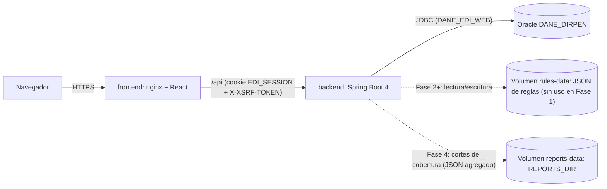

# Arquitectura — Formulario Web EDI/EDID

Fase 4: los reportes y las claves se arman al vuelo como `.xlsx` (Apache POI) y no se guardan en disco;
solo los cortes de cobertura se guardan, como JSON con cifras agregadas, en el volumen `reports-data`.
