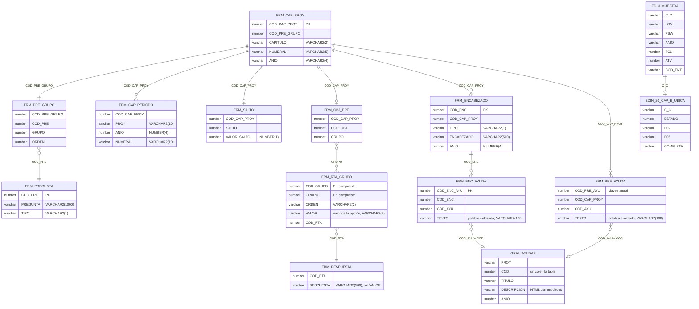

# MER — tablas usadas

> Tipos, longitudes y claves de las `FRM_*` confirmados con el diccionario de la base real
> (`DANE_DIRPEN`, 2026-11-06; juego de caracteres `WE8ISO8859P15`, longitudes en bytes). Sin
> secuencias ni disparadores: los ids se generan con MAX+1. `FRM_RTA_GRUPO` tiene clave compuesta
> `(COD_GRUPO, GRUPO)`. El DDL completo está en `db/dev/schema.sql`. Aquí solo se listan las
> columnas que usa la aplicación.

