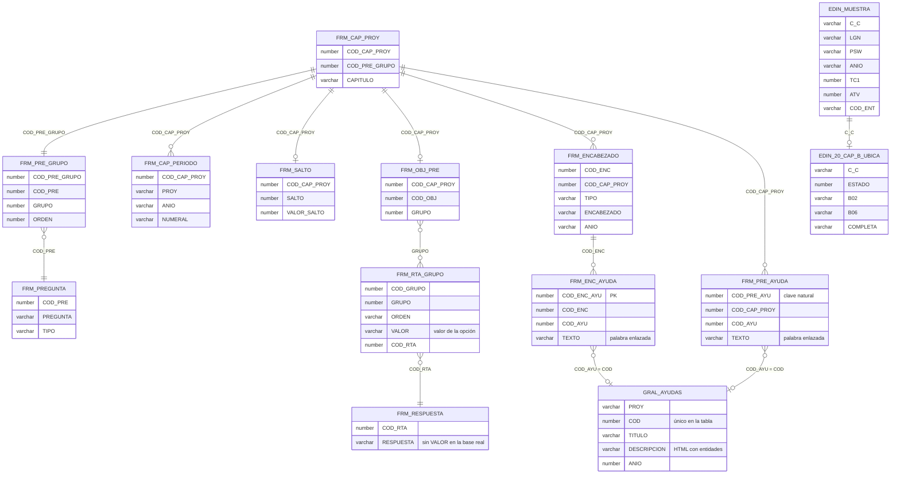

# MER — tablas usadas

> Columnas de las `FRM_*` confirmadas con el respaldo real de DANE_DIRPEN (16-oct-2026; salen de
> los INSERT y las claves de los índices únicos, porque el respaldo no trae sus CREATE TABLE).
> `GRAL_AYUDAS` es el único DDL completo del respaldo. Siguen **sin confirmar**: los tipos y
> longitudes de las `FRM_*`, la nulabilidad y cómo se generan los ids (secuencias o disparadores).
> Aquí solo se listan las columnas que usa la aplicación.

