# MER — tablas usadas

> Tipos, longitudes y claves de las `FRM_*` confirmados con el diccionario de la base real
> (`DANE_DIRPEN`, 2026-11-06; juego de caracteres `WE8ISO8859P15`, longitudes en bytes). Sin
> secuencias ni disparadores: los ids se generan con MAX+1. `FRM_RTA_GRUPO` tiene clave compuesta
> `(COD_GRUPO, GRUPO)`. El DDL completo está en `db/dev/schema.sql`. Aquí solo se listan las
> columnas que usa la aplicación.
>
> **Fase 4.** `GRAL_NOVEDAD`, `GRAL_ENTI`, `GRAL_DEPARTAMENTOS` y `GRAL_TERRITORIAL_ACCESO` se agregan
> con el DDL del respaldo del 2026-11-05 (sin tocarlas: solo lectura). Las relaciones con
> `EDIN_MUESTRA` son lógicas (la base no declara llaves foráneas conocidas) y los capítulos se unen por
> subconsultas agregadas por `C_C`. En el respaldo `GRAL_TERRITORIAL_ACCESO.COD_USUA` es `NUMBER(10)`;
> en desarrollo guarda el nombre de usuario de `GRAL_USUARIOS_ADM.COD_USUA`. La aplicación une con
> `TO_CHAR` en ambos lados y la consulta 13 de `db/verificacion/verificar-base-produccion.sql`
> confirma en la base real que ambos identificadores coinciden. La Fase 4 solo escribe
> `EDIN_MUESTRA.IDFNOV`, `NOV_OTRA_CAUSA`, `LGN` y `PSW`.

```mermaid
erDiagram
  FRM_CAP_PROY ||--|| FRM_PRE_GRUPO : "COD_PRE_GRUPO"
  FRM_PRE_GRUPO }o--|| FRM_PREGUNTA : "COD_PRE"
  FRM_CAP_PROY ||--o{ FRM_CAP_PERIODO : "COD_CAP_PROY"
  FRM_CAP_PROY ||--o| FRM_SALTO : "COD_CAP_PROY"
  FRM_CAP_PROY ||--o| FRM_OBJ_PRE : "COD_CAP_PROY"
  FRM_CAP_PROY ||--o{ FRM_ENCABEZADO : "COD_CAP_PROY"
  FRM_OBJ_PRE }o--o{ FRM_RTA_GRUPO : "GRUPO"
  FRM_RTA_GRUPO }o--|| FRM_RESPUESTA : "COD_RTA"
  FRM_CAP_PROY ||--o{ FRM_PRE_AYUDA : "COD_CAP_PROY"
  FRM_ENCABEZADO ||--o{ FRM_ENC_AYUDA : "COD_ENC"
  FRM_PRE_AYUDA }o--o| GRAL_AYUDAS : "COD_AYU = COD"
  FRM_ENC_AYUDA }o--o| GRAL_AYUDAS : "COD_AYU = COD"
  EDIN_MUESTRA ||--o| EDIN_20_CAP_B_UBICA : "C_C"
  EDIN_MUESTRA }o--o| EDIN_20_CAP_H_PREV_PRACT : "C_C"
  EDIN_MUESTRA }o--o| GRAL_ENTI : "COD_ENT"
  EDIN_MUESTRA }o--o| GRAL_DEPARTAMENTOS : "COD_DEPTO"
  EDIN_MUESTRA }o--o| GRAL_NOVEDAD : "IDFNOV"
  GRAL_DEPARTAMENTOS ||--o{ GRAL_TERRITORIAL_ACCESO : "COD_DEPTO"
  GRAL_USUARIOS_ADM ||--o{ GRAL_TERRITORIAL_ACCESO : "COD_USUA"
  FRM_CAP_PROY {
    number COD_CAP_PROY "PK"
    number COD_PRE_GRUPO
    varchar CAPITULO "VARCHAR2(2)"
    varchar NUMERAL "VARCHAR2(5)"
    varchar ANIO "VARCHAR2(4)"
  }
  FRM_PRE_GRUPO {
    number COD_PRE_GRUPO
    number COD_PRE
    number GRUPO
    number ORDEN
  }
  FRM_PREGUNTA {
    number COD_PRE "PK"
    varchar PREGUNTA "VARCHAR2(1000)"
    varchar TIPO "VARCHAR2(1)"
  }
  FRM_CAP_PERIODO {
    number COD_CAP_PROY
    varchar PROY "VARCHAR2(10)"
    number ANIO "NUMBER(4)"
    varchar NUMERAL "VARCHAR2(10)"
  }
  FRM_SALTO {
    number COD_CAP_PROY
    number SALTO
    number VALOR_SALTO "NUMBER(1)"
  }
  FRM_OBJ_PRE {
    number COD_CAP_PROY
    number COD_OBJ
    number GRUPO
  }
  FRM_RTA_GRUPO {
    number COD_GRUPO "PK compuesta"
    number GRUPO "PK compuesta"
    varchar ORDEN "VARCHAR2(2)"
    varchar VALOR "valor de la opción, VARCHAR2(5)"
    number COD_RTA
  }
  FRM_RESPUESTA {
    number COD_RTA
    varchar RESPUESTA "VARCHAR2(500), sin VALOR"
  }
  FRM_PRE_AYUDA {
    number COD_PRE_AYU "clave natural"
    number COD_CAP_PROY
    number COD_AYU
    varchar TEXTO "palabra enlazada, VARCHAR2(100)"
  }
  FRM_ENC_AYUDA {
    number COD_ENC_AYU "PK"
    number COD_ENC
    number COD_AYU
    varchar TEXTO "palabra enlazada, VARCHAR2(100)"
  }
  GRAL_AYUDAS {
    varchar PROY
    number COD "único en la tabla"
    varchar TITULO
    varchar DESCRIPCION "HTML con entidades"
    number ANIO
  }
  FRM_ENCABEZADO {
    number COD_ENC "PK"
    number COD_CAP_PROY
    varchar TIPO "VARCHAR2(1)"
    varchar ENCABEZADO "VARCHAR2(500)"
    number ANIO "NUMBER(4)"
  }
  EDIN_MUESTRA {
    varchar C_C
    varchar LGN
    varchar PSW
    varchar ANIO
    number TC1
    number ATV
    varchar COD_ENT
    varchar COD_DEPTO
    varchar ENC "1 EDI, 2 EDID; nulo = sin clasificar"
    number IDFNOV "novedad; NULL = sin novedad"
    varchar NOV_OTRA_CAUSA "texto de otra causa, VARCHAR2(500)"
    varchar IDMUES "id para auditoría, sin dato personal"
  }
  EDIN_20_CAP_H_PREV_PRACT {
    varchar C_C
    varchar H06 "no nulo = capítulo H terminado"
    timestamp FECHA
  }
  GRAL_NOVEDAD {
    varchar PROY "VARCHAR2(100)"
    number CONSEC
    number IDFNOV "PK, NUMBER(3)"
    varchar NOVEDAD "VARCHAR2(200)"
    number ANIO
  }
  GRAL_ENTI {
    varchar PROY "VARCHAR2(10)"
    number COD_ENT "PK, NUMBER(11)"
    varchar ENTIDAD "VARCHAR2(300)"
    number ACT_ENT
  }
  GRAL_DEPARTAMENTOS {
    number COD_DEPTO "PK"
    varchar NOM_DEPTO "VARCHAR2(100)"
    varchar TERRIT "territorial, VARCHAR2(100)"
  }
  GRAL_TERRITORIAL_ACCESO {
    number CODIGO "PK"
    number COD_DEPTO "NUMBER(10)"
    varchar COD_USUA "ver nota: tipo distinto en producción"
    varchar PROY "lista, p. ej. EDIN, EDID"
  }
  GRAL_USUARIOS_ADM {
    varchar COD_USUA
    varchar ROL "1 ingeniero, 2 territorial, 3 operativo"
    varchar COD_DPTO "departamento propio"
    varchar PROY
  }
  EDIN_20_CAP_B_UBICA {
    varchar C_C
    number ESTADO
    varchar B02
    varchar B06
    varchar COMPLETA
  }
```

