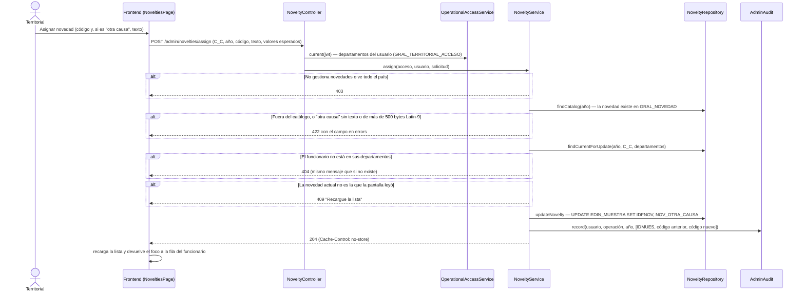

# Secuencia — asignar una novedad (Fase 4)

Solo el territorial asigna novedades, y solo en sus departamentos. La cédula (`C_C`) viaja en el cuerpo
del POST, nunca en la URL. La fila se bloquea (`FOR UPDATE`) y se compara con lo que la pantalla leyó:
si cambió entretanto, 409. La auditoría guarda el id de muestra y los códigos, sin cédula, nombre ni
texto libre. La operación funciona aunque el cuestionario esté en solo lectura
(`@AllowedInReadOnlyQuestionnaire`).

