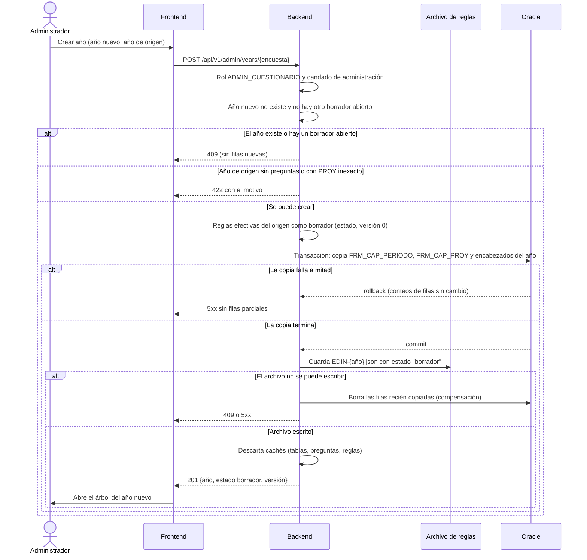

# Secuencia — crear un año del cuestionario

El administrador crea el año nuevo (borrador) a partir de un año publicado. Todo ocurre bajo el
candado global de administración; si algo falla, no queda ninguna fila ni archivo a medias.

Notas:
- Las filas de preguntas y grupos de FRM_* se comparten con el año de origen hasta que se edita
  una pregunta (ver la [secuencia de edición con copia al escribir](secuencia-editar-copia-al-escribir.md)).
- Un año con archivo sin `estado` es publicado y de solo lectura; solo existe un borrador por
  encuesta.
- El año nuevo no copia `columnasNuevas` del origen: esas columnas ya existen en la tabla o siguen
  pendientes en el año de origen.
