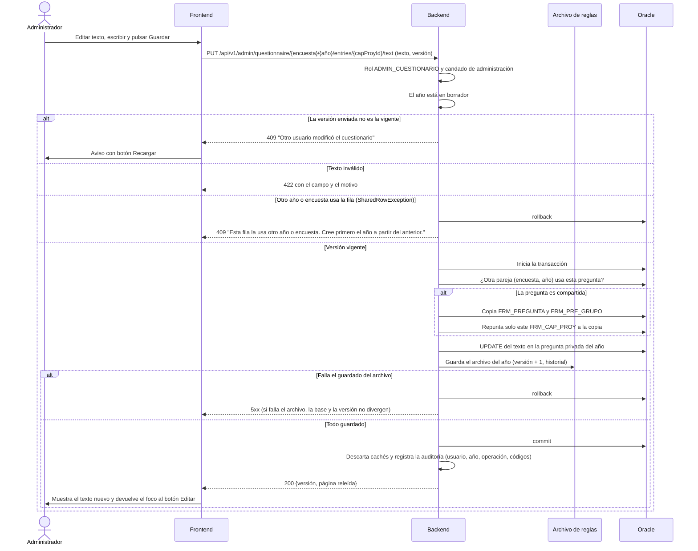

# Secuencia — editar una pregunta con copia al escribir

Editar el texto de una pregunta de un año en borrador nunca modifica una fila usada por otro
año: si la pregunta se comparte, se copia para el año que se edita y solo ese año se repunta.

Notas:
- El texto se guarda como texto plano (sin etiquetas) con las entidades que lee el PHP heredado y
  siempre se muestra escapado; el comodín `200X` se conserva al editar.
- Caso borde: el archivo se guarda dentro de la transacción y antes del commit. Si el commit falla
  después de escribir el archivo, la base se revierte pero el archivo ya quedó con versión + 1 (la
  versión anterior queda en el historial). El administrador recibe un 5xx; con la versión que
  tenía, su siguiente intento responde 409 hasta que recargue, y la base conserva el estado anterior.
- La línea de auditoría lleva usuario, encuesta, año, operación y códigos afectados; nunca el
  texto de la pregunta.
- Reordenar y desactivar siguen el mismo patrón (candado, versión, transacción y archivo); un
  `FRM_CAP_PROY` usado por otro año responde 409 en vez de modificarse.
