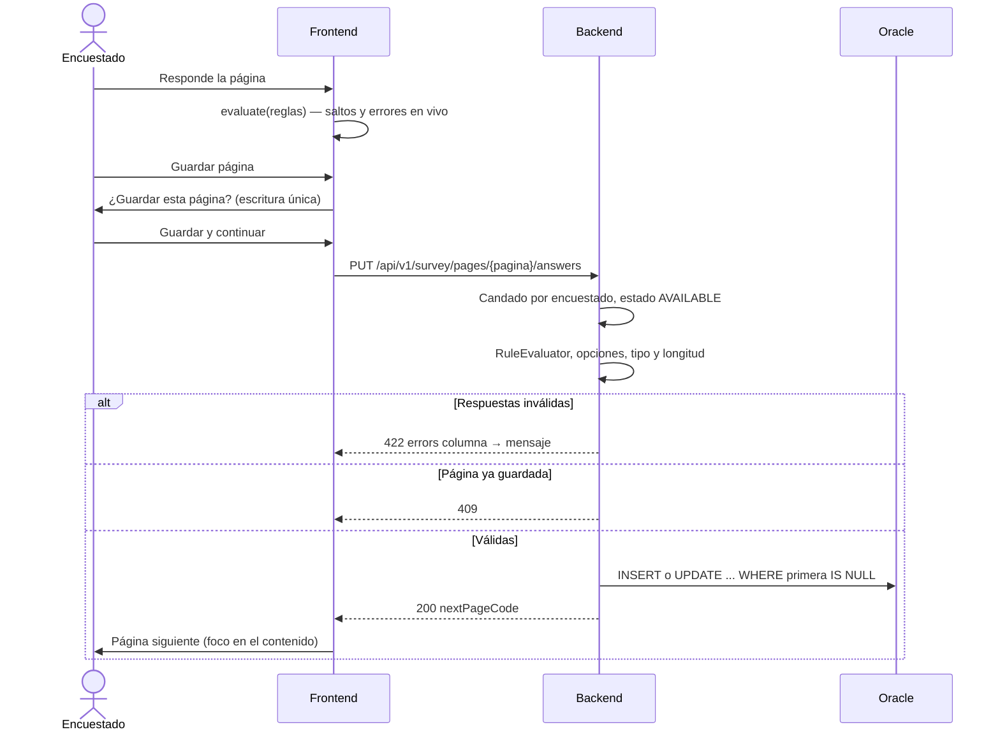

# Secuencia — guardar una página

Notas:
- La validación del servidor respeta los límites reales de Oracle (bytes o caracteres según
  `CHAR_USED`, precisión y escala de `NUMBER`): lo que no cabe responde 422, nunca 503.
- Una sesión con firma válida cuyo sujeto de encuestado no se puede descifrar responde 401.
- El repositorio de respuestas rechaza las columnas del sistema (`C_C`, `ESTADO`, `TC`, `ANIO`,
  `FECHA`, `COMPLETA`, `OBS`) y exige un valor de guarda no vacío.
