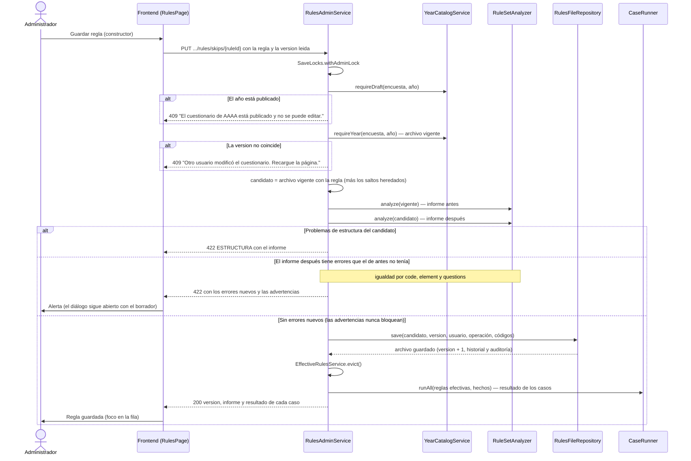

# Secuencia — guardar una regla (o una validación, un caso o una importación)

Todas las ediciones de reglas pasan por `RulesAdminService.apply`, que corre dentro del candado
global de administración (`SaveLocks.withAdminLock`). No toca Oracle: solo el archivo de reglas del
año (`RULES_DIR/<ENCUESTA>-<AÑO>.json`).

Notas:
- La respuesta (versión, informe y casos) se arma sin soltar el candado, para que otro guardado no
  se interponga entre el archivo y lo que se devuelve.
- `RulesFileRepository.save` vuelve a comprobar la versión; la operación (`editar-salto`,
  `borrar-salto`, `editar-validacion`, `borrar-validacion`, `editar-caso`, `borrar-caso`,
  `importar-reglas`) y los códigos (ids de regla o de caso, columnas) son lo único que va al log de
  auditoría: nunca texto libre.
- Un error que ya existía en el archivo vigente (por ejemplo, una columna del 2026 real que no está
  en el cuestionario ficticio) se muestra pero no bloquea un guardado que no lo agrava. El plan 3c
  exigirá cero errores para publicar.
- La importación (`PUT .../rules/import`) sigue el mismo camino; antes del candado rechaza con 413
  un cuerpo de más de 1 MB y con 422 los ids que la auditoría no admitiría.
