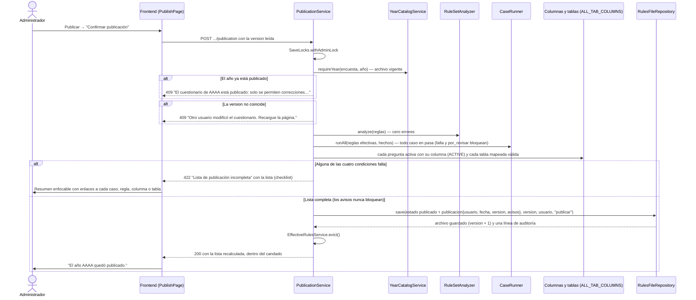

# Secuencia — publicar un año

Publicar pasa por `PublicationAdminController` y corre dentro del candado global de administración
(`SaveLocks.withAdminLock`): la lista se recalcula ahí, no se confía en la que el navegador vio.
No toca Oracle para escribir: solo cambia el `estado` en el archivo de reglas del año
(`RULES_DIR/<ENCUESTA>-<AÑO>.json`). Las filas `FRM_*` se leen para comprobar columnas y tablas.

## Después de publicar

- La edición estructural (agregar, desactivar, reordenar, tablas) responde 409.
- Las correcciones (textos, encabezados, ayudas, saltos, validaciones, casos) piden un `motivo` de
  10 a 500 caracteres, que queda solo en `ultimoCambio.motivo` del archivo, y se auditan como
  `corregir-<operación>`.
- Una corrección se rechaza (422) si deja algún caso en rojo que antes no lo estaba.
- Si `SURVEY_YEAR` apunta a este año, publicarlo levanta por sí mismo el 503 de la compuerta de la 3a.
