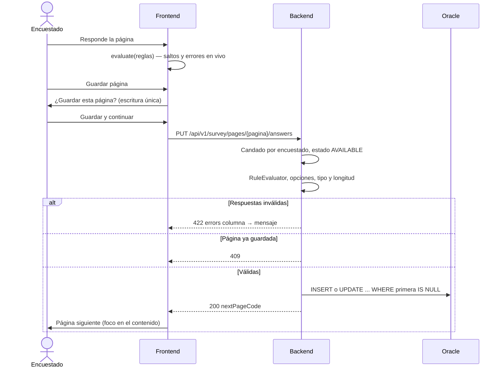

# Fase 2 — Flujo del encuestado: plan de implementación

> **For agentic workers:** REQUIRED SUB-SKILL: Use superpowers:subagent-driven-development (recommended) or superpowers:executing-plans to implement this plan task-by-task. Steps use checkbox (`- [ ]`) syntax for tracking.

**Goal:** Que el servidor público diligencie la encuesta EDIN 2026 completa (EDID no tiene cuestionario 2026 en la base; queda soportada pero vacía): páginas B1 a H1 en orden, observaciones y radicado. Cada página se guarda una sola vez en las tablas heredadas de Oracle y se valida con un motor de saltos y rangos que corre igual en el backend y en el frontend.

**Architecture:**
- **Motor de reglas:** las reglas viven en un JSON por encuesta y año dentro de `RULES_DIR`. Si el archivo no existe, se copia desde una semilla del classpath. Las evalúa un motor Java autoritativo y uno TypeScript para la interfaz. Ambos pasan los mismos casos de `shared/rules-fixtures`.
- **Semillas separadas:** la semilla del classpath (producción) solo trae las reglas reales de EDIN 2026. Las reglas del cuestionario ficticio viven en `db/dev/rules-seed`, que solo usan las pruebas, el desarrollo local y compose (`RULES_SEED_DIR`).
- **Saltos heredados:** los saltos simples de `FRM_SALTO` se traducen a reglas en tiempo de ejecución. Una regla del archivo con el mismo id (`legacy-<COL>`) los reemplaza.
- **Respuestas:** se escriben por página con `NamedParameterJdbcTemplate`, con columnas de la lista blanca de `ALL_TAB_COLUMNS`. Las deshabilitadas o vacías se guardan como `'0'` (D15).
- **Escritura única:** cada página se escribe una sola vez (D16), con candado por encuestado y guarda `IS NULL` en el `UPDATE`.
- **Datos personales:** el `C_C` viaja cifrado en el JWT y el comprobante es un radicado HMAC (D17).

**Tech Stack:** el mismo de la Fase 1, sin dependencias nuevas.
- Backend: Spring Boot 4.1.1, Java 21, Jackson 3 (`tools.jackson.databind.json.JsonMapper`), `javax.crypto`.
- Frontend: React 19.3, React Router 7.18, TanStack Query 5, Vitest 4, MSW 2, Playwright 1.63 + axe.

**Spec:** `docs/superpowers/specs/2026-10-14-formulario-web-design.md`. Ver §5, §6.1, §7.1 y las decisiones D15–D19 de la tabla §2.

## Prerrequisitos

1. Rama `feature/fase-2-encuestado`, creada desde `feature/fase-1-base`. Ya existe y contiene el commit del spec.
2. Docker Desktop encendido, porque las pruebas de integración usan Testcontainers con Oracle Free.
3. `db/reference/frm-2026-orden.csv` ya está en el repositorio (commit del plan). Tiene los 254 ítems de EDIN 2026: página, posición, numeral, columna, objeto, grupo de respuesta y salto. Se generó solo con las tablas `FRM_*` del respaldo de Oracle que entregó Oscar, sin respuestas, muestra ni usuarios. La usan las Tareas 4 y 17.

## Global Constraints

- **Código heredado:** se usan los mismos patrones que en la Fase 1.
  - Java: paquetes en minúscula; google-java-format; Checkstyle con líneas de 100 caracteres. Los literales largos se parten con `+`.
  - Frontend: Prettier con ancho 100 y comillas simples; ESLint con jsx-a11y.
- **Sin dependencias nuevas.** Si una tarea parece necesitar una, se detiene y lo reporta.
- **Oracle sin DDL nuevo.**
  - Tablas solo desde `Chapter.tableName()`.
  - Columnas validadas contra `ALL_TAB_COLUMNS` y contra `^[A-Z][0-9A-Z_]{1,29}$`.
  - Todos los valores enlazados como parámetros.
- **D15:** toda columna de la página que no esté habilitada, o que no tenga respuesta permitida, se guarda como `'0'`.
- **D16:**
  - Orden de páginas: `B1, C1, C2, D1, D2, E1, F1, G1, H1`.
  - Una página está **habilitada** cuando todas las anteriores están guardadas.
  - Una página está **guardada** cuando la columna de su primer ítem activo no es `NULL`.
  - Una página guardada no se vuelve a escribir: responde 409.
  - No hay autoguardado.
- **D17:**
  - El `C_C` nunca aparece en respuestas JSON, logs, URL ni en el JWT en claro. El sujeto del encuestado es `encuestado:` + `base64url(iv‖AES-GCM(C_C))`.
  - La clave AES-GCM es `HMAC-SHA256(jwtSecret, "edi-subject-v1")`.
  - El radicado es `HMAC-SHA256(RECEIPT_KEY, código + ":" + año + ":" + C_C)` en Base32 (RFC 4648, sin relleno), primeros 10 caracteres, con formato `XXXXX-XXXXX`.
- **D18:**
  - Terminar requiere las 9 páginas guardadas.
  - `OBS` de `EDIN_20_CAP_H_PREV_PRACT` se escribe solo si no tiene valor y el texto no está vacío. El texto llega sin espacios sobrantes en los extremos, con un máximo de 1100 caracteres.
  - No se escribe `COMPLETA`.
- **Filas nuevas:** columnas fijas `ESTADO = 1`, `TC = 1` (carga web) y `ANIO = año` solo si la tabla tiene la columna `ANIO` (hoy solo la B).
- **Formato JSON de reglas** (claves en español, como en el spec §5.1):
  - `encuesta`, `anio`, `version`, `saltos[]`, `validaciones{}`.
  - Cada salto tiene `id`, `descripcion`, `si`, `entonces` (`accion`: `"deshabilitar"`, `preguntas`).
  - `si` admite `pregunta` | `todas` | `alguna` con `op` y `valor`/`valores`, o `y[]` / `o[]`.
  - Operadores: `eq`, `ne`, `in`, `notIn`, `gt`, `lt`, `empty`, `notEmpty`.
  - Cada validación admite `obligatoria` (por defecto `true`), `tipo` (`entero` | `decimal` | `texto` | `opcion`), `min`, `max`, `longitudMax`.
- **Códigos de error del motor:** `REQUERIDA`, `TIPO_INVALIDO`, `FUERA_DE_RANGO`, `LONGITUD`, `OPCION_INVALIDA`, `PREGUNTA_DESCONOCIDA`. Los mensajes en español se generan en una sola tabla por lado.
- **Errores HTTP:** RFC 7807.
  - 409: "Esta página ya fue guardada." / "Complete primero las páginas anteriores." / "Faltan páginas por guardar."
  - 422: incluye `errors` con la forma columna → mensaje.
- **Accesibilidad:**
  - Cada grupo de opciones va en `fieldset` con `legend`; los errores se asocian con `aria-describedby`.
  - Los saltos se anuncian con `aria-live="polite"`.
  - En cada cambio de ruta se actualizan el foco y `document.title` (WCAG 2.4.3).
  - Objetivos táctiles de al menos 44 px; contraste de al menos 4,5:1.
- **Pruebas y trazabilidad:**
  - Cobertura del backend: al menos 80 % en `co.gov.dane.edi.security` y en `co.gov.dane.edi.rules`; al menos 60 % en el resto. Frontend: al menos 60 %.
  - Los commits siguen Conventional Commits en español, con el `Co-Authored-By` del modelo que hizo el trabajo.
  - Nada de *push*, *merge* ni PR sin autorización explícita de Oscar.

## Review Focus

1. **Doble envío o dos pestañas guardando la misma página a la vez.** Una sola escritura gana y la otra recibe 409, sin filas duplicadas. Prueba: Tarea 9, `concurrentSavesOfSamePageWriteOnce`.
2. **Valor más largo que la columna** (por ejemplo `"10"` en un `VARCHAR2(1)`). Debe responder 422 `LONGITUD` y no un 503 de Oracle. Prueba: Tarea 9, `valueLongerThanColumnIsRejected`.
3. **Petición manipulada:** respuesta a una pregunta deshabilitada, a una columna de otra página o a una columna inexistente. La deshabilitada se guarda como `'0'`; la ajena o inexistente da 422 `PREGUNTA_DESCONOCIDA`. Prueba: Tarea 9, `tamperedAnswersAreNeutralizedOrRejected`.
4. **Archivo de reglas ausente o dañado en `RULES_DIR`.**
   - Si falta, se copia la semilla y el directorio se crea.
   - Si está dañado, responde 500 con un log claro y sin exponer el contenido.

   Prueba: Tarea 2, `missingFileIsSeededAndCorruptFileFailsClearly`.
5. **Sesión que vence mientras se llena una página larga sin llamar a la API.** Cada 10 minutos, mientras haya cambios sin guardar, se renueva la sesión con `GET /auth/me`; además se avisa antes de cerrar la pestaña. Prueba: Tarea 14, `keepsSessionAliveWhileThereAreUnsavedAnswers`.

---

## Inventario de reglas heredadas (`General/JavaScript/FrmValida.js`, usado en la Tarea 17)

Las posiciones son índices **base 0 entre los ítems** (`TIPO = 'L'`) de la página, como `PP[]` en el PHP. En 2026 todos los ítems son combos (`COD_OBJ = 1`), así que la posición del ítem coincide con la del combo. Las columnas salen de `db/reference/frm-2026-orden.csv`, que coincide ítem por ítem con las listas de `Tabla()` en `Funciones.php`.

**Reglas especiales** (en `FRM_SALTO` se marcan con `VALOR_SALTO = 1`). Cada regla se traduce por su **intención**: el comentario del JS más el ítem que `FRM_SALTO` marca como disparador. En dos de ellas, los índices escritos a mano no coinciden con el orden de 2026 (se quedaron del cuestionario de 2024). La columna "JS literal" muestra qué haría el índice tal como está escrito.

| Id | Página | Línea JS | Condición (columnas 2026) | Deshabilita | JS literal |
|----|--------|----------|---------------------------|-------------|------------|
| `c07a-no` | C1 | 54–138 | `C07A` = `2` | `C08A`–`C08H` | dispara con pos 22 = `C06C` (corrido uno) |
| `c09-todas-no` | C1 | 140–176 | `C09A`–`C09G` todas = `2` | `C10` | cuenta `C08E`–`C09C` y deshabilita `C09D` (corrido cuatro) |
| `c13-teletrabajo` | C2 | 178–264 | `C13` = `6` | `C14`, `C15`, `C16A`–`C16F` | coincide |
| `e01-todas-no` | E1 | 265–298 | `E01A`–`E01F` todas = `2` | `E02` | coincide |
| `d09-1-2` | D2 | 299–344 | `D09` ∈ {`1`,`2`} | `D11` | coincide |
| `d09-3-4` | D2 | 299–344 | `D09` ∈ {`3`,`4`} | `D10` | coincide |
| `d09-otra` | D2 | 299–344 | `D09` con otro valor (por ejemplo `9`) | `D10`, `D11` | coincide |
| `f03a-no` | F1 | 345–437 | `F03A` = `2` | `F04A`–`F04I` | coincide |
| `f04-todas-no` | F1 | 438–475 | `F04A`–`F04H` todas = `2` | `F04I` ("ninguna") | coincide |
| `f04-alguna-si` | F1 | 476–500 | alguna de `F04A`–`F04H` ∈ {`1`,`9`} | `F04I` | por la precedencia de `\|\|`, un `9` en cualquier combo de la página también la deshabilitaba |
| `f03j-mayor-1` | F1 | 558–600 | `F03J` > `1` | `F05A`–`F05D` | coincide |
| `g05-mayor-1` | G1 | 532–557 | `G05` > `1` | `G06` | coincide |

Notas:
- Las líneas 501–531 (F04f no puede ser "Sí" si otro F04 es "Sí") quedan cubiertas por `f04-alguna-si`.
- Las alertas de las líneas 645–655 ("pulse Guardar para continuar…") no son reglas; no se migran.
- `d09-otra` no cubre `D09` vacía, porque una pregunta habilitada y vacía ya es `REQUERIDA`.

**Salto genérico** (`VALOR_SALTO = 2`): si el combo vale `2`, se deshabilitan los `SALTO` combos siguientes. Este salto **no** va en la semilla; lo traduce la Tarea 5 desde la base de datos. En 2026 son siete:

| Disparador | Deshabilita |
|------------|-------------|
| `B10` = `2` | `B11` |
| `C09G` = `2` | `C10` (**se reemplaza**: ver abajo) |
| `C19` = `2` | `C20A`, `C20B` |
| `D04` = `2` | `D05`, `D06A`–`D06E`, `D07` |
| `E05` = `2` | `E06A`–`E06D` |
| `E07` = `2` | `E08A`–`E08D` |
| `G02` = `2` | `G03A`–`G03E` |

**Conflicto en C10.** El genérico de `C09G` deshabilita `C10` apenas `C09G` es "No", aunque las otras C09 sean "Sí". Esto contradice `c09-todas-no`. Por eso la semilla define una regla con el **mismo id** `legacy-C09G`, y en `EffectiveRulesService` una regla del archivo reemplaza a la heredada del mismo id (Tarea 17). **Queda pendiente que Oscar confirme esta lectura**, igual que las dos reglas corridas.

---

## Estructura de archivos de la fase

```
db/dev/schema.sql, data.sql                       (modificados: tablas C–H y cuestionario ficticio completo)
db/dev/rules-seed/EDIN-2026.json                  (reglas del cuestionario ficticio; solo dev, pruebas y compose)
db/reference/frm-2026-orden.csv                   (orden real de 2026: posición → numeral → columna → salto)
shared/rules-fixtures/*.json                      (casos del motor, compartidos)
backend/src/main/java/co/gov/dane/edi/
  rules/        RuleSet, SkipRule, Condition, SkipAction, FieldValidation, Evaluation, RuleEvaluator,
                RuleErrorCodes, RulesFileRepository, RuleSetValidator, LegacySkipTranslator, EffectiveRulesService
  model/        SurveyPage, PageState, PageStatus, SurveyProgress, PageDetail, PageAnswersRequest,
                PageSaveResult, FinishRequest, FinishResult, AnswerColumn   (+ QuestionnaireEntry.pageCode)
  repository/   AnswerRepository (+ AnswerColumnRepository.findColumnDetails)
  service/      SurveyProgressService, SurveyAnswerService, ReceiptService, SaveLocks, AnswerErrorMessages
  service/error/ ConflictException, AnswerValidationException
  security/     SubjectCipher, ReceiptProperties (+ SessionTokenService.principalFrom, SessionPrincipal.respondentCode)
  config/       RulesSeedProperties
  util/         ColumnCodeResolver (corregido: "C7a." → C07A)
  controller/   RespondentSurveyController (+ ApiExceptionHandler 409/422)
backend/src/main/resources/rules-seed/EDIN-2026.json, EDID-2026.json   (producción: solo reglas reales)
frontend/src/features/survey/
  rules/rule-evaluator.ts, answer-error-messages.ts, survey-api.ts
  SurveyHomePage.tsx (reescrito), SurveyPageView.tsx, SavedPageSummary.tsx, ErrorSummary.tsx, FinishPage.tsx
  questions/QuestionField.tsx, ChoiceQuestion.tsx, TextQuestion.tsx, CheckboxQuestion.tsx
  use-unsaved-changes.ts
frontend/src/components/ConfirmDialog.tsx, LinkButton.tsx (+ AppLayout: foco en <main> al cambiar de ruta)
frontend/src/hooks/use-document-title.ts
frontend/e2e/encuesta-completa.spec.ts
```

Todos los comandos se ejecutan desde la raíz del repositorio, `D:\PERSONALES\PROYECTOS\FORMULARIO_WEB\formulario-web`, con Git Bash.

---

### Tarea 1: Datos de desarrollo con cuestionario ficticio completo

**Files:**
- Modify: `db/dev/schema.sql`. Agregar las tablas de respuesta C a H, con un subconjunto de columnas del DDL de 2024.
- Modify: `db/dev/data.sql`. Agregar páginas C1 a H1 ficticias, un salto genérico, dos encuestados nuevos y el borrado de las respuestas.
- Test: `backend/src/test/java/co/gov/dane/edi/DevDataIT.java`

**Interfaces:**
- Produces (encuestados ficticios):
  - `PRUEBA05` / `Clave#05`, `C_C` `1000000005`: lo usa la E2E del flujo completo.
  - `PRUEBA06` / `Clave#06`, `C_C` `1000000006`: lo usa la prueba de integración del flujo.
- Produces (cuestionario de 2026): ítems combo **Sí (`1`) / No (`2`)** en el grupo de opciones `20`, uno o dos por página:

  | Página | Columna | Notas |
  |---|---|---|
  | C1 | `C01A` | Salto genérico: `SALTO = 1`, `VALOR_SALTO = 2` → deshabilita `C01B` |
  | C1 | `C01B` | |
  | C2 | `C13` | |
  | D1 | `D01A` | |
  | D1 | `D05` | Texto, sin regla de validación (`VARCHAR2(2)`): sirve para probar la longitud de columna |
  | D2 | `D09` | |
  | E1 | `E01A` | |
  | F1 | `F01A` | |
  | G1 | `G01A` | |
  | H1 | `H01` | |

  B1 queda igual que en la Fase 1, con `B02` (combo), `B06` (texto) y `B99` (pendiente).
- Produces: `data.sql` borra todas las filas de respuesta en cada arranque, así las pruebas parten de cero.

- [ ] **Step 1: Escribir la prueba que falla `DevDataIT`**

```java
package co.gov.dane.edi;

import static org.assertj.core.api.Assertions.assertThat;

import co.gov.dane.edi.support.OracleIntegrationTest;
import java.util.List;
import java.util.Map;
import org.junit.jupiter.api.Test;
import org.springframework.beans.factory.annotation.Autowired;
import org.springframework.jdbc.core.namedparam.NamedParameterJdbcTemplate;

/** Garantiza que el cuestionario ficticio cubre las 9 páginas que recorre la encuesta. */
class DevDataIT extends OracleIntegrationTest {

  @Autowired private NamedParameterJdbcTemplate jdbc;

  @Test
  void everyPageHasAtLeastOneQuestionForTheActiveYear() {
    List<String> pages =
        jdbc.queryForList(
            "SELECT DISTINCT PP.CAPITULO FROM FRM_CAP_PROY PP JOIN FRM_CAP_PERIODO PER"
                + " ON PER.COD_CAP_PROY = PP.COD_CAP_PROY WHERE PER.ANIO = '2026'"
                + " ORDER BY PP.CAPITULO",
            Map.of(),
            String.class);
    assertThat(pages).containsExactly("B1", "C1", "C2", "D1", "D2", "E1", "F1", "G1", "H1");
  }

  @Test
  void answerTablesStartEmpty() {
    for (String table :
        List.of(
            "EDIN_20_CAP_B_UBICA",
            "EDIN_20_CAP_C_EXP_PERS",
            "EDIN_20_CAP_D_GEST_TAL",
            "EDIN_20_CAP_E_USO_TECN",
            "EDIN_20_CAP_F_GEST_ENT",
            "EDIN_20_CAP_G_REN_CUEN",
            "EDIN_20_CAP_H_PREV_PRACT")) {
      Integer rows = jdbc.queryForObject("SELECT COUNT(*) FROM " + table, Map.of(), Integer.class);
      assertThat(rows).as(table).isZero();
    }
  }

  @Test
  void flowRespondentsExist() {
    assertThat(
            jdbc.queryForList(
                "SELECT LGN FROM EDIN_MUESTRA WHERE LGN IN ('PRUEBA05','PRUEBA06') ORDER BY LGN",
                Map.of(),
                String.class))
        .containsExactly("PRUEBA05", "PRUEBA06");
  }
}
```

- [ ] **Step 2: Ejecutar y ver que falla**

Run: `cd backend && ./mvnw -B verify -Dit.test=DevDataIT -Dtest=NONE -Dsurefire.failIfNoSpecifiedTests=false -Djacoco.skip=true`
Expected: FAIL. Solo existe la página B1 y las tablas C a H no existen.

- [ ] **Step 3: Agregar las tablas al final de `db/dev/schema.sql`**

```sql
-- Subconjunto de columnas del DDL 2024 (DOCUMENTOS/SCRIPT BASE DE DATOS) necesario para el cuestionario
-- ficticio. Los tipos y longitudes son los del DDL real.
CREATE TABLE IF NOT EXISTS EDIN_20_CAP_C_EXP_PERS (
  C_C VARCHAR2(11), ESTADO NUMBER(1), TC NUMBER(1), FECHA TIMESTAMP DEFAULT SYSDATE,
  C01A VARCHAR2(1), C01B VARCHAR2(1), C13 VARCHAR2(1)
);
CREATE TABLE IF NOT EXISTS EDIN_20_CAP_D_GEST_TAL (
  C_C VARCHAR2(11), ESTADO NUMBER(11), TC NUMBER(11), FECHA TIMESTAMP DEFAULT SYSDATE,
  D01A VARCHAR2(1), D05 VARCHAR2(2), D09 VARCHAR2(1)
);
CREATE TABLE IF NOT EXISTS EDIN_20_CAP_E_USO_TECN (
  C_C VARCHAR2(11), ESTADO NUMBER(1), TC NUMBER(1), FECHA TIMESTAMP DEFAULT SYSDATE,
  E01A VARCHAR2(1)
);
CREATE TABLE IF NOT EXISTS EDIN_20_CAP_F_GEST_ENT (
  C_C VARCHAR2(11), ESTADO NUMBER(1), TC NUMBER(1), FECHA TIMESTAMP DEFAULT SYSDATE,
  F01A VARCHAR2(1)
);
CREATE TABLE IF NOT EXISTS EDIN_20_CAP_G_REN_CUEN (
  C_C VARCHAR2(11), ESTADO NUMBER(1), TC NUMBER(1), FECHA TIMESTAMP DEFAULT SYSDATE,
  G01A VARCHAR2(1)
);
CREATE TABLE IF NOT EXISTS EDIN_20_CAP_H_PREV_PRACT (
  C_C VARCHAR2(11), ESTADO NUMBER(1), TC NUMBER(1), FECHA TIMESTAMP DEFAULT SYSDATE,
  H01 VARCHAR2(1), OBS VARCHAR2(1100)
);
```

- [ ] **Step 4: Ampliar `db/dev/data.sql`**

Agregar al bloque de `DELETE` del inicio:

```sql
DELETE FROM EDIN_20_CAP_B_UBICA;
DELETE FROM EDIN_20_CAP_C_EXP_PERS;
DELETE FROM EDIN_20_CAP_D_GEST_TAL;
DELETE FROM EDIN_20_CAP_E_USO_TECN;
DELETE FROM EDIN_20_CAP_F_GEST_ENT;
DELETE FROM EDIN_20_CAP_G_REN_CUEN;
DELETE FROM EDIN_20_CAP_H_PREV_PRACT;
```

Agregar al `INSERT INTO EDIN_MUESTRA` dos filas más, separando con coma la última fila existente:

```sql
  ('2026', '899999', '11', '1000000005', 'Persona Ficticia Cinco', 1, 1, 'PRUEBA05', 'Clave#05'),
  ('2026', '899999', '11', '1000000006', 'Persona Ficticia Seis', 1, 1, 'PRUEBA06', 'Clave#06')
```

Agregar al final del archivo el cuestionario de las páginas C1 a H1. Los códigos 201 en adelante no chocan con los de B1:

```sql
-- Cuestionario FICTICIO de las páginas C1–H1: un combo Sí/No por página (dos en C1, con salto genérico).
INSERT INTO FRM_PREGUNTA (COD_PRE, PREGUNTA, TIPO) VALUES
  (201, '&iquest;Pregunta ficticia C01A?', 'L'), (202, 'Pregunta ficticia C01B', 'L'),
  (203, 'Pregunta ficticia C13', 'L'), (204, 'Pregunta ficticia D01A', 'L'),
  (205, 'Pregunta ficticia D09', 'L'), (206, 'Pregunta ficticia E01A', 'L'),
  (207, 'Pregunta ficticia F01A', 'L'), (208, 'Pregunta ficticia G01A', 'L'),
  (209, 'Pregunta ficticia H01', 'L'), (210, 'Antig&uuml;edad ficticia D05 (a&ntilde;os)', 'L');
INSERT INTO FRM_PRE_GRUPO (COD_PRE_GRUPO, COD_PRE, GRUPO, ORDEN) VALUES
  (201, 201, 1, 1), (202, 202, 1, 2), (203, 203, 1, 1), (204, 204, 1, 1), (205, 205, 1, 1),
  (206, 206, 1, 1), (207, 207, 1, 1), (208, 208, 1, 1), (209, 209, 1, 1), (210, 210, 1, 2);
INSERT INTO FRM_CAP_PROY (COD_CAP_PROY, COD_PRE_GRUPO, CAPITULO) VALUES
  (301, 201, 'C1'), (302, 202, 'C1'), (303, 203, 'C2'), (304, 204, 'D1'), (305, 205, 'D2'),
  (306, 206, 'E1'), (307, 207, 'F1'), (308, 208, 'G1'), (309, 209, 'H1'), (310, 210, 'D1');
INSERT INTO FRM_CAP_PERIODO (COD_CAP_PROY, PROY, ANIO, NUMERAL) VALUES
  (301, 'EDIN', '2026', 'C01A.'), (302, 'EDIN', '2026', 'C01B.'), (303, 'EDIN', '2026', 'C13*.'),
  (304, 'EDIN', '2026', 'D01A.'), (305, 'EDIN', '2026', 'D09*.'), (306, 'EDIN', '2026', 'E01A.'),
  (307, 'EDIN', '2026', 'F01A.'), (308, 'EDIN', '2026', 'G01A.'), (309, 'EDIN', '2026', 'H01*.'),
  (310, 'EDIN', '2026', 'D05*.');
INSERT INTO FRM_OBJ_PRE (COD_CAP_PROY, COD_OBJ, GRUPO) VALUES
  (301, 1, 20), (302, 1, 20), (303, 1, 20), (304, 1, 20), (305, 1, 20), (306, 1, 20), (307, 1, 20),
  (308, 1, 20), (309, 1, 20), (310, 5, 11);
-- Salto genérico heredado: si C01A = 2 (No), se deshabilita el combo siguiente (C01B).
INSERT INTO FRM_SALTO (COD_CAP_PROY, SALTO, VALOR_SALTO) VALUES (301, 1, 2);
INSERT INTO FRM_RESPUESTA (COD_RTA, VALOR, RESPUESTA) VALUES (21, '1', 'S&iacute;'), (22, '2', 'No');
INSERT INTO FRM_RTA_GRUPO (GRUPO, COD_RTA, ORDEN) VALUES (20, 21, '1'), (20, 22, '2');
```

- [ ] **Step 5: Ejecutar y verificar todo el backend**

Run: `cd backend && ./mvnw -B verify`
Expected: `BUILD SUCCESS`. `DevDataIT` pasa 3/3. `SurveyControllerIT` sigue en verde, porque solo revisa el capítulo B y la lista de capítulos.

- [ ] **Step 6: Commit**

```bash
git add db/dev backend/src/test/java/co/gov/dane/edi/DevDataIT.java
git commit -m "test(db): ampliar el cuestionario ficticio a las nueve páginas de la encuesta

Co-Authored-By: Claude <modelo> 5.5 <noreply@anthropic.com>"
```

---

### Tarea 2: Modelo de reglas, carga desde `RULES_DIR` y validación estructural

**Files:**
- Create: `backend/src/main/java/co/gov/dane/edi/rules/RuleSet.java`, `SkipRule.java`, `Condition.java`, `SkipAction.java`, `FieldValidation.java`
- Create: `backend/src/main/java/co/gov/dane/edi/rules/RuleSetValidator.java`
- Create: `backend/src/main/java/co/gov/dane/edi/rules/RulesFileRepository.java`
- Create: `backend/src/main/java/co/gov/dane/edi/config/RulesSeedProperties.java`
- Create: `backend/src/main/resources/rules-seed/EDIN-2026.json`, `backend/src/main/resources/rules-seed/EDID-2026.json` (semillas de producción: solo reglas reales)
- Create: `db/dev/rules-seed/EDIN-2026.json` (semilla de desarrollo y pruebas, para el cuestionario ficticio)
- Modify: `backend/src/main/resources/application.yml`, `backend/src/test/resources/application-test.yml`, `docker-compose.yml`, `.env.example` (nueva variable `RULES_SEED_DIR`)
- Test: `backend/src/test/java/co/gov/dane/edi/rules/RuleSetValidatorTest.java`, `RulesFileRepositoryTest.java`

**Interfaces:**
- Consumes: `SurveyProperties.code()`, `year()` y `rulesDir()`; el *bean* `JsonMapper` (`tools.jackson.databind.json.JsonMapper`, autoconfigurado por Boot 4).
- Produces: `record RulesSeedProperties(String dir)`, con prefijo `app.rules-seed`. `dir` vacío significa "usar la semilla del classpath". Solo desarrollo, pruebas y la pila de compose lo apuntan a `db/dev/rules-seed`, para que las reglas del cuestionario ficticio (por ejemplo, la edad `B06` de 15 a 99) nunca lleguen a producción. En el cuestionario real de 2026, `B06` es el nivel educativo.
- Produces (*records*, con nombres JSON en español mediante `@JsonProperty`):
  - `RuleSet(String survey, int year, int version, List<SkipRule> skips, Map<String, FieldValidation> validations)`, con `static RuleSet empty(String survey, int year)`.
  - `SkipRule(String id, String description, Condition when, SkipAction then)`.
  - `Condition(String question, String op, String value, List<String> values, List<String> all, List<String> any, List<Condition> and, List<Condition> or)`.
  - `SkipAction(String action, List<String> questions)`.
  - `FieldValidation(Boolean required, String type, BigDecimal min, BigDecimal max, Integer maxLength)`.
- Produces: `RuleSetValidator.validate(RuleSet)` lanza `IllegalStateException` con un mensaje claro si la estructura es inválida.
- Produces: `RulesFileRepository.load()` devuelve un `RuleSet` cacheado. Copia la semilla si falta el archivo, y si el JSON está dañado lanza `IllegalStateException("Archivo de reglas inválido: <archivo>")`.

- [ ] **Step 1: Escribir las pruebas que fallan**

`RuleSetValidatorTest.java`:

```java
package co.gov.dane.edi.rules;

import static org.assertj.core.api.Assertions.assertThatCode;
import static org.assertj.core.api.Assertions.assertThatThrownBy;

import java.util.List;
import java.util.Map;
import org.junit.jupiter.api.Test;

class RuleSetValidatorTest {

  private static Condition eq(String question, String value) {
    return new Condition(question, "eq", value, null, null, null, null, null);
  }

  private static RuleSet withSkip(SkipRule rule) {
    return new RuleSet("EDIN", 2026, 1, List.of(rule), Map.of());
  }

  @Test
  void acceptsAWellFormedRuleSet() {
    SkipRule rule =
        new SkipRule("c01a-no", "Si C01A es No", eq("C01A", "2"),
            new SkipAction("deshabilitar", List.of("C01B")));
    assertThatCode(() -> RuleSetValidator.validate(withSkip(rule))).doesNotThrowAnyException();
  }

  @Test
  void rejectsUnknownOperator() {
    SkipRule rule =
        new SkipRule("x", null, new Condition("C01A", "contiene", "2", null, null, null, null, null),
            new SkipAction("deshabilitar", List.of("C01B")));
    assertThatThrownBy(() -> RuleSetValidator.validate(withSkip(rule)))
        .isInstanceOf(IllegalStateException.class)
        .hasMessageContaining("x")
        .hasMessageContaining("contiene");
  }

  @Test
  void rejectsUnsupportedActionAndEmptyTargets() {
    SkipRule badAction =
        new SkipRule("a", null, eq("C01A", "2"), new SkipAction("ocultar", List.of("C01B")));
    SkipRule noTargets =
        new SkipRule("b", null, eq("C01A", "2"), new SkipAction("deshabilitar", List.of()));
    assertThatThrownBy(() -> RuleSetValidator.validate(withSkip(badAction)))
        .hasMessageContaining("ocultar");
    assertThatThrownBy(() -> RuleSetValidator.validate(withSkip(noTargets)))
        .hasMessageContaining("b");
  }

  @Test
  void rejectsRuleThatDisablesItsOwnTrigger() {
    SkipRule selfDisabling =
        new SkipRule("self", null, eq("C01A", "2"), new SkipAction("deshabilitar", List.of("C01A")));
    assertThatThrownBy(() -> RuleSetValidator.validate(withSkip(selfDisabling)))
        .hasMessageContaining("self");
  }

  @Test
  void rejectsDuplicateIdsAndInvalidColumnNames() {
    SkipRule first =
        new SkipRule("dup", null, eq("C01A", "2"), new SkipAction("deshabilitar", List.of("C01B")));
    RuleSet duplicated = new RuleSet("EDIN", 2026, 1, List.of(first, first), Map.of());
    SkipRule badColumn =
        new SkipRule("col", null, eq("C01A; DROP", "2"),
            new SkipAction("deshabilitar", List.of("C01B")));
    assertThatThrownBy(() -> RuleSetValidator.validate(duplicated)).hasMessageContaining("dup");
    assertThatThrownBy(() -> RuleSetValidator.validate(withSkip(badColumn)))
        .hasMessageContaining("col");
  }

  @Test
  void rejectsValidationWithMinGreaterThanMax() {
    RuleSet rules =
        new RuleSet("EDIN", 2026, 1, List.of(),
            Map.of("B06", new FieldValidation(true, "entero",
                new java.math.BigDecimal("99"), new java.math.BigDecimal("15"), null)));
    assertThatThrownBy(() -> RuleSetValidator.validate(rules)).hasMessageContaining("B06");
  }
}
```

`RulesFileRepositoryTest.java`:

```java
package co.gov.dane.edi.rules;

import static org.assertj.core.api.Assertions.assertThat;
import static org.assertj.core.api.Assertions.assertThatThrownBy;

import co.gov.dane.edi.config.RulesSeedProperties;
import co.gov.dane.edi.config.SurveyProperties;
import java.nio.charset.StandardCharsets;
import java.nio.file.Files;
import java.nio.file.Path;
import org.junit.jupiter.api.Test;
import org.junit.jupiter.api.io.TempDir;
import tools.jackson.databind.json.JsonMapper;

class RulesFileRepositoryTest {

  private static final Path DEV_SEED_DIR = Path.of("..", "db", "dev", "rules-seed");

  @TempDir Path tempDir;

  private RulesFileRepository repository(Path rulesDir, String code) {
    return repository(rulesDir, code, DEV_SEED_DIR.toString());
  }

  private RulesFileRepository repository(Path rulesDir, String code, String seedDir) {
    return new RulesFileRepository(
        JsonMapper.builder().build(),
        new SurveyProperties(code, 2026, "S", rulesDir.toString()),
        new RulesSeedProperties(seedDir));
  }

  @Test
  void productionSeedFromTheClasspathIsUsedWithoutSeedDirectory() {
    RuleSet seeded = repository(tempDir, "EDIN", "").load();
    assertThat(seeded.survey()).isEqualTo("EDIN");
    // La semilla de producción nunca trae las validaciones del cuestionario ficticio.
    assertThat(seeded.validations()).doesNotContainKey("B06");
  }

  @Test
  void missingFileIsSeededAndCorruptFileFailsClearly() throws Exception {
    Path rulesDir = tempDir.resolve("no-existe-aun");
    RuleSet seeded = repository(rulesDir, "EDIN").load();

    assertThat(Files.exists(rulesDir.resolve("EDIN-2026.json"))).isTrue();
    assertThat(seeded.survey()).isEqualTo("EDIN");
    assertThat(seeded.validations()).containsKey("B06");

    Files.writeString(rulesDir.resolve("EDIN-2026.json"), "{no es json", StandardCharsets.UTF_8);
    assertThatThrownBy(() -> repository(rulesDir, "EDIN").load())
        .isInstanceOf(IllegalStateException.class)
        .hasMessage("Archivo de reglas inválido: EDIN-2026.json");
  }

  @Test
  void surveyWithoutSeedGetsAnEmptyRuleSet() {
    RuleSet rules = repository(tempDir, "ZZZZ").load();
    assertThat(rules.skips()).isEmpty();
  }

  @Test
  void existingFileTakesPrecedenceOverSeed() throws Exception {
    Files.writeString(
        tempDir.resolve("EDIN-2026.json"),
        "{\"encuesta\":\"EDIN\",\"anio\":2026,\"version\":7,\"saltos\":[],\"validaciones\":{}}",
        StandardCharsets.UTF_8);
    assertThat(repository(tempDir, "EDIN").load().version()).isEqualTo(7);
  }

  @Test
  void loadIsCachedAfterTheFirstRead() {
    RulesFileRepository repository = repository(tempDir, "EDIN");
    assertThat(repository.load()).isSameAs(repository.load());
  }
}
```

La prueba `surveyWithoutSeedGetsAnEmptyRuleSet` usa un código sin semilla (`ZZZZ`). El *record* se construye directamente, así que no pasa por Bean Validation. Las pruebas se ejecutan desde `backend/`, por eso `DEV_SEED_DIR` es `../db/dev/rules-seed` (igual que `data-locations: file:../db/dev/data.sql` en `application-test.yml`).

- [ ] **Step 2: Ejecutar y ver que fallan**

Run: `cd backend && ./mvnw -B test -Dtest='RuleSetValidatorTest,RulesFileRepositoryTest' -Djacoco.skip=true`
Expected: error de compilación.

- [ ] **Step 3: Implementar el modelo**

```java
package co.gov.dane.edi.rules;

import com.fasterxml.jackson.annotation.JsonProperty;
import java.util.List;
import java.util.Map;

/** Reglas de saltos y validaciones de una encuesta y año (spec §5.1). */
public record RuleSet(
    @JsonProperty("encuesta") String survey,
    @JsonProperty("anio") int year,
    @JsonProperty("version") int version,
    @JsonProperty("saltos") List<SkipRule> skips,
    @JsonProperty("validaciones") Map<String, FieldValidation> validations) {

  public RuleSet {
    skips = skips == null ? List.of() : List.copyOf(skips);
    validations = validations == null ? Map.of() : Map.copyOf(validations);
  }

  public static RuleSet empty(String survey, int year) {
    return new RuleSet(survey, year, 0, List.of(), Map.of());
  }
}
```

```java
package co.gov.dane.edi.rules;

import com.fasterxml.jackson.annotation.JsonProperty;

public record SkipRule(
    @JsonProperty("id") String id,
    @JsonProperty("descripcion") String description,
    @JsonProperty("si") Condition when,
    @JsonProperty("entonces") SkipAction then) {}
```

```java
package co.gov.dane.edi.rules;

import com.fasterxml.jackson.annotation.JsonInclude;
import com.fasterxml.jackson.annotation.JsonProperty;
import java.util.List;

/**
 * Condición de un salto. Se usa exactamente una forma: {@code pregunta}, {@code todas} o
 * {@code alguna} (con {@code op}), o bien {@code y} / {@code o} con condiciones anidadas.
 */
@JsonInclude(JsonInclude.Include.NON_NULL)
public record Condition(
    @JsonProperty("pregunta") String question,
    @JsonProperty("op") String op,
    @JsonProperty("valor") String value,
    @JsonProperty("valores") List<String> values,
    @JsonProperty("todas") List<String> all,
    @JsonProperty("alguna") List<String> any,
    @JsonProperty("y") List<Condition> and,
    @JsonProperty("o") List<Condition> or) {}
```

```java
package co.gov.dane.edi.rules;

import com.fasterxml.jackson.annotation.JsonProperty;
import java.util.List;

public record SkipAction(
    @JsonProperty("accion") String action, @JsonProperty("preguntas") List<String> questions) {}
```

```java
package co.gov.dane.edi.rules;

import com.fasterxml.jackson.annotation.JsonInclude;
import com.fasterxml.jackson.annotation.JsonProperty;
import java.math.BigDecimal;

/** Validación de una columna; {@code obligatoria} es verdadera si no se indica. */
@JsonInclude(JsonInclude.Include.NON_NULL)
public record FieldValidation(
    @JsonProperty("obligatoria") Boolean required,
    @JsonProperty("tipo") String type,
    @JsonProperty("min") BigDecimal min,
    @JsonProperty("max") BigDecimal max,
    @JsonProperty("longitudMax") Integer maxLength) {

  public boolean isRequired() {
    return required == null || required;
  }
}
```

- [ ] **Step 4: Implementar `RuleSetValidator`**

```java
package co.gov.dane.edi.rules;

import java.util.ArrayList;
import java.util.HashSet;
import java.util.List;
import java.util.Map;
import java.util.Set;
import java.util.regex.Pattern;

/** Valida la estructura de las reglas antes de usarlas; un error detiene la carga con un mensaje. */
public final class RuleSetValidator {

  static final Set<String> OPERATORS =
      Set.of("eq", "ne", "in", "notIn", "gt", "lt", "empty", "notEmpty");
  static final Set<String> TYPES = Set.of("entero", "decimal", "texto", "opcion");
  private static final String DISABLE = "deshabilitar";
  private static final Pattern COLUMN = Pattern.compile("[A-Z][0-9A-Z_]{1,29}");

  private RuleSetValidator() {}

  public static void validate(RuleSet rules) {
    List<String> problems = new ArrayList<>();
    Set<String> ids = new HashSet<>();
    for (SkipRule rule : rules.skips()) {
      String id = rule.id() == null ? "(sin id)" : rule.id();
      if (rule.id() == null || !ids.add(rule.id())) {
        problems.add("Regla con id ausente o repetido: " + id);
      }
      if (rule.then() == null || !DISABLE.equals(rule.then().action())) {
        problems.add("Regla " + id + ": acción no soportada "
            + (rule.then() == null ? "(ninguna)" : rule.then().action()));
      } else if (rule.then().questions() == null || rule.then().questions().isEmpty()) {
        problems.add("Regla " + id + ": no indica preguntas a deshabilitar");
      } else {
        rule.then().questions().forEach(q -> checkColumn(id, q, problems));
      }
      if (rule.when() == null) {
        problems.add("Regla " + id + ": no tiene condición");
      } else {
        Set<String> triggers = new HashSet<>();
        checkCondition(id, rule.when(), triggers, problems);
        if (rule.then() != null && rule.then().questions() != null) {
          rule.then().questions().stream()
              .filter(triggers::contains)
              .forEach(q -> problems.add("Regla " + id + ": deshabilita su propia pregunta " + q));
        }
      }
    }
    for (Map.Entry<String, FieldValidation> entry : rules.validations().entrySet()) {
      checkColumn("validación", entry.getKey(), problems);
      FieldValidation validation = entry.getValue();
      if (validation.type() != null && !TYPES.contains(validation.type())) {
        problems.add("Validación " + entry.getKey() + ": tipo desconocido " + validation.type());
      }
      if (validation.min() != null && validation.max() != null
          && validation.min().compareTo(validation.max()) > 0) {
        problems.add("Validación " + entry.getKey() + ": min mayor que max");
      }
    }
    if (!problems.isEmpty()) {
      throw new IllegalStateException("Reglas inválidas: " + String.join("; ", problems));
    }
  }

  private static void checkCondition(
      String id, Condition condition, Set<String> triggers, List<String> problems) {
    if (condition.and() != null || condition.or() != null) {
      List<Condition> nested = condition.and() != null ? condition.and() : condition.or();
      if (nested.isEmpty()) {
        problems.add("Regla " + id + ": y/o sin condiciones");
      }
      nested.forEach(child -> checkCondition(id, child, triggers, problems));
      return;
    }
    if (!OPERATORS.contains(condition.op())) {
      problems.add("Regla " + id + ": operador desconocido " + condition.op());
    }
    List<String> targets =
        condition.question() != null
            ? List.of(condition.question())
            : condition.all() != null ? condition.all() : condition.any();
    if (targets == null || targets.isEmpty()) {
      problems.add("Regla " + id + ": la condición no indica preguntas");
      return;
    }
    targets.forEach(q -> checkColumn(id, q, problems));
    triggers.addAll(targets);
  }

  private static void checkColumn(String id, String column, List<String> problems) {
    if (column == null || !COLUMN.matcher(column).matches()) {
      problems.add("Regla " + id + ": columna inválida " + column);
    }
  }
}
```

- [ ] **Step 5: Implementar `RulesFileRepository`**

```java
package co.gov.dane.edi.rules;

import co.gov.dane.edi.config.RulesSeedProperties;
import co.gov.dane.edi.config.SurveyProperties;
import java.io.IOException;
import java.io.InputStream;
import java.io.UncheckedIOException;
import java.nio.file.Files;
import java.nio.file.Path;
import java.util.concurrent.atomic.AtomicReference;
import org.slf4j.Logger;
import org.slf4j.LoggerFactory;
import org.springframework.stereotype.Repository;
import tools.jackson.core.JacksonException;
import tools.jackson.databind.json.JsonMapper;

/**
 * Archivo de reglas en {@code RULES_DIR/<CODIGO>-<AÑO>.json} (spec §5.3). Si no existe se copia la
 * semilla (de {@code RULES_SEED_DIR} en desarrollo, del classpath en producción); una sola instancia
 * (D6) permite cachearlo en memoria.
 */
@Repository
public class RulesFileRepository {

  private static final Logger LOGGER = LoggerFactory.getLogger(RulesFileRepository.class);

  private final JsonMapper jsonMapper;
  private final SurveyProperties survey;
  private final RulesSeedProperties seed;
  private final AtomicReference<RuleSet> cached = new AtomicReference<>();

  public RulesFileRepository(
      JsonMapper jsonMapper, SurveyProperties survey, RulesSeedProperties seed) {
    this.jsonMapper = jsonMapper;
    this.survey = survey;
    this.seed = seed;
  }

  public RuleSet load() {
    RuleSet current = cached.get();
    if (current != null) {
      return current;
    }
    RuleSet loaded = readOrSeed();
    RuleSetValidator.validate(loaded);
    cached.compareAndSet(null, loaded);
    return cached.get();
  }

  private RuleSet readOrSeed() {
    String fileName = survey.code() + "-" + survey.year() + ".json";
    Path file = Path.of(survey.rulesDir()).resolve(fileName);
    try {
      if (Files.notExists(file)) {
        Files.createDirectories(file.getParent());
        try (InputStream seedContent = openSeed(fileName)) {
          if (seedContent == null) {
            LOGGER.warn("Sin semilla de reglas para {}; se usan reglas vacías", fileName);
            return RuleSet.empty(survey.code(), survey.year());
          }
          Files.copy(seedContent, file);
          LOGGER.info("Reglas sembradas en {}", fileName);
        }
      }
      return jsonMapper.readValue(file.toFile(), RuleSet.class);
    } catch (JacksonException exception) {
      // El contenido no se registra: puede ser grande y no aporta al diagnóstico.
      LOGGER.error("Archivo de reglas inválido: {}", fileName);
      throw new IllegalStateException("Archivo de reglas inválido: " + fileName, exception);
    } catch (IOException exception) {
      throw new UncheckedIOException("No fue posible leer las reglas " + fileName, exception);
    }
  }

  private InputStream openSeed(String fileName) throws IOException {
    if (seed.dir() != null && !seed.dir().isBlank()) {
      Path devSeed = Path.of(seed.dir()).resolve(fileName);
      if (Files.exists(devSeed)) {
        return Files.newInputStream(devSeed);
      }
    }
    return getClass().getResourceAsStream("/rules-seed/" + fileName);
  }
}
```

`config/RulesSeedProperties.java` (el proyecto ya usa `@ConfigurationPropertiesScan`):

```java
package co.gov.dane.edi.config;

import org.springframework.boot.context.properties.ConfigurationProperties;

/**
 * Carpeta opcional con semillas de reglas de desarrollo. Vacía en QA y producción: allí manda la
 * semilla del classpath, que solo contiene reglas del cuestionario real.
 */
@ConfigurationProperties("app.rules-seed")
public record RulesSeedProperties(String dir) {}
```

Configuración:
- `application.yml`, bajo `app:`: `rules-seed:` / `dir: ${RULES_SEED_DIR:}`.
- `application-test.yml`:
  - bajo `app.survey`, cambiar `rules-dir` a `${java.io.tmpdir}/edi-rules-test-${random.uuid}`. Con un directorio fijo, un archivo sembrado en una corrida anterior escondería los cambios de la semilla.
  - bajo `app:`, agregar `rules-seed:` / `dir: ../db/dev/rules-seed`.
- `docker-compose.yml`, en `backend.environment`: `RULES_SEED_DIR: /db/dev/rules-seed`. La carpeta ya está montada en `/db/dev`.
- `.env.example`, después de `RULES_DIR`:

```
# Solo desarrollo: semillas de reglas del cuestionario ficticio. Vacío en QA y producción.
RULES_SEED_DIR=
```

Si la pila de compose ya tenía el volumen `rules-data` sembrado, `docker compose down -v` lo borra para que se vuelva a sembrar.

- [ ] **Step 6: Crear las semillas**

`backend/src/main/resources/rules-seed/EDIN-2026.json` (producción; la Tarea 17 agrega las reglas especiales del cuestionario real):

```json
{
  "encuesta": "EDIN",
  "anio": 2026,
  "version": 1,
  "saltos": [],
  "validaciones": {}
}
```

`backend/src/main/resources/rules-seed/EDID-2026.json`: el mismo contenido, con `"encuesta": "EDID"`. La base no tiene cuestionario EDID para 2026 (el último es de 2018), así que queda vacía hasta que exista.

`db/dev/rules-seed/EDIN-2026.json` (desarrollo y pruebas, cuestionario ficticio de `db/dev/data.sql`):

```json
{
  "encuesta": "EDIN",
  "anio": 2026,
  "version": 1,
  "saltos": [],
  "validaciones": {
    "B06": { "obligatoria": true, "tipo": "entero", "min": 15, "max": 99 }
  }
}
```

En los datos ficticios, `B06` es un campo de texto de edad. El rango de 15 a 99 es el de `ComboEdad()` en `Funciones.php`.

- [ ] **Step 7: Ejecutar las pruebas, el formato y la verificación completa**

Run: `cd backend && ./mvnw -B spotless:apply && ./mvnw -B verify`
Expected: `BUILD SUCCESS` (12 pruebas nuevas en verde, y las de integración siguen pasando con la semilla de desarrollo). Si JaCoCo pide cobertura para el paquete `rules`, la regla de 80 % se agrega en la Tarea 3 junto con el motor.

- [ ] **Step 8: Commit**

```bash
git add backend/src/main/java/co/gov/dane/edi/rules backend/src/main/java/co/gov/dane/edi/config \
  backend/src/main/resources backend/src/test db/dev/rules-seed docker-compose.yml .env.example
git commit -m "feat(backend): cargar reglas de saltos y validaciones desde RULES_DIR

Co-Authored-By: Claude <modelo> 5.5 <noreply@anthropic.com>"
```

---

### Tarea 3: Motor de reglas (Java) con casos compartidos

**Files:**
- Create: `backend/src/main/java/co/gov/dane/edi/rules/RuleEvaluator.java`, `Evaluation.java`, `RuleErrorCodes.java`
- Create: `shared/rules-fixtures/01-salto-simple.json`, `02-cascada.json`, `03-todas-alguna.json`, `04-validaciones.json`, `05-y-o-numericos.json`
- Modify: `backend/pom.xml` — regla JaCoCo de al menos 80 % de líneas también para el paquete `co.gov.dane.edi.rules`
- Test: `backend/src/test/java/co/gov/dane/edi/rules/RuleEvaluatorFixturesTest.java`

**Interfaces:**
- Consumes: `RuleSet`, `SkipRule`, `Condition` y `FieldValidation` (Tarea 2).
- Produces:
  - `record Evaluation(SortedSet<String> disabled, SortedMap<String, String> errors)`. `errors` va de columna a código.
  - `static Evaluation RuleEvaluator.evaluate(RuleSet rules, Map<String, String> answers, List<String> itemColumns)`.
- Produces: las constantes de `RuleErrorCodes`: `REQUIRED = "REQUERIDA"`, `INVALID_TYPE = "TIPO_INVALIDO"`, `OUT_OF_RANGE = "FUERA_DE_RANGO"`, `TOO_LONG = "LONGITUD"`, `INVALID_OPTION = "OPCION_INVALIDA"`, `UNKNOWN_QUESTION = "PREGUNTA_DESCONOCIDA"`.
- Produces: el formato de los casos compartidos, que la Tarea 12 reutiliza en TypeScript:
  `{ "descripcion", "reglas": <RuleSet>, "columnas": [..], "respuestas": {..}, "deshabilitadas": [..], "errores": {col: código} }`.

**Semántica (idéntica en Java y TypeScript):**
- **Valor vacío:** `null`, o texto vacío después de quitar espacios.
- **Deshabilitadas:** se calculan por punto fijo.
  - Se empieza con el conjunto vacío.
  - En cada vuelta, las respuestas de las columnas deshabilitadas se tratan como vacías y se aplican todos los saltos.
  - Se para cuando el conjunto no cambia, o tras `saltos.size() + 1` vueltas.
- **Operadores:**
  - `eq`: igual a `valor`.
  - `ne`: no vacío y distinto de `valor`.
  - `in`: está en `valores`.
  - `notIn`: no vacío y no está en `valores`.
  - `gt` y `lt`: comparación numérica con `valor`; si alguno de los dos no es número, el resultado es falso.
  - `empty` y `notEmpty`.
- **Forma de la condición:**
  - `pregunta`: aplica el operador a esa columna.
  - `todas`: todas cumplen.
  - `alguna`: al menos una cumple.
  - `y` y `o` combinan subcondiciones.
- **Errores:** solo sobre `itemColumns` que no estén deshabilitadas.
  - Vacía y obligatoria (la obligatoriedad es por defecto, salvo que la validación diga `obligatoria: false`) → `REQUERIDA`.
  - No vacía y con validación:
    - `entero` (`-?\d+`) o `decimal` (`-?\d+(\.\d+)?`) que no cumple el formato → `TIPO_INVALIDO`;
    - fuera de `min` o `max` → `FUERA_DE_RANGO`;
    - más de `longitudMax` caracteres → `LONGITUD`.

- [ ] **Step 1: Crear los casos compartidos**

`shared/rules-fixtures/01-salto-simple.json`:

```json
{
  "descripcion": "Un salto deshabilita C01B cuando C01A es 2; la deshabilitada no se exige",
  "reglas": {
    "encuesta": "EDIN", "anio": 2026, "version": 1,
    "saltos": [
      { "id": "c01a-no", "si": { "pregunta": "C01A", "op": "eq", "valor": "2" },
        "entonces": { "accion": "deshabilitar", "preguntas": ["C01B"] } }
    ],
    "validaciones": {}
  },
  "columnas": ["C01A", "C01B"],
  "respuestas": { "C01A": "2" },
  "deshabilitadas": ["C01B"],
  "errores": {}
}
```

`shared/rules-fixtures/02-cascada.json`:

```json
{
  "descripcion": "Cascada: A=2 deshabilita B; B deshabilitada cuenta como vacía y su regla no aplica",
  "reglas": {
    "encuesta": "EDIN", "anio": 2026, "version": 1,
    "saltos": [
      { "id": "a-no", "si": { "pregunta": "A01", "op": "eq", "valor": "2" },
        "entonces": { "accion": "deshabilitar", "preguntas": ["B01"] } },
      { "id": "b-si", "si": { "pregunta": "B01", "op": "eq", "valor": "1" },
        "entonces": { "accion": "deshabilitar", "preguntas": ["C01"] } }
    ],
    "validaciones": {}
  },
  "columnas": ["A01", "B01", "C01"],
  "respuestas": { "A01": "2", "B01": "1" },
  "deshabilitadas": ["B01"],
  "errores": { "C01": "REQUERIDA" }
}
```

`shared/rules-fixtures/03-todas-alguna.json`:

```json
{
  "descripcion": "todas=2 deshabilita C10; alguna en {1,9} deshabilita F04I",
  "reglas": {
    "encuesta": "EDIN", "anio": 2026, "version": 1,
    "saltos": [
      { "id": "c09-todas-no", "si": { "todas": ["C09A", "C09B"], "op": "eq", "valor": "2" },
        "entonces": { "accion": "deshabilitar", "preguntas": ["C10"] } },
      { "id": "f04-alguna-si", "si": { "alguna": ["F04A", "F04B"], "op": "in", "valores": ["1", "9"] },
        "entonces": { "accion": "deshabilitar", "preguntas": ["F04I"] } }
    ],
    "validaciones": {}
  },
  "columnas": ["C09A", "C09B", "C10", "F04A", "F04B", "F04I"],
  "respuestas": { "C09A": "2", "C09B": "2", "F04A": "2", "F04B": "9" },
  "deshabilitadas": ["C10", "F04I"],
  "errores": {}
}
```

`shared/rules-fixtures/04-validaciones.json`:

```json
{
  "descripcion": "Validaciones: entero fuera de rango, tipo inválido, longitud y opcional vacío",
  "reglas": {
    "encuesta": "EDIN", "anio": 2026, "version": 1,
    "saltos": [],
    "validaciones": {
      "B06": { "tipo": "entero", "min": 15, "max": 99 },
      "B07": { "tipo": "entero" },
      "B08": { "tipo": "texto", "longitudMax": 3 },
      "B09": { "obligatoria": false, "tipo": "decimal" },
      "B10": { "tipo": "decimal", "max": 10.5 }
    }
  },
  "columnas": ["B06", "B07", "B08", "B09", "B10"],
  "respuestas": { "B06": "14", "B07": "doce", "B08": "abcd", "B09": " ", "B10": "10.5" },
  "deshabilitadas": [],
  "errores": { "B06": "FUERA_DE_RANGO", "B07": "TIPO_INVALIDO", "B08": "LONGITUD" }
}
```

`shared/rules-fixtures/05-y-o-numericos.json`:

```json
{
  "descripcion": "y/o anidados, gt/lt numéricos (no numérico = falso), ne, notIn, empty",
  "reglas": {
    "encuesta": "EDIN", "anio": 2026, "version": 1,
    "saltos": [
      { "id": "g05-mayor-1", "si": { "pregunta": "G05", "op": "gt", "valor": "1" },
        "entonces": { "accion": "deshabilitar", "preguntas": ["G06"] } },
      { "id": "y-o", "si": { "y": [
          { "pregunta": "D09", "op": "notIn", "valores": ["1", "2"] },
          { "o": [ { "pregunta": "X01", "op": "lt", "valor": "5" }, { "pregunta": "X02", "op": "empty" } ] }
        ] },
        "entonces": { "accion": "deshabilitar", "preguntas": ["D11"] } },
      { "id": "ne", "si": { "pregunta": "X03", "op": "ne", "valor": "1" },
        "entonces": { "accion": "deshabilitar", "preguntas": ["X04"] } }
    ],
    "validaciones": {}
  },
  "columnas": ["G05", "G06", "D09", "D11", "X01", "X02", "X03", "X04"],
  "respuestas": { "G05": "3", "D09": "3", "X01": "no-numero", "X03": "" },
  "deshabilitadas": ["D11", "G06"],
  "errores": { "X02": "REQUERIDA", "X03": "REQUERIDA", "X04": "REQUERIDA" }
}
```

En este último caso:
- `D11` se deshabilita porque `D09 = 3` no está en {1, 2} y `X02` está vacía.
- `X01` (`"no-numero"`) no es numérica, así que `lt` da falso, pero la regla se cumple igual por la rama `o` de `X02`.
- `X04` no se deshabilita, porque `ne` exige que `X03` no esté vacía.
- `X01` no está vacía y no tiene validación, así que no genera error. `X02`, `X03` y `X04` (habilitadas y vacías) son `REQUERIDA`.

- [ ] **Step 2: Escribir la prueba que falla `RuleEvaluatorFixturesTest`**

```java
package co.gov.dane.edi.rules;

import static org.assertj.core.api.Assertions.assertThat;

import java.io.IOException;
import java.nio.file.Files;
import java.nio.file.Path;
import java.util.List;
import java.util.Map;
import java.util.stream.Stream;
import org.junit.jupiter.params.ParameterizedTest;
import org.junit.jupiter.params.provider.MethodSource;
import tools.jackson.databind.JsonNode;
import tools.jackson.databind.json.JsonMapper;

/** Los mismos casos se ejecutan en el motor TypeScript (Tarea 12): ambos deben coincidir. */
class RuleEvaluatorFixturesTest {

  private static final Path FIXTURES = Path.of("..", "shared", "rules-fixtures");
  private static final JsonMapper JSON = JsonMapper.builder().build();

  static Stream<Path> fixtures() throws IOException {
    return Files.list(FIXTURES).filter(p -> p.toString().endsWith(".json")).sorted();
  }

  @ParameterizedTest(name = "{0}")
  @MethodSource("fixtures")
  void matchesTheSharedFixture(Path fixture) throws IOException {
    JsonNode node = JSON.readTree(fixture.toFile());
    RuleSet rules = JSON.treeToValue(node.get("reglas"), RuleSet.class);
    List<String> columns = JSON.convertValue(node.get("columnas"), JSON.getTypeFactory()
        .constructCollectionType(List.class, String.class));
    Map<String, String> answers = JSON.convertValue(node.get("respuestas"), JSON.getTypeFactory()
        .constructMapType(Map.class, String.class, String.class));
    List<String> expectedDisabled = JSON.convertValue(node.get("deshabilitadas"), JSON
        .getTypeFactory().constructCollectionType(List.class, String.class));
    Map<String, String> expectedErrors = JSON.convertValue(node.get("errores"), JSON
        .getTypeFactory().constructMapType(Map.class, String.class, String.class));

    Evaluation evaluation = RuleEvaluator.evaluate(rules, answers, columns);

    assertThat(evaluation.disabled()).containsExactlyElementsOf(expectedDisabled.stream()
        .sorted().toList());
    assertThat(evaluation.errors()).isEqualTo(expectedErrors);
  }
}
```

- [ ] **Step 3: Ejecutar y ver que falla**

Run: `cd backend && ./mvnw -B test -Dtest=RuleEvaluatorFixturesTest -Djacoco.skip=true`
Expected: error de compilación, porque `RuleEvaluator` y `Evaluation` todavía no existen.

- [ ] **Step 4: Implementar**

```java
package co.gov.dane.edi.rules;

public final class RuleErrorCodes {

  public static final String REQUIRED = "REQUERIDA";
  public static final String INVALID_TYPE = "TIPO_INVALIDO";
  public static final String OUT_OF_RANGE = "FUERA_DE_RANGO";
  public static final String TOO_LONG = "LONGITUD";
  public static final String INVALID_OPTION = "OPCION_INVALIDA";
  public static final String UNKNOWN_QUESTION = "PREGUNTA_DESCONOCIDA";

  private RuleErrorCodes() {}
}
```

```java
package co.gov.dane.edi.rules;

import java.util.SortedMap;
import java.util.SortedSet;

/** Resultado del motor: columnas deshabilitadas y errores (columna → código) de las habilitadas. */
public record Evaluation(SortedSet<String> disabled, SortedMap<String, String> errors) {}
```

```java
package co.gov.dane.edi.rules;

import java.math.BigDecimal;
import java.util.HashMap;
import java.util.List;
import java.util.Map;
import java.util.Optional;
import java.util.SortedMap;
import java.util.SortedSet;
import java.util.TreeMap;
import java.util.TreeSet;
import java.util.function.Predicate;
import java.util.regex.Pattern;

/**
 * Motor autoritativo de saltos y validaciones (spec §5.2). Debe producir lo mismo que
 * {@code frontend/src/features/survey/rules/rule-evaluator.ts} sobre {@code shared/rules-fixtures}.
 */
public final class RuleEvaluator {

  private static final Pattern INTEGER = Pattern.compile("-?\\d+");
  private static final Pattern DECIMAL = Pattern.compile("-?\\d+(\\.\\d+)?");

  private RuleEvaluator() {}

  public static Evaluation evaluate(
      RuleSet rules, Map<String, String> answers, List<String> itemColumns) {
    SortedSet<String> disabled = new TreeSet<>();
    for (int round = 0; round <= rules.skips().size(); round++) {
      Map<String, String> effective = new HashMap<>(answers);
      disabled.forEach(effective::remove);
      SortedSet<String> next = new TreeSet<>();
      for (SkipRule rule : rules.skips()) {
        if (matches(rule.when(), effective)) {
          next.addAll(rule.then().questions());
        }
      }
      if (next.equals(disabled)) {
        break;
      }
      disabled = next;
    }
    SortedMap<String, String> errors = new TreeMap<>();
    for (String column : itemColumns) {
      if (disabled.contains(column)) {
        continue;
      }
      FieldValidation validation = rules.validations().get(column);
      validate(answers.get(column), validation).ifPresent(code -> errors.put(column, code));
    }
    return new Evaluation(disabled, errors);
  }

  private static Optional<String> validate(String rawValue, FieldValidation validation) {
    if (isBlank(rawValue)) {
      boolean required = validation == null || validation.isRequired();
      return required ? Optional.of(RuleErrorCodes.REQUIRED) : Optional.empty();
    }
    if (validation == null) {
      return Optional.empty();
    }
    String value = rawValue.strip();
    if ("entero".equals(validation.type()) && !INTEGER.matcher(value).matches()
        || "decimal".equals(validation.type()) && !DECIMAL.matcher(value).matches()) {
      return Optional.of(RuleErrorCodes.INVALID_TYPE);
    }
    if (validation.min() != null || validation.max() != null) {
      Optional<BigDecimal> number = toNumber(value);
      if (number.isEmpty()) {
        return Optional.of(RuleErrorCodes.INVALID_TYPE);
      }
      if (validation.min() != null && number.get().compareTo(validation.min()) < 0
          || validation.max() != null && number.get().compareTo(validation.max()) > 0) {
        return Optional.of(RuleErrorCodes.OUT_OF_RANGE);
      }
    }
    if (validation.maxLength() != null && value.length() > validation.maxLength()) {
      return Optional.of(RuleErrorCodes.TOO_LONG);
    }
    return Optional.empty();
  }

  static boolean matches(Condition condition, Map<String, String> answers) {
    if (condition.and() != null) {
      return condition.and().stream().allMatch(child -> matches(child, answers));
    }
    if (condition.or() != null) {
      return condition.or().stream().anyMatch(child -> matches(child, answers));
    }
    Predicate<String> test = column -> applies(condition, answers.get(column));
    if (condition.question() != null) {
      return test.test(condition.question());
    }
    if (condition.all() != null) {
      return condition.all().stream().allMatch(test);
    }
    return condition.any() != null && condition.any().stream().anyMatch(test);
  }

  private static boolean applies(Condition condition, String rawValue) {
    String value = isBlank(rawValue) ? "" : rawValue.strip();
    List<String> values = condition.values() == null ? List.of() : condition.values();
    return switch (condition.op()) {
      case "eq" -> value.equals(condition.value());
      case "ne" -> !value.isEmpty() && !value.equals(condition.value());
      case "in" -> values.contains(value);
      case "notIn" -> !value.isEmpty() && !values.contains(value);
      case "gt" -> compare(value, condition.value()).map(c -> c > 0).orElse(false);
      case "lt" -> compare(value, condition.value()).map(c -> c < 0).orElse(false);
      case "empty" -> value.isEmpty();
      case "notEmpty" -> !value.isEmpty();
      default -> false;
    };
  }

  private static Optional<Integer> compare(String left, String right) {
    Optional<BigDecimal> a = toNumber(left);
    Optional<BigDecimal> b = toNumber(right);
    return a.isPresent() && b.isPresent() ? Optional.of(a.get().compareTo(b.get())) : Optional.empty();
  }

  private static Optional<BigDecimal> toNumber(String value) {
    if (value == null || !DECIMAL.matcher(value.strip()).matches()) {
      return Optional.empty();
    }
    return Optional.of(new BigDecimal(value.strip()));
  }

  private static boolean isBlank(String value) {
    return value == null || value.isBlank();
  }
}
```

- [ ] **Step 5: Agregar la regla de cobertura del paquete `rules` en `backend/pom.xml`**

Dentro de `<rules>` de la ejecución `check` de JaCoCo, agregar la siguiente regla después de la del paquete `security`:

```xml
                <rule>
                  <element>PACKAGE</element>
                  <includes><include>co.gov.dane.edi.rules</include></includes>
                  <limits>
                    <limit><counter>LINE</counter><value>COVEREDRATIO</value><minimum>0.80</minimum></limit>
                  </limits>
                </rule>
```

- [ ] **Step 6: Ejecutar y verificar**

Run: `cd backend && ./mvnw -B spotless:apply && ./mvnw -B verify`
Expected: `BUILD SUCCESS`, con los 5 casos de `RuleEvaluatorFixturesTest` en verde y la cobertura del paquete `rules` en al menos 80 %. Si la cobertura no llega, agregar casos en `shared/rules-fixtures/` para la rama que falte, nunca bajar el umbral. Los casos nuevos también los usa el frontend.

- [ ] **Step 7: Commit**

```bash
git add shared backend/src/main/java/co/gov/dane/edi/rules backend/src/test/java/co/gov/dane/edi/rules backend/pom.xml
git commit -m "feat(backend): agregar motor de saltos y validaciones con casos compartidos

Co-Authored-By: Claude <modelo> 5.5 <noreply@anthropic.com>"
```

---

### Tarea 4: Catálogo de páginas y preguntas por página

**Files:**
- Create: `backend/src/main/java/co/gov/dane/edi/model/SurveyPage.java`
- Modify: `backend/src/main/java/co/gov/dane/edi/model/QuestionnaireEntry.java` — nuevo componente `pageCode` (segundo componente)
- Modify: `backend/src/main/java/co/gov/dane/edi/service/QuestionnaireService.java` — completar `pageCode` y nuevo método `pageEntries`
- Modify: `backend/src/test/java/co/gov/dane/edi/service/QuestionnaireServiceTest.java`
- Modify: `backend/src/main/java/co/gov/dane/edi/util/ColumnCodeResolver.java`. Corrige el relleno con cero.
- Modify: `backend/src/test/java/co/gov/dane/edi/util/ColumnCodeResolverTest.java`
- Test: `backend/src/test/java/co/gov/dane/edi/model/SurveyPageTest.java`
- Test: `backend/src/test/java/co/gov/dane/edi/util/ColumnCodeResolverReferenceTest.java`
- Regenerate: `docs/api/openapi.yaml`

**Corrección heredada de la Fase 1.** Los numerales reales de 2026 son `"C7a."`, `"B2*."`, `"F3j."`…, mientras que las columnas son `C07A`, `B02`, `F03J`. Hoy `ColumnCodeResolver.fromNumeral` produce `C7A`, que no existe, y deja como `PENDING_COLUMN` 174 de los 254 ítems. Los datos ficticios no lo mostraban porque ya traían el cero (`"C01A."`). La regla es: si después de la letra viene **un solo dígito**, se antepone un `0`. `db/reference/frm-2026-orden.csv` permite comprobarla contra los 254 ítems reales.

**Interfaces:**
- Produces: `record SurveyPage(String code, Chapter chapter)`, con:
  - `static List<SurveyPage> ordered()`: B1, C1, C2, D1, D2, E1, F1, G1, H1;
  - `static Optional<SurveyPage> find(String code)`, que no distingue mayúsculas;
  - `Optional<SurveyPage> next()`.
- Produces: `QuestionnaireEntry(long id, String pageCode, EntryKind kind, String numeral, String label, String text, List<SectionHeader> headers, AnswerSpec answer, LegacySkip legacySkip)`.
- Produces: `List<QuestionnaireEntry> QuestionnaireService.pageEntries(SurveyPage page)`. Devuelve solo las entradas del encuestado, sin columnas pendientes, en el orden heredado.
- Produces: `static List<String> QuestionnaireService.activeItemColumns(List<QuestionnaireEntry> entries)`. Devuelve las columnas `ACTIVE` de los `ITEM`, en orden.
- Produces: `ColumnCodeResolver.fromNumeral("C7a.")` devuelve `C07A`, y `fromNumeral("C10.")` devuelve `C10`, sin cambios.

- [ ] **Step 0a: Escribir las pruebas que fallan del resolvedor**

En `ColumnCodeResolverTest.derivesColumnFromLegacyNumeral`, agregar:

```java
    assertThat(ColumnCodeResolver.fromNumeral("C7a.")).contains("C07A");
    assertThat(ColumnCodeResolver.fromNumeral("B2*.")).contains("B02");
    assertThat(ColumnCodeResolver.fromNumeral("H1*.")).contains("H01");
    assertThat(ColumnCodeResolver.fromNumeral("C10.")).contains("C10");
    assertThat(ColumnCodeResolver.fromNumeral("C11C.")).contains("C11C");
```

`ColumnCodeResolverReferenceTest.java`:

```java
package co.gov.dane.edi.util;

import static org.assertj.core.api.Assertions.assertThat;

import java.io.IOException;
import java.nio.charset.StandardCharsets;
import java.nio.file.Files;
import java.nio.file.Path;
import java.util.List;
import org.junit.jupiter.api.Test;

/** Los 254 ítems reales de EDIN 2026 deben resolver a la columna que usaba Tabla() en el PHP. */
class ColumnCodeResolverReferenceTest {

  private static final Path REFERENCE = Path.of("..", "db", "reference", "frm-2026-orden.csv");

  @Test
  void everyRealNumeralResolvesToItsLegacyColumn() throws IOException {
    List<String> lines = Files.readAllLines(REFERENCE, StandardCharsets.UTF_8);
    assertThat(lines.get(0)).startsWith("PAGINA,POSICION,NUMERAL,COLUMNA");
    List<String> rows = lines.subList(1, lines.size());
    assertThat(rows).hasSize(254);
    for (String row : rows) {
      String[] fields = row.split(",", -1);
      assertThat(ColumnCodeResolver.fromNumeral(fields[2]))
          .as("numeral %s de la página %s", fields[2], fields[0])
          .contains(fields[3]);
    }
  }
}
```

- [ ] **Step 0b: Corregir `ColumnCodeResolver`**

Agregar la constante y el relleno en `fromNumeral`:

```java
  // "C7a." es C07A en la tabla: los numerales de 2026 no traen el cero que sí tienen las columnas.
  private static final Pattern SINGLE_DIGIT_NUMBER =
      Pattern.compile("^(?<letter>[A-Z])(?<digit>\\d)(?!\\d)");
```

```java
    String candidate = NUMERAL_DECORATION.matcher(numeral).replaceAll("").toUpperCase(Locale.ROOT);
    candidate = SINGLE_DIGIT_NUMBER.matcher(candidate).replaceFirst("${letter}0${digit}");
```

Los grupos llevan nombre a propósito. Con `"$10$2"` habría que confiar en que Java lea `$1` seguido de `0` y no el grupo 10.

Actualizar el Javadoc de la clase con el ejemplo `"C7a." → C07A`.

Run: `cd backend && ./mvnw -B test -Dtest='ColumnCodeResolver*' -Djacoco.skip=true`
Expected: PASS. Las pruebas de la Fase 1 siguen en verde, porque `"B2-2025."` sigue sin ser una columna válida: el guion lo descarta.

- [ ] **Step 1: Escribir la prueba que falla `SurveyPageTest`**

```java
package co.gov.dane.edi.model;

import static org.assertj.core.api.Assertions.assertThat;

import org.junit.jupiter.api.Test;

class SurveyPageTest {

  @Test
  void ordersPagesLikeTheLegacyMenu() {
    assertThat(SurveyPage.ordered()).extracting(SurveyPage::code)
        .containsExactly("B1", "C1", "C2", "D1", "D2", "E1", "F1", "G1", "H1");
  }

  @Test
  void findsPagesIgnoringCaseAndKnowsTheNextOne() {
    SurveyPage c2 = SurveyPage.find("c2").orElseThrow();
    assertThat(c2.chapter()).isEqualTo(Chapter.C);
    assertThat(c2.next()).map(SurveyPage::code).contains("D1");
    assertThat(SurveyPage.find("H1").orElseThrow().next()).isEmpty();
    assertThat(SurveyPage.find("Z9")).isEmpty();
    assertThat(SurveyPage.find(null)).isEmpty();
  }

  @Test
  void firstPageOfChapterInsertsTheRow() {
    assertThat(SurveyPage.find("C1").orElseThrow().isFirstOfChapter()).isTrue();
    assertThat(SurveyPage.find("C2").orElseThrow().isFirstOfChapter()).isFalse();
  }
}
```

- [ ] **Step 2: Ejecutar y ver que falla**

Run: `cd backend && ./mvnw -B test -Dtest=SurveyPageTest -Djacoco.skip=true`
Expected: error de compilación.

- [ ] **Step 3: Implementar `SurveyPage`**

```java
package co.gov.dane.edi.model;

import java.util.Arrays;
import java.util.List;
import java.util.Locale;
import java.util.Optional;

/** Página del cuestionario en el orden del menú heredado (D16: se guardan en este orden). */
public record SurveyPage(String code, Chapter chapter) {

  private static final List<SurveyPage> ORDERED =
      Arrays.stream(Chapter.values())
          .flatMap(chapter -> chapter.pageCodes().stream().map(code -> new SurveyPage(code, chapter)))
          .toList();

  public static List<SurveyPage> ordered() {
    return ORDERED;
  }

  public static Optional<SurveyPage> find(String code) {
    if (code == null) {
      return Optional.empty();
    }
    String normalized = code.strip().toUpperCase(Locale.ROOT);
    return ORDERED.stream().filter(page -> page.code().equals(normalized)).findFirst();
  }

  public Optional<SurveyPage> next() {
    int index = ORDERED.indexOf(this);
    return index + 1 < ORDERED.size() ? Optional.of(ORDERED.get(index + 1)) : Optional.empty();
  }

  /** La primera página de un capítulo crea la fila del encuestado; las demás la actualizan. */
  public boolean isFirstOfChapter() {
    return chapter.pageCodes().get(0).equals(code);
  }
}
```

- [ ] **Step 4: Agregar `pageCode` a `QuestionnaireEntry` y `pageEntries` al servicio**

Reemplazar `QuestionnaireEntry` por:

```java
package co.gov.dane.edi.model;

import java.util.List;

public record QuestionnaireEntry(
    long id,
    String pageCode,
    EntryKind kind,
    String numeral,
    String label,
    String text,
    List<SectionHeader> headers,
    AnswerSpec answer,
    LegacySkip legacySkip) {}
```

En `QuestionnaireService`:

1. `getChapter`: cambiar la construcción de `rows` para que cada fila conserve su página.

```java
    List<QuestionnaireEntry> entries =
        chapter.pageCodes().stream()
            .flatMap(page -> buildEntries(page, columns, includePendingColumns).stream())
            .toList();
    return new ChapterDetail(chapter.code(), chapter.title(), chapter.module(), entries);
```

2. Extraer el armado actual (encabezados, opciones y `toEntry`) a un método privado. Recibe la página y pasa `pageCode` a `toEntry`, que lo pone como segundo argumento de los dos `new QuestionnaireEntry(...)`.

```java
  private List<QuestionnaireEntry> buildEntries(
      String pageCode, Set<String> columns, boolean includePendingColumns) {
    List<QuestionnaireRow> rows = questionnaire.findRowsByPage(pageCode);
    Map<Long, List<SectionHeader>> headers =
        questionnaire.findHeaders(rows.stream().map(QuestionnaireRow::entryId).toList());
    Map<Integer, List<AnswerOption>> options =
        questionnaire.findOptions(
            rows.stream().map(QuestionnaireRow::optionGroup).filter(Objects::nonNull)
                .distinct().toList());
    return rows.stream()
        .map(row -> toEntry(pageCode, row, headers, options, columns))
        .filter(entry -> includePendingColumns || !isPending(entry))
        .toList();
  }
```

3. Agregar los métodos públicos:

```java
  /** Preguntas que ve el encuestado en una página, sin columnas pendientes de crear. */
  public List<QuestionnaireEntry> pageEntries(SurveyPage page) {
    Set<String> columns = answerColumns.findColumns(page.chapter().tableName());
    return buildEntries(page.code(), columns, false);
  }

  /** Columnas de respuesta de los ítems activos, en el orden de la página. */
  public static List<String> activeItemColumns(List<QuestionnaireEntry> entries) {
    return entries.stream()
        .filter(e -> e.kind() == EntryKind.ITEM && e.answer() != null
            && e.answer().columnStatus() == ColumnStatus.ACTIVE)
        .map(e -> e.answer().columnCode())
        .toList();
  }
```

4. En `QuestionnaireServiceTest`, actualizar los mocks y aserciones:
   - Las aserciones que crean o comparan `QuestionnaireEntry` ahora incluyen `pageCode`, que en las pruebas existentes es `"B1"`.
   - Agregar una prueba para el nuevo método:

```java
  @Test
  void pageEntriesExcludePendingColumnsAndKeepThePage() {
    List<QuestionnaireEntry> entries = service.pageEntries(SurveyPage.find("B1").orElseThrow());
    assertThat(entries).extracting(QuestionnaireEntry::pageCode).containsOnly("B1");
    assertThat(QuestionnaireService.activeItemColumns(entries)).containsExactly("B02");
  }
```

   Con los mocks de esa prueba, las columnas reales son `B02` y `B06`, y las filas son 101 (enunciado), 102 (`B02`) y 104 (`B99`, pendiente). Por eso la única columna activa es `B02`.

- [ ] **Step 5: Ejecutar y verificar, y regenerar el contrato**

Run: `cd backend && ./mvnw -B spotless:apply && ./mvnw -B verify`
Expected: `BUILD SUCCESS`; `docs/api/openapi.yaml` cambia y ahora incluye `pageCode` en `QuestionnaireEntry`. `SurveyControllerIT` sigue en verde.

- [ ] **Step 6: Commit**

```bash
git add backend docs/api/openapi.yaml
git commit -m "feat(backend): exponer el catálogo de páginas y las preguntas por página

Co-Authored-By: Claude <modelo> 5.5 <noreply@anthropic.com>"
```

---

### Tarea 5: Saltos heredados de `FRM_SALTO`, reglas efectivas y `GET /survey/rules`

**Files:**
- Create: `backend/src/main/java/co/gov/dane/edi/rules/LegacySkipTranslator.java`
- Create: `backend/src/main/java/co/gov/dane/edi/rules/EffectiveRulesService.java`
- Create: `backend/src/main/java/co/gov/dane/edi/controller/RespondentSurveyController.java` (solo el endpoint de reglas en esta tarea)
- Modify: `backend/src/main/java/co/gov/dane/edi/security/SecurityConfig.java` — las rutas del encuestado (`/api/v1/survey/progress`, `/api/v1/survey/pages/**` y `/api/v1/survey/finish`) quedan solo para `ENCUESTADO`, también en GET
- Test: `backend/src/test/java/co/gov/dane/edi/rules/LegacySkipTranslatorTest.java`
- Test: `backend/src/test/java/co/gov/dane/edi/controller/SurveyRulesIT.java`
- Regenerate: `docs/api/openapi.yaml`

**Interfaces:**
- Consumes: `QuestionnaireService.pageEntries` y `SurveyPage.ordered()` (Tarea 4); `RulesFileRepository.load()` (Tarea 2); `RuleEvaluator` (Tarea 3).
- Produces: `static List<SkipRule> LegacySkipTranslator.translate(List<QuestionnaireEntry> pageEntries)`.
  - Solo traduce `legacySkip.triggerValue() == "2"`: si el combo vale `"2"`, deshabilita los `count` combos activos siguientes de la página.
  - El id de la regla es `legacy-<COLUMNA>`.
- Produces: `RuleSet EffectiveRulesService.effectiveRules()`. Agrega, a los saltos del archivo, los heredados de las 9 páginas; las validaciones son las del archivo.
- Produces: `GET /api/v1/survey/rules`, que responde 200 con un `RuleSet`. Pueden leerlo `ENCUESTADO` y `ADMIN_CUESTIONARIO`.

- [ ] **Step 1: Escribir las pruebas que fallan**

`LegacySkipTranslatorTest.java`:

```java
package co.gov.dane.edi.rules;

import static org.assertj.core.api.Assertions.assertThat;

import co.gov.dane.edi.model.AnswerSpec;
import co.gov.dane.edi.model.ColumnStatus;
import co.gov.dane.edi.model.EntryKind;
import co.gov.dane.edi.model.InputType;
import co.gov.dane.edi.model.LegacySkip;
import co.gov.dane.edi.model.QuestionnaireEntry;
import java.util.List;
import org.junit.jupiter.api.Test;

class LegacySkipTranslatorTest {

  private static QuestionnaireEntry combo(String column, LegacySkip skip) {
    return new QuestionnaireEntry(1, "C1", EntryKind.ITEM, column, column, "t", List.of(),
        new AnswerSpec(InputType.SINGLE_CHOICE, column, ColumnStatus.ACTIVE, List.of()), skip);
  }

  private static QuestionnaireEntry text(String column) {
    return new QuestionnaireEntry(1, "C1", EntryKind.ITEM, column, column, "t", List.of(),
        new AnswerSpec(InputType.TEXT, column, ColumnStatus.ACTIVE, List.of()), null);
  }

  private static QuestionnaireEntry statement() {
    return new QuestionnaireEntry(1, "C1", EntryKind.STATEMENT, "C1.", "C1.", "t", List.of(),
        null, null);
  }

  @Test
  void genericSkipDisablesTheNextCombosOnly() {
    List<SkipRule> rules = LegacySkipTranslator.translate(List.of(
        combo("C01A", new LegacySkip(2, "2")), statement(), text("C01T"), combo("C01B", null),
        combo("C01C", null), combo("C01D", null)));

    assertThat(rules).hasSize(1);
    SkipRule rule = rules.get(0);
    assertThat(rule.id()).isEqualTo("legacy-C01A");
    assertThat(rule.when().question()).isEqualTo("C01A");
    assertThat(rule.when().op()).isEqualTo("eq");
    assertThat(rule.when().value()).isEqualTo("2");
    assertThat(rule.then().questions()).containsExactly("C01B", "C01C");
  }

  @Test
  void specialSkipsMarkedWithValueOneAreLeftToTheSeedRules() {
    assertThat(LegacySkipTranslator.translate(List.of(combo("C07A", new LegacySkip(6, "1")),
        combo("C08A", null)))).isEmpty();
  }

  @Test
  void skipAtTheEndOfThePageProducesNoRule() {
    assertThat(LegacySkipTranslator.translate(List.of(combo("H01", new LegacySkip(3, "2")))))
        .isEmpty();
  }
}
```

`SurveyRulesIT.java`:

```java
package co.gov.dane.edi.controller;

import static org.springframework.test.web.servlet.request.MockMvcRequestBuilders.get;
import static org.springframework.test.web.servlet.result.MockMvcResultMatchers.jsonPath;
import static org.springframework.test.web.servlet.result.MockMvcResultMatchers.status;

import co.gov.dane.edi.security.Role;
import co.gov.dane.edi.security.SessionPrincipal;
import co.gov.dane.edi.security.SessionTokenService;
import co.gov.dane.edi.support.OracleIntegrationTest;
import jakarta.servlet.http.Cookie;
import java.util.EnumSet;
import org.junit.jupiter.api.Test;
import org.springframework.beans.factory.annotation.Autowired;
import org.springframework.test.web.servlet.MockMvc;

class SurveyRulesIT extends OracleIntegrationTest {

  @Autowired private MockMvc mockMvc;
  @Autowired private SessionTokenService tokens;

  @Test
  void respondentGetsSeedValidationsPlusLegacySkips() throws Exception {
    mockMvc.perform(get("/api/v1/survey/rules").cookie(session(SessionPrincipal.respondent("1"))))
        .andExpect(status().isOk())
        .andExpect(jsonPath("$.encuesta").value("EDIN"))
        .andExpect(jsonPath("$.validaciones.B06.min").value(15))
        .andExpect(jsonPath("$.saltos[?(@.id == 'legacy-C01A')].entonces.preguntas[0]")
            .value("C01B"));
  }

  @Test
  void respondentOnlyEndpointsRejectQuestionnaireAdministrators() throws Exception {
    Cookie admin = session(SessionPrincipal.administrator("adm", EnumSet.of(Role.ADMIN_CUESTIONARIO), null));
    mockMvc.perform(get("/api/v1/survey/rules").cookie(admin)).andExpect(status().isOk());
    mockMvc.perform(get("/api/v1/survey/progress").cookie(admin)).andExpect(status().isForbidden());
    mockMvc.perform(get("/api/v1/survey/pages/B1").cookie(admin)).andExpect(status().isForbidden());
  }

  private Cookie session(SessionPrincipal principal) {
    return new Cookie(SessionTokenService.SESSION_COOKIE_NAME, tokens.issueToken(principal));
  }
}
```

En esta tarea, `progress` y `pages` todavía no existen. Por eso la prueba solo comprueba que el administrador recibe 403: la autorización se evalúa antes de buscar el controlador.

- [ ] **Step 2: Ejecutar y ver que fallan**

Run: `cd backend && ./mvnw -B test -Dtest=LegacySkipTranslatorTest -Djacoco.skip=true`
Expected: error de compilación.

- [ ] **Step 3: Implementar `LegacySkipTranslator`**

```java
package co.gov.dane.edi.rules;

import co.gov.dane.edi.model.ColumnStatus;
import co.gov.dane.edi.model.EntryKind;
import co.gov.dane.edi.model.InputType;
import co.gov.dane.edi.model.QuestionnaireEntry;
import java.util.ArrayList;
import java.util.List;

/**
 * Traduce el salto genérico de FRM_SALTO del PHP ({@code SALTOS()} con VALOR_SALTO = 2): si el combo
 * vale 2 se deshabilitan los SALTO combos siguientes de la página. VALOR_SALTO = 1 marcaba reglas
 * especiales escritas a mano en FrmValida.js; esas viven en la semilla de reglas (Tarea 17).
 */
public final class LegacySkipTranslator {

  private static final String GENERIC_TRIGGER = "2";

  private LegacySkipTranslator() {}

  public static List<SkipRule> translate(List<QuestionnaireEntry> pageEntries) {
    List<String> combos =
        pageEntries.stream()
            .filter(LegacySkipTranslator::isActiveCombo)
            .map(entry -> entry.answer().columnCode())
            .toList();
    List<SkipRule> rules = new ArrayList<>();
    for (QuestionnaireEntry entry : pageEntries) {
      if (!isActiveCombo(entry) || entry.legacySkip() == null
          || !GENERIC_TRIGGER.equals(entry.legacySkip().triggerValue())) {
        continue;
      }
      String trigger = entry.answer().columnCode();
      int from = combos.indexOf(trigger) + 1;
      List<String> targets =
          combos.subList(from, Math.min(combos.size(), from + entry.legacySkip().count()));
      if (!targets.isEmpty()) {
        rules.add(new SkipRule("legacy-" + trigger, "Salto heredado de FRM_SALTO",
            new Condition(trigger, "eq", GENERIC_TRIGGER, null, null, null, null, null),
            new SkipAction("deshabilitar", List.copyOf(targets))));
      }
    }
    return rules;
  }

  private static boolean isActiveCombo(QuestionnaireEntry entry) {
    return entry.kind() == EntryKind.ITEM && entry.answer() != null
        && entry.answer().inputType() == InputType.SINGLE_CHOICE
        && entry.answer().columnStatus() == ColumnStatus.ACTIVE;
  }
}
```

- [ ] **Step 4: Implementar `EffectiveRulesService` y el endpoint**

```java
package co.gov.dane.edi.rules;

import co.gov.dane.edi.model.SurveyPage;
import co.gov.dane.edi.service.QuestionnaireService;
import java.util.ArrayList;
import java.util.List;
import org.springframework.stereotype.Service;

/** Reglas que aplican de verdad: las del archivo más los saltos heredados de FRM_SALTO. */
@Service
public class EffectiveRulesService {

  private final RulesFileRepository rulesFile;
  private final QuestionnaireService questionnaire;

  public EffectiveRulesService(RulesFileRepository rulesFile, QuestionnaireService questionnaire) {
    this.rulesFile = rulesFile;
    this.questionnaire = questionnaire;
  }

  public RuleSet effectiveRules() {
    RuleSet fromFile = rulesFile.load();
    List<SkipRule> skips = new ArrayList<>(fromFile.skips());
    for (SurveyPage page : SurveyPage.ordered()) {
      skips.addAll(LegacySkipTranslator.translate(questionnaire.pageEntries(page)));
    }
    return new RuleSet(fromFile.survey(), fromFile.year(), fromFile.version(), skips,
        fromFile.validations());
  }
}
```

```java
package co.gov.dane.edi.controller;

import co.gov.dane.edi.rules.EffectiveRulesService;
import co.gov.dane.edi.rules.RuleSet;
import io.swagger.v3.oas.annotations.Operation;
import io.swagger.v3.oas.annotations.responses.ApiResponse;
import io.swagger.v3.oas.annotations.tags.Tag;
import org.springframework.http.MediaType;
import org.springframework.web.bind.annotation.GetMapping;
import org.springframework.web.bind.annotation.RequestMapping;
import org.springframework.web.bind.annotation.RestController;

@RestController
@RequestMapping("/api/v1/survey")
@Tag(name = "Encuesta", description = "Diligenciamiento del cuestionario")
public class RespondentSurveyController {

  private final EffectiveRulesService rules;

  public RespondentSurveyController(EffectiveRulesService rules) {
    this.rules = rules;
  }

  @Operation(summary = "Consultar las reglas de saltos y validaciones vigentes")
  @ApiResponse(responseCode = "200", description = "Reglas del archivo más saltos heredados")
  @GetMapping(value = "/rules", produces = MediaType.APPLICATION_JSON_VALUE)
  public RuleSet rules() {
    return rules.effectiveRules();
  }
}
```

- [ ] **Step 5: Restringir las rutas del encuestado en `SecurityConfig`**

En `authorizeHttpRequests`, **antes** de `requestMatchers(HttpMethod.GET, "/api/v1/survey/**")`, agregar:

```java
              // Rutas con datos del propio encuestado: ni el administrador del cuestionario las lee.
              authorize
                  .requestMatchers(
                      "/api/v1/survey/progress", "/api/v1/survey/pages/**", "/api/v1/survey/finish")
                  .hasRole(Role.ENCUESTADO.name());
```

- [ ] **Step 6: Ejecutar y verificar todo**

Run: `cd backend && ./mvnw -B spotless:apply && ./mvnw -B verify`
Expected: `BUILD SUCCESS`; `docs/api/openapi.yaml` incluye `/api/v1/survey/rules` y el esquema `RuleSet`, con claves en español: `encuesta`, `saltos`, etc.

- [ ] **Step 7: Commit**

```bash
git add backend docs/api/openapi.yaml
git commit -m "feat(backend): publicar las reglas efectivas con los saltos heredados de FRM_SALTO

Co-Authored-By: Claude <modelo> 5.5 <noreply@anthropic.com>"
```

---

### Tarea 6: `C_C` cifrado en la sesión y radicado derivado (D17)

**Files:**
- Create: `backend/src/main/java/co/gov/dane/edi/security/SubjectCipher.java`
- Create: `backend/src/main/java/co/gov/dane/edi/security/ReceiptProperties.java`
- Create: `backend/src/main/java/co/gov/dane/edi/service/ReceiptService.java`
- Modify: `SessionPrincipal.java`: `RESPONDENT_PREFIX` pasa a ser público y se agrega `respondentCode()`.
- Modify: `SessionTokenService.java`: recibe `SubjectCipher`, cifra el sujeto del encuestado y agrega `principalFrom(Jwt)`.
- Modify: `AuthController.java` (`me`) y `SessionRenewalFilter.java`: usan `tokens.principalFrom(...)` en lugar de `SessionPrincipal.fromJwt(...)`.
- Modify: `backend/src/main/resources/application.yml`, `backend/src/test/resources/application-test.yml`, `.env.example`. Nueva clave `RECEIPT_KEY`.
- Modify: `SessionTokenServiceTest.java`, por el constructor nuevo. Test: `SubjectCipherTest.java`, `ReceiptServiceTest.java`
- Modify: `AuthControllerIT.java`, con una aserción nueva sobre la cookie.

**Interfaces:**
- Produces:
  - `SubjectCipher(AppSecurityProperties)` con `String encrypt(String plain)` y `String decrypt(String token)`. Usa AES-256-GCM, IV de 12 bytes aleatorio y salida en base64url sin relleno de `iv‖ct`.
  - `String SessionPrincipal.respondentCode()`: el `C_C` en claro. Lanza `IllegalStateException` si el *principal* no es un encuestado.
  - `SessionPrincipal SessionTokenService.principalFrom(Jwt jwt)`: descifra el sujeto del encuestado.
  - `record ReceiptProperties(String key)`, con prefijo `app.receipt`.
  - `String ReceiptService.receiptFor(String respondentCode)`, con formato `^[A-Z2-7]{5}-[A-Z2-7]{5}$`.

- [ ] **Step 1: Escribir las pruebas que fallan**

`backend/src/test/java/co/gov/dane/edi/security/SubjectCipherTest.java`:

```java
package co.gov.dane.edi.security;

import static org.assertj.core.api.Assertions.assertThat;
import static org.assertj.core.api.Assertions.assertThatThrownBy;

import org.junit.jupiter.api.Test;

class SubjectCipherTest {

  private static AppSecurityProperties properties(String secret) {
    return new AppSecurityProperties(secret, 30, true, "http://localhost", 5, 15, false);
  }

  private final SubjectCipher cipher =
      new SubjectCipher(properties("0123456789abcdef0123456789abcdef"));

  @Test
  void roundTripsWithoutRevealingThePlainValue() {
    String token = cipher.encrypt("1000000001");
    assertThat(token).doesNotContain("1000000001").matches("[A-Za-z0-9_-]+");
    assertThat(cipher.decrypt(token)).isEqualTo("1000000001");
  }

  @Test
  void sameValueEncryptsDifferentlyEachTime() {
    assertThat(cipher.encrypt("1000000001")).isNotEqualTo(cipher.encrypt("1000000001"));
  }

  @Test
  void tokenFromAnotherSecretIsRejected() {
    String foreign =
        new SubjectCipher(properties("ffffffffffffffffffffffffffffffff")).encrypt("1000000001");
    assertThatThrownBy(() -> cipher.decrypt(foreign)).isInstanceOf(IllegalArgumentException.class);
  }
}
```

`backend/src/test/java/co/gov/dane/edi/service/ReceiptServiceTest.java`:

```java
package co.gov.dane.edi.service;

import static org.assertj.core.api.Assertions.assertThat;

import co.gov.dane.edi.config.SurveyProperties;
import co.gov.dane.edi.security.ReceiptProperties;
import org.junit.jupiter.api.Test;

class ReceiptServiceTest {

  private final ReceiptService service =
      new ReceiptService(
          new ReceiptProperties("clave-de-radicado-de-prueba-0123456789"),
          new SurveyProperties("EDIN", 2026, "S", "/tmp"));

  @Test
  void receiptIsStableFormattedAndDoesNotRevealTheCode() {
    String receipt = service.receiptFor("1000000001");
    assertThat(receipt).matches("[A-Z2-7]{5}-[A-Z2-7]{5}").doesNotContain("1000000001");
    assertThat(service.receiptFor("1000000001")).isEqualTo(receipt);
  }

  @Test
  void differentRespondentsGetDifferentReceipts() {
    assertThat(service.receiptFor("1000000001")).isNotEqualTo(service.receiptFor("1000000002"));
  }
}
```

En `SessionTokenServiceTest`, agregar las pruebas siguientes. Antes, cambiar `setUp` para construir el servicio con el cifrador: `service = new SessionTokenService(config.jwtEncoder(key), Clock.fixed(Instant.now(), ZoneOffset.UTC), properties, new SubjectCipher(properties));`.

```java
  @Test
  void respondentTokenDoesNotCarryTheReadableCode() {
    Jwt jwt = decoder.decode(service.issueToken(SessionPrincipal.respondent("1000000001")));
    assertThat(jwt.getSubject()).startsWith("encuestado:").doesNotContain("1000000001");
    SessionPrincipal principal = service.principalFrom(jwt);
    assertThat(principal.respondentCode()).isEqualTo("1000000001");
    assertThat(principal.roles()).containsExactly(Role.ENCUESTADO);
  }

  @Test
  void administratorTokenIsUnchanged() {
    SessionPrincipal admin =
        SessionPrincipal.administrator("adm.bogota", EnumSet.of(Role.ADMIN_TERRITORIAL), "11");
    assertThat(service.principalFrom(decoder.decode(service.issueToken(admin)))).isEqualTo(admin);
  }

  @Test
  void respondentCodeIsOnlyAvailableForRespondents() {
    SessionPrincipal admin =
        SessionPrincipal.administrator("adm", EnumSet.of(Role.ADMIN_NACIONAL), null);
    org.assertj.core.api.Assertions.assertThatThrownBy(admin::respondentCode)
        .isInstanceOf(IllegalStateException.class);
  }
```

En `AuthControllerIT.loginResponseAndLogsDoNotExposePersonalData`, agregar al final:

```java
    String token = result.getResponse().getCookie(SessionTokenService.SESSION_COOKIE_NAME).getValue();
    String payload = new String(java.util.Base64.getUrlDecoder().decode(token.split("\\.")[1]),
        java.nio.charset.StandardCharsets.UTF_8);
    assertThat(payload).doesNotContain("1000000001");
```

- [ ] **Step 2: Ejecutar y ver que fallan**

Run: `cd backend && ./mvnw -B test -Dtest='SubjectCipherTest,ReceiptServiceTest,SessionTokenServiceTest' -Djacoco.skip=true`
Expected: error de compilación.

- [ ] **Step 3: Implementar `SubjectCipher`**

```java
package co.gov.dane.edi.security;

import java.nio.ByteBuffer;
import java.nio.charset.StandardCharsets;
import java.security.GeneralSecurityException;
import java.security.SecureRandom;
import java.util.Base64;
import javax.crypto.Cipher;
import javax.crypto.Mac;
import javax.crypto.spec.GCMParameterSpec;
import javax.crypto.spec.SecretKeySpec;
import org.springframework.stereotype.Component;

/**
 * Cifra el C_C dentro del JWT (D17): el token va firmado pero no cifrado, y quien copie la cookie no
 * debe poder leer la cédula. La clave se deriva del secreto JWT; rotarlo invalida también las sesiones.
 */
@Component
public class SubjectCipher {

  private static final String ALGORITHM = "AES/GCM/NoPadding";
  private static final int IV_BYTES = 12;
  private static final int TAG_BITS = 128;

  private final SecretKeySpec key;
  private final SecureRandom random = new SecureRandom();

  public SubjectCipher(AppSecurityProperties properties) {
    this.key = new SecretKeySpec(derive(properties.jwtSecret(), "edi-subject-v1"), "AES");
  }

  public String encrypt(String plain) {
    try {
      byte[] iv = new byte[IV_BYTES];
      random.nextBytes(iv);
      Cipher cipher = Cipher.getInstance(ALGORITHM);
      cipher.init(Cipher.ENCRYPT_MODE, key, new GCMParameterSpec(TAG_BITS, iv));
      byte[] encrypted = cipher.doFinal(plain.getBytes(StandardCharsets.UTF_8));
      byte[] output = ByteBuffer.allocate(iv.length + encrypted.length).put(iv).put(encrypted).array();
      return Base64.getUrlEncoder().withoutPadding().encodeToString(output);
    } catch (GeneralSecurityException exception) {
      throw new IllegalStateException("No fue posible cifrar el identificador", exception);
    }
  }

  public String decrypt(String token) {
    try {
      byte[] input = Base64.getUrlDecoder().decode(token);
      Cipher cipher = Cipher.getInstance(ALGORITHM);
      cipher.init(Cipher.DECRYPT_MODE, key, new GCMParameterSpec(TAG_BITS, input, 0, IV_BYTES));
      byte[] plain = cipher.doFinal(input, IV_BYTES, input.length - IV_BYTES);
      return new String(plain, StandardCharsets.UTF_8);
    } catch (GeneralSecurityException | IllegalArgumentException exception) {
      throw new IllegalArgumentException("Identificador de sesión inválido", exception);
    }
  }

  static byte[] derive(String secret, String purpose) {
    try {
      Mac mac = Mac.getInstance("HmacSHA256");
      mac.init(new SecretKeySpec(secret.getBytes(StandardCharsets.UTF_8), "HmacSHA256"));
      return mac.doFinal(purpose.getBytes(StandardCharsets.UTF_8));
    } catch (GeneralSecurityException exception) {
      throw new IllegalStateException("No fue posible derivar la clave", exception);
    }
  }
}
```

- [ ] **Step 4: Ajustar `SessionPrincipal` y `SessionTokenService`**

En `SessionPrincipal`, cambiar `private static final String RESPONDENT_PREFIX` por `public static final String RESPONDENT_PREFIX` y agregar:

```java
  /** C_C del encuestado; dato personal (D17): no se registra ni se devuelve en respuestas. */
  public String respondentCode() {
    if (!isRespondent()) {
      throw new IllegalStateException("La sesión no es de un encuestado");
    }
    return subject.substring(RESPONDENT_PREFIX.length());
  }
```

En `SessionTokenService`:
- agregar el campo `private final SubjectCipher subjectCipher;` y recibirlo como cuarto argumento del constructor;
- en `issueToken(principal, issuedAt)`, reemplazar `.subject(principal.subject())` por `.subject(tokenSubject(principal))`;
- agregar estos dos métodos:

```java
  /** Reconstruye la identidad de la sesión, descifrando el C_C del encuestado. */
  public SessionPrincipal principalFrom(Jwt jwt) {
    SessionPrincipal raw = SessionPrincipal.fromJwt(jwt);
    if (!raw.isRespondent()) {
      return raw;
    }
    String code = subjectCipher.decrypt(raw.respondentCode());
    return new SessionPrincipal(
        SessionPrincipal.RESPONDENT_PREFIX + code, raw.roles(), raw.departmentCode());
  }

  private String tokenSubject(SessionPrincipal principal) {
    return principal.isRespondent()
        ? SessionPrincipal.RESPONDENT_PREFIX + subjectCipher.encrypt(principal.respondentCode())
        : principal.subject();
  }
```

En `AuthController.me`, reemplazar `SessionPrincipal.fromJwt(jwt)` por `tokens.principalFrom(jwt)`. En `SessionRenewalFilter`, reemplazar `SessionPrincipal.fromJwt(jwtAuthentication.getToken())` por `tokens.principalFrom(jwtAuthentication.getToken())`.

- [ ] **Step 5: Implementar el radicado y su configuración**

```java
package co.gov.dane.edi.security;

import jakarta.validation.constraints.NotBlank;
import jakarta.validation.constraints.Size;
import org.springframework.boot.context.properties.ConfigurationProperties;
import org.springframework.validation.annotation.Validated;

/** Clave del radicado: debe ser estable entre despliegues para que soporte pueda recalcularlo. */
@Validated
@ConfigurationProperties("app.receipt")
public record ReceiptProperties(@NotBlank @Size(min = 32) String key) {

  @Override
  public String toString() {
    return "ReceiptProperties[key=***]";
  }
}
```

```java
package co.gov.dane.edi.service;

import co.gov.dane.edi.config.SurveyProperties;
import co.gov.dane.edi.security.ReceiptProperties;
import java.nio.charset.StandardCharsets;
import java.security.GeneralSecurityException;
import javax.crypto.Mac;
import javax.crypto.spec.SecretKeySpec;
import org.springframework.stereotype.Service;

/** Radicado no reversible que reemplaza al C_C del PHP en la pantalla final (D17). */
@Service
public class ReceiptService {

  private static final char[] BASE32 = "ABCDEFGHIJKLMNOPQRSTUVWXYZ234567".toCharArray();
  private static final int LENGTH = 10;

  private final byte[] key;
  private final SurveyProperties survey;

  public ReceiptService(ReceiptProperties properties, SurveyProperties survey) {
    this.key = properties.key().getBytes(StandardCharsets.UTF_8);
    this.survey = survey;
  }

  public String receiptFor(String respondentCode) {
    byte[] digest = hmac(survey.code() + ":" + survey.year() + ":" + respondentCode);
    StringBuilder code = new StringBuilder();
    int buffer = 0;
    int bits = 0;
    for (byte value : digest) {
      buffer = (buffer << 8) | (value & 0xFF);
      bits += 8;
      while (bits >= 5 && code.length() < LENGTH) {
        code.append(BASE32[(buffer >> (bits - 5)) & 31]);
        bits -= 5;
      }
      if (code.length() == LENGTH) {
        break;
      }
    }
    return code.substring(0, 5) + "-" + code.substring(5);
  }

  private byte[] hmac(String message) {
    try {
      Mac mac = Mac.getInstance("HmacSHA256");
      mac.init(new SecretKeySpec(key, "HmacSHA256"));
      return mac.doFinal(message.getBytes(StandardCharsets.UTF_8));
    } catch (GeneralSecurityException exception) {
      throw new IllegalStateException("No fue posible calcular el radicado", exception);
    }
  }
}
```

En `application.yml`, bajo `app:`, agregar:

```yaml
  receipt:
    key: ${RECEIPT_KEY}
```

En `application-test.yml`, bajo `app:`, agregar:

```yaml
  receipt:
    key: clave-de-radicado-solo-para-pruebas-automatizadas
```

En `.env.example`, debajo de `JWT_SECRET`, agregar:

```bash
# Clave del radicado (mín. 32 caracteres). Debe ser ESTABLE entre despliegues: si cambia, los radicados
# ya entregados no se pueden recalcular. Genere una con: openssl rand -base64 48
RECEIPT_KEY=genere-otra-clave-aleatoria-de-al-menos-32-caracteres
```

- [ ] **Step 6: Ejecutar y verificar todo**

Run: `cd backend && ./mvnw -B spotless:apply && ./mvnw -B verify`
Expected: `BUILD SUCCESS`, con las pruebas nuevas en verde. `AuthControllerIT`, `SecurityConfigIT` y `SurveyControllerIT` siguen en verde, porque emiten y leen tokens con el mismo servicio.

- [ ] **Step 7: Commit**

```bash
git add backend .env.example
git commit -m "feat(backend): cifrar el C_C en la sesión y derivar el radicado

Co-Authored-By: Claude <modelo> 5.5 <noreply@anthropic.com>"
```

---

### Tarea 7: Repositorio de respuestas con escritura única

**Files:**
- Create: `backend/src/main/java/co/gov/dane/edi/model/AnswerColumn.java`
- Modify: `backend/src/main/java/co/gov/dane/edi/repository/AnswerColumnRepository.java`. Cachea nombre, tipo y longitud; `findColumns` mantiene su firma.
- Create: `backend/src/main/java/co/gov/dane/edi/repository/AnswerRepository.java`
- Create: `backend/src/main/java/co/gov/dane/edi/service/SaveLocks.java`
- Test: `backend/src/test/java/co/gov/dane/edi/repository/AnswerRepositoryIT.java`, `backend/src/test/java/co/gov/dane/edi/service/SaveLocksTest.java`

**Interfaces:**
- Produces:
  - `record AnswerColumn(String name, String dataType, int dataLength)`;
  - `Map<String, AnswerColumn> AnswerColumnRepository.findColumnDetails(String tableName)`.
- Produces (`AnswerRepository`):
  - `Map<String, String> findAnswers(Chapter chapter, String respondentCode, Collection<String> columns)`. Devuelve un mapa vacío si no hay fila; los `NULL` se omiten.
  - `void insertPage(Chapter chapter, String respondentCode, Map<String, String> values)`. Agrega `ESTADO = 1`, `TC = 1` y `ANIO` si la tabla tiene esa columna.
  - `int updatePage(Chapter chapter, String respondentCode, Map<String, String> values, String guardColumn)`. Solo actualiza si `guardColumn IS NULL`; devuelve las filas afectadas.
  - `String findObservations(String respondentCode)`, que puede devolver `null`.
  - `int saveObservations(String respondentCode, String text)`. Solo escribe si `OBS IS NULL`.
- Produces: `<T> T SaveLocks.withLock(String key, Supplier<T> action)`, con 64 candados por *hash*.

- [ ] **Step 1: Escribir las pruebas que fallan**

`SaveLocksTest.java`:

```java
package co.gov.dane.edi.service;

import static org.assertj.core.api.Assertions.assertThat;

import java.util.concurrent.CountDownLatch;
import java.util.concurrent.ExecutorService;
import java.util.concurrent.Executors;
import java.util.concurrent.TimeUnit;
import java.util.concurrent.atomic.AtomicInteger;
import org.junit.jupiter.api.Test;

class SaveLocksTest {

  @Test
  void serializesActionsForTheSameKey() throws Exception {
    SaveLocks locks = new SaveLocks();
    AtomicInteger inside = new AtomicInteger();
    AtomicInteger maxInside = new AtomicInteger();
    CountDownLatch start = new CountDownLatch(1);
    ExecutorService pool = Executors.newFixedThreadPool(8);
    for (int i = 0; i < 8; i++) {
      pool.submit(() -> {
        start.await();
        return locks.withLock("1000000001", () -> {
          maxInside.accumulateAndGet(inside.incrementAndGet(), Math::max);
          Thread.onSpinWait();
          return inside.decrementAndGet();
        });
      });
    }
    start.countDown();
    pool.shutdown();
    assertThat(pool.awaitTermination(10, TimeUnit.SECONDS)).isTrue();
    assertThat(maxInside.get()).isEqualTo(1);
  }

  @Test
  void returnsTheActionResult() {
    assertThat(new SaveLocks().withLock("x", () -> 42)).isEqualTo(42);
  }
}
```

`AnswerRepositoryIT.java`:

```java
package co.gov.dane.edi.repository;

import static org.assertj.core.api.Assertions.assertThat;
import static org.assertj.core.api.Assertions.assertThatThrownBy;

import co.gov.dane.edi.model.Chapter;
import co.gov.dane.edi.support.OracleIntegrationTest;
import java.util.List;
import java.util.Map;
import org.junit.jupiter.api.AfterEach;
import org.junit.jupiter.api.Test;
import org.springframework.beans.factory.annotation.Autowired;
import org.springframework.jdbc.core.namedparam.NamedParameterJdbcTemplate;

class AnswerRepositoryIT extends OracleIntegrationTest {

  private static final String CODE = "9000000701";

  @Autowired private AnswerRepository answers;
  @Autowired private AnswerColumnRepository columns;
  @Autowired private NamedParameterJdbcTemplate jdbc;

  @AfterEach
  void cleanUp() {
    for (Chapter chapter : Chapter.values()) {
      jdbc.update("DELETE FROM " + chapter.tableName() + " WHERE C_C = :cc", Map.of("cc", CODE));
    }
  }

  @Test
  void insertsFirstPageWithFixedColumnsAndYearWhenTheTableHasIt() {
    answers.insertPage(Chapter.B, CODE, Map.of("B02", "1", "B06", "O'Br"));

    Map<String, Object> row = jdbc.queryForMap(
        "SELECT ESTADO, TC, ANIO, B02, B06 FROM EDIN_20_CAP_B_UBICA WHERE C_C = :cc",
        Map.of("cc", CODE));
    assertThat(row).containsEntry("ANIO", "2026").containsEntry("B02", "1")
        .containsEntry("B06", "O'Br");
    assertThat(((Number) row.get("ESTADO")).intValue()).isEqualTo(1);
    assertThat(((Number) row.get("TC")).intValue()).isEqualTo(1);
    assertThat(answers.findAnswers(Chapter.B, CODE, List.of("B02", "B06", "B07")))
        .isEqualTo(Map.of("B02", "1", "B06", "O'Br"));
  }

  @Test
  void tablesWithoutYearColumnStillGetARow() {
    answers.insertPage(Chapter.C, CODE, Map.of("C01A", "2", "C01B", "0"));
    assertThat(answers.findAnswers(Chapter.C, CODE, List.of("C01A", "C01B", "C13")))
        .isEqualTo(Map.of("C01A", "2", "C01B", "0"));
  }

  @Test
  void secondPageIsWrittenOnlyOnce() {
    answers.insertPage(Chapter.C, CODE, Map.of("C01A", "1", "C01B", "1"));
    assertThat(answers.updatePage(Chapter.C, CODE, Map.of("C13", "1"), "C13")).isEqualTo(1);
    assertThat(answers.updatePage(Chapter.C, CODE, Map.of("C13", "2"), "C13")).isZero();
    assertThat(answers.findAnswers(Chapter.C, CODE, List.of("C13"))).containsEntry("C13", "1");
  }

  @Test
  void observationsAreWrittenOnlyOnce() {
    answers.insertPage(Chapter.H, CODE, Map.of("H01", "1"));
    assertThat(answers.findObservations(CODE)).isNull();
    assertThat(answers.saveObservations(CODE, "Primera")).isEqualTo(1);
    assertThat(answers.saveObservations(CODE, "Segunda")).isZero();
    assertThat(answers.findObservations(CODE)).isEqualTo("Primera");
  }

  @Test
  void unknownOrUnsafeColumnsAreRejectedBeforeTouchingTheDatabase() {
    assertThatThrownBy(() -> answers.insertPage(Chapter.B, CODE, Map.of("B99", "1")))
        .isInstanceOf(IllegalArgumentException.class);
    assertThatThrownBy(() -> answers.findAnswers(Chapter.B, CODE, List.of("B02; DROP")))
        .isInstanceOf(IllegalArgumentException.class);
  }

  @Test
  void exposesColumnTypeAndLength() {
    assertThat(columns.findColumnDetails("EDIN_20_CAP_B_UBICA").get("B02").dataLength())
        .isEqualTo(1);
  }
}
```

- [ ] **Step 2: Ejecutar y ver que fallan**

Run: `cd backend && ./mvnw -B test -Dtest=SaveLocksTest -Djacoco.skip=true`
Expected: error de compilación.

- [ ] **Step 3: Implementar `AnswerColumn` y ampliar `AnswerColumnRepository`**

```java
package co.gov.dane.edi.model;

/** Metadatos de ALL_TAB_COLUMNS: permiten rechazar con 422 un valor que no cabe en la columna. */
public record AnswerColumn(String name, String dataType, int dataLength) {}
```

Reemplazar el cuerpo de `AnswerColumnRepository` (se conservan el Javadoc de clase y los métodos públicos existentes):

```java
@Repository
public class AnswerColumnRepository {

  private static final String COLUMNS_OF_TABLE =
      "SELECT COLUMN_NAME, DATA_TYPE, DATA_LENGTH FROM ALL_TAB_COLUMNS"
          + " WHERE OWNER = :owner AND TABLE_NAME = :tableName";

  private final NamedParameterJdbcTemplate jdbc;
  private final SurveyProperties survey;
  private final Map<String, Map<String, AnswerColumn>> columnsByTable = new ConcurrentHashMap<>();

  public AnswerColumnRepository(NamedParameterJdbcTemplate jdbc, SurveyProperties survey) {
    this.jdbc = jdbc;
    this.survey = survey;
  }

  public Set<String> findColumns(String tableName) {
    return findColumnDetails(tableName).keySet();
  }

  public Map<String, AnswerColumn> findColumnDetails(String tableName) {
    return columnsByTable.computeIfAbsent(tableName, this::loadColumns);
  }

  public void evict(String tableName) {
    columnsByTable.remove(tableName);
  }

  private Map<String, AnswerColumn> loadColumns(String tableName) {
    Map<String, AnswerColumn> columns = new LinkedHashMap<>();
    jdbc.query(
        COLUMNS_OF_TABLE,
        Map.of("owner", survey.dbSchema(), "tableName", tableName),
        row -> {
          AnswerColumn column = new AnswerColumn(
              row.getString("COLUMN_NAME"), row.getString("DATA_TYPE"), row.getInt("DATA_LENGTH"));
          columns.put(column.name(), column);
        });
    return Map.copyOf(columns);
  }
}
```

Importaciones nuevas: `co.gov.dane.edi.model.AnswerColumn` y `java.util.LinkedHashMap`.

- [ ] **Step 4: Implementar `SaveLocks` y `AnswerRepository`**

```java
package co.gov.dane.edi.service;

import java.util.function.Supplier;
import org.springframework.stereotype.Component;

/**
 * Serializa los guardados de un mismo encuestado (doble clic, dos pestañas) en la única instancia del
 * backend (D6). Candados por hash: memoria fija sin importar cuántos encuestados haya.
 */
@Component
public class SaveLocks {

  private static final int STRIPES = 64;
  private final Object[] locks = new Object[STRIPES];

  public SaveLocks() {
    for (int i = 0; i < STRIPES; i++) {
      locks[i] = new Object();
    }
  }

  public <T> T withLock(String key, Supplier<T> action) {
    synchronized (locks[Math.floorMod(key.hashCode(), STRIPES)]) {
      return action.get();
    }
  }
}
```

```java
package co.gov.dane.edi.repository;

import co.gov.dane.edi.config.SurveyProperties;
import co.gov.dane.edi.model.Chapter;
import java.util.ArrayList;
import java.util.Collection;
import java.util.HashMap;
import java.util.List;
import java.util.Map;
import java.util.Set;
import java.util.regex.Pattern;
import org.springframework.jdbc.core.namedparam.MapSqlParameterSource;
import org.springframework.jdbc.core.namedparam.NamedParameterJdbcTemplate;
import org.springframework.stereotype.Repository;

/**
 * Lectura y escritura de respuestas en las tablas heredadas (una fila por encuestado y capítulo).
 * Solo los nombres de tabla (Chapter) y de columna (lista blanca) se concatenan; todo valor va enlazado.
 */
@Repository
public class AnswerRepository {

  private static final Pattern COLUMN = Pattern.compile("[A-Z][0-9A-Z_]{1,29}");
  private static final String YEAR_COLUMN = "ANIO";
  private static final String OBSERVATIONS_COLUMN = "OBS";

  private final NamedParameterJdbcTemplate jdbc;
  private final AnswerColumnRepository answerColumns;
  private final SurveyProperties survey;

  public AnswerRepository(
      NamedParameterJdbcTemplate jdbc, AnswerColumnRepository answerColumns, SurveyProperties survey) {
    this.jdbc = jdbc;
    this.answerColumns = answerColumns;
    this.survey = survey;
  }

  public Map<String, String> findAnswers(
      Chapter chapter, String respondentCode, Collection<String> columns) {
    List<String> safe = requireColumns(chapter, columns);
    if (safe.isEmpty()) {
      return Map.of();
    }
    String sql = "SELECT " + String.join(", ", safe) + " FROM " + chapter.tableName()
        + " WHERE C_C = :cc";
    List<Map<String, String>> rows = jdbc.query(sql, Map.of("cc", respondentCode), (row, i) -> {
      Map<String, String> values = new HashMap<>();
      for (String column : safe) {
        String value = row.getString(column);
        if (value != null) {
          values.put(column, value);
        }
      }
      return values;
    });
    return rows.isEmpty() ? Map.of() : Map.copyOf(rows.get(0));
  }

  public void insertPage(Chapter chapter, String respondentCode, Map<String, String> values) {
    List<String> safe = requireColumns(chapter, values.keySet());
    List<String> names = new ArrayList<>(List.of("C_C", "ESTADO", "TC"));
    List<String> params = new ArrayList<>(List.of(":cc", "1", "1"));
    MapSqlParameterSource parameters = new MapSqlParameterSource("cc", respondentCode);
    if (answerColumns.findColumns(chapter.tableName()).contains(YEAR_COLUMN)) {
      names.add(YEAR_COLUMN);
      params.add(":year");
      parameters.addValue("year", survey.yearText());
    }
    for (int i = 0; i < safe.size(); i++) {
      names.add(safe.get(i));
      params.add(":v" + i);
      parameters.addValue("v" + i, values.get(safe.get(i)));
    }
    jdbc.update("INSERT INTO " + chapter.tableName() + " (" + String.join(", ", names)
        + ") VALUES (" + String.join(", ", params) + ")", parameters);
  }

  /** Escritura única (D16): solo actualiza si la columna guarda de la página sigue en NULL. */
  public int updatePage(
      Chapter chapter, String respondentCode, Map<String, String> values, String guardColumn) {
    List<String> safe = requireColumns(chapter, values.keySet());
    String guard = requireColumns(chapter, List.of(guardColumn)).get(0);
    MapSqlParameterSource parameters = new MapSqlParameterSource("cc", respondentCode);
    List<String> assignments = new ArrayList<>();
    for (int i = 0; i < safe.size(); i++) {
      assignments.add(safe.get(i) + " = :v" + i);
      parameters.addValue("v" + i, values.get(safe.get(i)));
    }
    return jdbc.update("UPDATE " + chapter.tableName() + " SET " + String.join(", ", assignments)
        + " WHERE C_C = :cc AND " + guard + " IS NULL", parameters);
  }

  public String findObservations(String respondentCode) {
    return findAnswers(Chapter.H, respondentCode, List.of(OBSERVATIONS_COLUMN))
        .get(OBSERVATIONS_COLUMN);
  }

  public int saveObservations(String respondentCode, String text) {
    return jdbc.update("UPDATE " + Chapter.H.tableName() + " SET " + OBSERVATIONS_COLUMN
        + " = :obs WHERE C_C = :cc AND " + OBSERVATIONS_COLUMN + " IS NULL",
        Map.of("obs", text, "cc", respondentCode));
  }

  private List<String> requireColumns(Chapter chapter, Collection<String> columns) {
    Set<String> known = answerColumns.findColumns(chapter.tableName());
    List<String> safe = new ArrayList<>();
    for (String column : columns) {
      if (column == null || !COLUMN.matcher(column).matches() || !known.contains(column)) {
        throw new IllegalArgumentException("Columna no permitida en " + chapter.tableName());
      }
      safe.add(column);
    }
    return safe;
  }
}
```

- [ ] **Step 5: Ejecutar y verificar todo**

Run: `cd backend && ./mvnw -B spotless:apply && ./mvnw -B verify`
Expected: `BUILD SUCCESS`, con `AnswerRepositoryIT` (6 pruebas) y `SaveLocksTest` (2) en verde.

- [ ] **Step 6: Commit**

```bash
git add backend
git commit -m "feat(backend): guardar respuestas por página con escritura única

Co-Authored-By: Claude <modelo> 5.5 <noreply@anthropic.com>"
```

---

### Tarea 8: Progreso secuencial y detalle de página

**Files:**
- Create: `backend/src/main/java/co/gov/dane/edi/model/PageState.java`, `PageStatus.java`, `SurveyProgress.java`, `PageDetail.java`
- Create: `backend/src/main/java/co/gov/dane/edi/service/SurveyProgressService.java`
- Modify: `backend/src/main/java/co/gov/dane/edi/controller/RespondentSurveyController.java`. Agrega `GET /progress` y `GET /pages/{pageCode}`.
- Test: `backend/src/test/java/co/gov/dane/edi/controller/SurveyProgressIT.java`
- Regenerate: `docs/api/openapi.yaml`

**Interfaces:**
- Consumes:
  - `SurveyPage` (Tarea 4);
  - `QuestionnaireService.pageEntries` y `activeItemColumns` (Tarea 4);
  - `AnswerRepository` (Tarea 7);
  - `ReceiptService.receiptFor` (Tarea 6);
  - `SessionTokenService.principalFrom` (Tarea 6).
- Produces:
  - `enum PageState { SAVED, AVAILABLE, LOCKED }`;
  - `record PageStatus(String pageCode, String chapterCode, String chapterTitle, String module, PageState state)`;
  - `record SurveyProgress(List<PageStatus> pages, boolean finished, boolean observationsSaved, String receipt)`. `receipt` es `null` hasta que la encuesta esté terminada;
  - `record PageDetail(String pageCode, String chapterCode, String chapterTitle, String module, PageState state, List<QuestionnaireEntry> entries, Map<String, String> answers)`.
- Produces (`SurveyProgressService`):
  - `SurveyProgress progress(String respondentCode)`;
  - `PageDetail pageDetail(String respondentCode, String pageCode)`: 404 si la página no existe; `answers` solo trae datos si la página está `SAVED`;
  - `PageState stateOf(String respondentCode, SurveyPage page)`;
  - `Map<String, String> allAnswers(String respondentCode)`: las respuestas guardadas de todas las columnas activas de todos los capítulos, para evaluar reglas entre páginas.
- Produces: `GET /api/v1/survey/progress` → `SurveyProgress`; `GET /api/v1/survey/pages/{pageCode}` → `PageDetail` (404 problem+json si no existe).

- [ ] **Step 1: Escribir la prueba que falla `SurveyProgressIT`**

```java
package co.gov.dane.edi.controller;

import static org.assertj.core.api.Assertions.assertThat;
import static org.springframework.test.web.servlet.request.MockMvcRequestBuilders.get;
import static org.springframework.test.web.servlet.result.MockMvcResultMatchers.jsonPath;
import static org.springframework.test.web.servlet.result.MockMvcResultMatchers.status;

import co.gov.dane.edi.model.Chapter;
import co.gov.dane.edi.security.SessionPrincipal;
import co.gov.dane.edi.security.SessionTokenService;
import co.gov.dane.edi.support.OracleIntegrationTest;
import jakarta.servlet.http.Cookie;
import java.util.Map;
import org.junit.jupiter.api.AfterEach;
import org.junit.jupiter.api.Test;
import org.springframework.beans.factory.annotation.Autowired;
import org.springframework.jdbc.core.namedparam.NamedParameterJdbcTemplate;
import org.springframework.test.web.servlet.MockMvc;

class SurveyProgressIT extends OracleIntegrationTest {

  private static final String CODE = "9000000801";

  @Autowired private MockMvc mockMvc;
  @Autowired private SessionTokenService tokens;
  @Autowired private NamedParameterJdbcTemplate jdbc;

  @AfterEach
  void cleanUp() {
    for (Chapter chapter : Chapter.values()) {
      jdbc.update("DELETE FROM " + chapter.tableName() + " WHERE C_C = :cc", Map.of("cc", CODE));
    }
  }

  @Test
  void newRespondentCanOnlyStartWithTheFirstPage() throws Exception {
    String body = mockMvc.perform(get("/api/v1/survey/progress").cookie(respondent()))
        .andExpect(status().isOk())
        .andExpect(jsonPath("$.pages.length()").value(9))
        .andExpect(jsonPath("$.pages[0].pageCode").value("B1"))
        .andExpect(jsonPath("$.pages[0].state").value("AVAILABLE"))
        .andExpect(jsonPath("$.pages[1].state").value("LOCKED"))
        .andExpect(jsonPath("$.finished").value(false))
        .andExpect(jsonPath("$.receipt").doesNotExist())
        .andReturn().getResponse().getContentAsString();
    assertThat(body).doesNotContain(CODE);
  }

  @Test
  void savedFirstPageUnlocksTheNextAndShowsItsAnswers() throws Exception {
    jdbc.update("INSERT INTO EDIN_20_CAP_B_UBICA (C_C, ESTADO, TC, ANIO, B02, B06)"
        + " VALUES (:cc, 1, 1, '2026', '1', '30')", Map.of("cc", CODE));

    mockMvc.perform(get("/api/v1/survey/progress").cookie(respondent()))
        .andExpect(jsonPath("$.pages[0].state").value("SAVED"))
        .andExpect(jsonPath("$.pages[1].state").value("AVAILABLE"))
        .andExpect(jsonPath("$.pages[2].state").value("LOCKED"));
    mockMvc.perform(get("/api/v1/survey/pages/B1").cookie(respondent()))
        .andExpect(status().isOk())
        .andExpect(jsonPath("$.state").value("SAVED"))
        .andExpect(jsonPath("$.answers.B02").value("1"))
        .andExpect(jsonPath("$.entries[1].pageCode").value("B1"));
  }

  @Test
  void unsavedPageHasNoAnswersAndUnknownPageIs404() throws Exception {
    mockMvc.perform(get("/api/v1/survey/pages/c1").cookie(respondent()))
        .andExpect(status().isOk())
        .andExpect(jsonPath("$.pageCode").value("C1"))
        .andExpect(jsonPath("$.state").value("LOCKED"))
        .andExpect(jsonPath("$.answers").isEmpty());
    mockMvc.perform(get("/api/v1/survey/pages/Z9").cookie(respondent()))
        .andExpect(status().isNotFound());
  }

  private Cookie respondent() {
    return new Cookie(SessionTokenService.SESSION_COOKIE_NAME,
        tokens.issueToken(SessionPrincipal.respondent(CODE)));
  }
}
```

- [ ] **Step 2: Ejecutar y ver que falla**

Run: `cd backend && ./mvnw -B verify -Dit.test=SurveyProgressIT -Dtest=NONE -Dsurefire.failIfNoSpecifiedTests=false -Djacoco.skip=true`
Expected: FAIL, con 404 en `/api/v1/survey/progress`.

- [ ] **Step 3: Implementar los modelos**

```java
package co.gov.dane.edi.model;

/** D16: guardada, habilitada (todas las anteriores guardadas) o bloqueada. */
public enum PageState {
  SAVED,
  AVAILABLE,
  LOCKED
}
```

```java
package co.gov.dane.edi.model;

public record PageStatus(
    String pageCode, String chapterCode, String chapterTitle, String module, PageState state) {}
```

```java
package co.gov.dane.edi.model;

import java.util.List;

/** {@code receipt} solo existe cuando la encuesta está terminada (D17, D18). */
public record SurveyProgress(
    List<PageStatus> pages, boolean finished, boolean observationsSaved, String receipt) {}
```

```java
package co.gov.dane.edi.model;

import java.util.List;
import java.util.Map;

public record PageDetail(
    String pageCode,
    String chapterCode,
    String chapterTitle,
    String module,
    PageState state,
    List<QuestionnaireEntry> entries,
    Map<String, String> answers) {}
```

- [ ] **Step 4: Implementar `SurveyProgressService`**

```java
package co.gov.dane.edi.service;

import co.gov.dane.edi.model.Chapter;
import co.gov.dane.edi.model.PageDetail;
import co.gov.dane.edi.model.PageState;
import co.gov.dane.edi.model.PageStatus;
import co.gov.dane.edi.model.QuestionnaireEntry;
import co.gov.dane.edi.model.SurveyPage;
import co.gov.dane.edi.model.SurveyProgress;
import co.gov.dane.edi.repository.AnswerRepository;
import co.gov.dane.edi.service.error.ResourceNotFoundException;
import java.util.ArrayList;
import java.util.HashMap;
import java.util.LinkedHashMap;
import java.util.List;
import java.util.Map;
import org.springframework.stereotype.Service;

@Service
public class SurveyProgressService {

  private final QuestionnaireService questionnaire;
  private final AnswerRepository answers;
  private final ReceiptService receipts;

  public SurveyProgressService(
      QuestionnaireService questionnaire, AnswerRepository answers, ReceiptService receipts) {
    this.questionnaire = questionnaire;
    this.answers = answers;
    this.receipts = receipts;
  }

  public SurveyProgress progress(String respondentCode) {
    Map<SurveyPage, PageState> states = states(respondentCode);
    List<PageStatus> pages = new ArrayList<>();
    states.forEach((page, state) -> pages.add(new PageStatus(page.code(), page.chapter().code(),
        page.chapter().title(), page.chapter().module(), state)));
    boolean finished = states.values().stream().allMatch(state -> state == PageState.SAVED);
    boolean observationsSaved = finished && answers.findObservations(respondentCode) != null;
    return new SurveyProgress(pages, finished, observationsSaved,
        finished ? receipts.receiptFor(respondentCode) : null);
  }

  public PageDetail pageDetail(String respondentCode, String pageCode) {
    SurveyPage page = SurveyPage.find(pageCode)
        .orElseThrow(() -> new ResourceNotFoundException("La página solicitada no existe."));
    List<QuestionnaireEntry> entries = questionnaire.pageEntries(page);
    PageState state = states(respondentCode).get(page);
    Map<String, String> saved = state == PageState.SAVED
        ? answers.findAnswers(page.chapter(), respondentCode,
            QuestionnaireService.activeItemColumns(entries))
        : Map.of();
    Chapter chapter = page.chapter();
    return new PageDetail(page.code(), chapter.code(), chapter.title(), chapter.module(), state,
        entries, saved);
  }

  public PageState stateOf(String respondentCode, SurveyPage page) {
    return states(respondentCode).get(page);
  }

  /** Respuestas guardadas de todo el cuestionario: las reglas pueden mirar páginas anteriores. */
  public Map<String, String> allAnswers(String respondentCode) {
    Map<String, String> all = new HashMap<>();
    for (Chapter chapter : Chapter.values()) {
      List<String> columns = chapter.pageCodes().stream()
          .flatMap(code -> QuestionnaireService.activeItemColumns(
              questionnaire.pageEntries(SurveyPage.find(code).orElseThrow())).stream())
          .toList();
      all.putAll(answers.findAnswers(chapter, respondentCode, columns));
    }
    return all;
  }

  private Map<SurveyPage, PageState> states(String respondentCode) {
    Map<SurveyPage, PageState> states = new LinkedHashMap<>();
    boolean previousSaved = true;
    for (SurveyPage page : SurveyPage.ordered()) {
      List<String> columns = QuestionnaireService.activeItemColumns(questionnaire.pageEntries(page));
      // Página sin preguntas activas: no hay nada que guardar, cuenta como guardada.
      boolean saved = columns.isEmpty()
          || answers.findAnswers(page.chapter(), respondentCode, columns.subList(0, 1))
              .containsKey(columns.get(0));
      PageState state = saved ? PageState.SAVED
          : previousSaved ? PageState.AVAILABLE : PageState.LOCKED;
      states.put(page, state);
      previousSaved = previousSaved && saved;
    }
    return states;
  }
}
```

- [ ] **Step 5: Agregar los endpoints a `RespondentSurveyController`**

El constructor recibe además `SurveyProgressService progress` y `SessionTokenService tokens`. Agregar:

```java
  @Operation(summary = "Consultar el avance del encuestado")
  @ApiResponse(responseCode = "200", description = "Estado de las 9 páginas y radicado si terminó")
  @GetMapping(value = "/progress", produces = MediaType.APPLICATION_JSON_VALUE)
  public SurveyProgress progress(@Parameter(hidden = true) @AuthenticationPrincipal Jwt jwt) {
    return progress.progress(respondentCode(jwt));
  }

  @Operation(summary = "Consultar una página con sus preguntas y, si ya se guardó, sus respuestas")
  @ApiResponse(responseCode = "200", description = "Página")
  @ApiResponse(responseCode = "404", description = "La página no existe",
      content = @Content(mediaType = "application/problem+json",
          schema = @Schema(implementation = ProblemDetail.class)))
  @GetMapping(value = "/pages/{pageCode}", produces = MediaType.APPLICATION_JSON_VALUE)
  public PageDetail page(
      @PathVariable String pageCode, @Parameter(hidden = true) @AuthenticationPrincipal Jwt jwt) {
    return progress.pageDetail(respondentCode(jwt), pageCode);
  }

  private String respondentCode(Jwt jwt) {
    return tokens.principalFrom(jwt).respondentCode();
  }
```

Importaciones: `io.swagger.v3.oas.annotations.Parameter`, `io.swagger.v3.oas.annotations.media.Content`, `io.swagger.v3.oas.annotations.media.Schema`, `org.springframework.http.ProblemDetail`, `org.springframework.security.core.annotation.AuthenticationPrincipal`, `org.springframework.security.oauth2.jwt.Jwt`, `org.springframework.web.bind.annotation.PathVariable`, y los modelos y servicios nuevos.

- [ ] **Step 6: Ejecutar y verificar todo**

Run: `cd backend && ./mvnw -B spotless:apply && ./mvnw -B verify`
Expected: `BUILD SUCCESS`, con `SurveyProgressIT` 3/3; el contrato incluye `/progress`, `/pages/{pageCode}`, `SurveyProgress` y `PageDetail`.

- [ ] **Step 7: Commit**

```bash
git add backend docs/api/openapi.yaml
git commit -m "feat(backend): exponer el avance secuencial y el detalle de cada página

Co-Authored-By: Claude <modelo> 5.5 <noreply@anthropic.com>"
```

---

### Tarea 9: Guardar una página (validación autoritativa y escritura única)

**Files:**
- Create: `backend/src/main/java/co/gov/dane/edi/service/error/ConflictException.java`, `AnswerValidationException.java`
- Create: `backend/src/main/java/co/gov/dane/edi/service/AnswerErrorMessages.java`
- Create: `backend/src/main/java/co/gov/dane/edi/service/SurveyAnswerService.java`
- Create: `backend/src/main/java/co/gov/dane/edi/model/PageAnswersRequest.java`, `PageSaveResult.java`
- Modify: `backend/src/main/java/co/gov/dane/edi/repository/AnswerRepository.java`. Agrega `rowExists`.
- Modify: `backend/src/main/java/co/gov/dane/edi/controller/ApiExceptionHandler.java`. Agrega 409 y 422.
- Modify: `backend/src/main/java/co/gov/dane/edi/controller/RespondentSurveyController.java`. Agrega `PUT /pages/{pageCode}/answers`.
- Test: `backend/src/test/java/co/gov/dane/edi/controller/SurveyAnswerIT.java`
- Regenerate: `docs/api/openapi.yaml`

**Interfaces:**
- Consumes:
  - `SurveyProgressService.stateOf` y `allAnswers` (Tarea 8);
  - `QuestionnaireService.pageEntries` y `activeItemColumns` (Tarea 4);
  - `EffectiveRulesService.effectiveRules()` (Tarea 5);
  - `RuleEvaluator` y `RuleErrorCodes` (Tarea 3);
  - `AnswerRepository` y `AnswerColumnRepository.findColumnDetails` (Tarea 7);
  - `SaveLocks` (Tarea 7).
- Produces:
  - `record PageAnswersRequest(@NotNull Map<String, String> answers)`;
  - `record PageSaveResult(String pageCode, String nextPageCode)`. `nextPageCode` es `null` tras H1.
- Produces: `PageSaveResult SurveyAnswerService.savePage(String respondentCode, String pageCode, Map<String, String> submitted)`.
- Produces: `boolean AnswerRepository.rowExists(Chapter chapter, String respondentCode)`.
- Produces:
  - `new ConflictException(String detail)` → 409;
  - `new AnswerValidationException(Map<String, String> fieldMessages)` → 422 con la propiedad `errors`.
- Produces: `static String AnswerErrorMessages.messageFor(String code)`.
- Produces: `PUT /api/v1/survey/pages/{pageCode}/answers`, que responde 200 `PageSaveResult`, 404, 409 o 422.

**Algoritmo de `savePage`** (dentro de `SaveLocks.withLock(respondentCode, …)`):

1. La página no existe → 404.
2. El estado `SAVED` → 409 "Esta página ya fue guardada."; el estado `LOCKED` → 409 "Complete primero las páginas anteriores."
3. `items` = columnas activas de la página. Toda clave enviada que no esté en `items` produce el error `PREGUNTA_DESCONOCIDA`.
4. `combined` = `allAnswers` (páginas anteriores) más lo enviado para `items`. Se evalúa con las reglas efectivas y se suman sus errores.
5. Por cada ítem habilitado con valor no vacío:
   - `SINGLE_CHOICE` con opciones y valor fuera de ellas → `OPCION_INVALIDA`;
   - `CHECKBOX` con valor distinto de `"1"` o `"0"` → `OPCION_INVALIDA`;
   - columna `NUMBER` y valor no numérico → `TIPO_INVALIDO`;
   - columna de texto con más caracteres que `DATA_LENGTH` → `LONGITUD`.
6. Si hay errores, se lanza 422 con columna → mensaje.
7. `values`: cada ítem deshabilitado o vacío se guarda como `"0"` (D15) y el resto con su valor sin espacios en los extremos.
8. Escritura:
   - Si la fila del capítulo no existe, se inserta.
   - Si existe, se actualiza con la guarda en la primera columna de la página. Si la guarda afecta 0 filas, se responde 409 "Esta página ya fue guardada."
9. Se devuelve la página siguiente.

- [ ] **Step 1: Escribir la prueba que falla `SurveyAnswerIT`**

```java
package co.gov.dane.edi.controller;

import static co.gov.dane.edi.support.CsrfTestSupport.realCsrf;
import static org.assertj.core.api.Assertions.assertThat;
import static org.springframework.test.web.servlet.request.MockMvcRequestBuilders.put;
import static org.springframework.test.web.servlet.result.MockMvcResultMatchers.jsonPath;
import static org.springframework.test.web.servlet.result.MockMvcResultMatchers.status;

import co.gov.dane.edi.model.Chapter;
import co.gov.dane.edi.security.SessionPrincipal;
import co.gov.dane.edi.security.SessionTokenService;
import co.gov.dane.edi.support.OracleIntegrationTest;
import jakarta.servlet.http.Cookie;
import java.util.ArrayList;
import java.util.List;
import java.util.Map;
import java.util.concurrent.Callable;
import java.util.concurrent.ExecutorService;
import java.util.concurrent.Executors;
import java.util.concurrent.Future;
import org.junit.jupiter.api.AfterEach;
import org.junit.jupiter.api.Test;
import org.springframework.beans.factory.annotation.Autowired;
import org.springframework.http.MediaType;
import org.springframework.jdbc.core.namedparam.NamedParameterJdbcTemplate;
import org.springframework.test.web.servlet.MockMvc;
import org.springframework.test.web.servlet.ResultActions;

class SurveyAnswerIT extends OracleIntegrationTest {

  private static final String CODE = "9000000901";

  @Autowired private MockMvc mockMvc;
  @Autowired private SessionTokenService tokens;
  @Autowired private NamedParameterJdbcTemplate jdbc;

  @AfterEach
  void cleanUp() {
    for (Chapter chapter : Chapter.values()) {
      jdbc.update("DELETE FROM " + chapter.tableName() + " WHERE C_C = :cc", Map.of("cc", CODE));
    }
  }

  @Test
  void savesTheFirstPageAndUnlocksTheNext() throws Exception {
    save("B1", "{\"answers\":{\"B02\":\"1\",\"B06\":\"30\"}}")
        .andExpect(status().isOk())
        .andExpect(jsonPath("$.nextPageCode").value("C1"));
    Map<String, Object> row = jdbc.queryForMap(
        "SELECT B02, B06, ANIO FROM EDIN_20_CAP_B_UBICA WHERE C_C = :cc", Map.of("cc", CODE));
    assertThat(row).containsEntry("B02", "1").containsEntry("B06", "30").containsEntry("ANIO", "2026");
  }

  @Test
  void savedPageCannotBeWrittenAgainAndLockedPageCannotBeWrittenYet() throws Exception {
    save("C2", "{\"answers\":{\"C13\":\"1\"}}")
        .andExpect(status().isConflict())
        .andExpect(jsonPath("$.detail").value("Complete primero las páginas anteriores."));
    save("B1", "{\"answers\":{\"B02\":\"1\",\"B06\":\"30\"}}").andExpect(status().isOk());
    save("B1", "{\"answers\":{\"B02\":\"2\",\"B06\":\"40\"}}")
        .andExpect(status().isConflict())
        .andExpect(jsonPath("$.detail").value("Esta página ya fue guardada."));
  }

  @Test
  void invalidAnswersReturnFieldErrorsInSpanish() throws Exception {
    save("B1", "{\"answers\":{\"B02\":\"\",\"B06\":\"14\"}}")
        .andExpect(status().isUnprocessableEntity())
        .andExpect(jsonPath("$.errors.B02").value("Responda esta pregunta."))
        .andExpect(jsonPath("$.errors.B06").value("El valor está fuera del rango permitido."));
    save("B1", "{\"answers\":{\"B02\":\"7\",\"B06\":\"30\"}}")
        .andExpect(status().isUnprocessableEntity())
        .andExpect(jsonPath("$.errors.B02").value("Seleccione una de las opciones."));
  }

  @Test
  void valueLongerThanColumnIsRejected() throws Exception {
    insertDirect("EDIN_20_CAP_B_UBICA", "B02, B06", "'1', '30'");
    insertDirect("EDIN_20_CAP_C_EXP_PERS", "C01A, C01B, C13", "'1', '1', '1'");
    save("D1", "{\"answers\":{\"D01A\":\"1\",\"D05\":\"123\"}}")
        .andExpect(status().isUnprocessableEntity())
        .andExpect(jsonPath("$.errors.D05").value("La respuesta es demasiado larga."));
  }

  @Test
  void tamperedAnswersAreNeutralizedOrRejected() throws Exception {
    insertDirect("EDIN_20_CAP_B_UBICA", "B02, B06", "'1', '30'");
    save("C1", "{\"answers\":{\"C01A\":\"1\",\"C13\":\"1\",\"ZZ99\":\"1\"}}")
        .andExpect(status().isUnprocessableEntity())
        .andExpect(jsonPath("$.errors.C13").value("Pregunta desconocida."))
        .andExpect(jsonPath("$.errors.ZZ99").value("Pregunta desconocida."));
    // C01A = 2 deshabilita C01B (salto heredado): aunque se envíe "1", se guarda "0" (D15).
    save("C1", "{\"answers\":{\"C01A\":\"2\",\"C01B\":\"1\"}}").andExpect(status().isOk());
    assertThat(jdbc.queryForObject("SELECT C01B FROM EDIN_20_CAP_C_EXP_PERS WHERE C_C = :cc",
        Map.of("cc", CODE), String.class)).isEqualTo("0");
  }

  @Test
  void concurrentSavesOfSamePageWriteOnce() throws Exception {
    List<Callable<Integer>> attempts = new ArrayList<>();
    for (int i = 0; i < 4; i++) {
      attempts.add(() -> save("B1", "{\"answers\":{\"B02\":\"1\",\"B06\":\"30\"}}")
          .andReturn().getResponse().getStatus());
    }
    ExecutorService pool = Executors.newFixedThreadPool(4);
    List<Integer> statuses = new ArrayList<>();
    for (Future<Integer> result : pool.invokeAll(attempts)) {
      statuses.add(result.get());
    }
    pool.shutdown();
    assertThat(statuses).containsOnlyOnce(200).containsOnly(200, 409);
    assertThat(jdbc.queryForObject("SELECT COUNT(*) FROM EDIN_20_CAP_B_UBICA WHERE C_C = :cc",
        Map.of("cc", CODE), Integer.class)).isEqualTo(1);
  }

  private ResultActions save(String page, String body) throws Exception {
    return mockMvc.perform(put("/api/v1/survey/pages/" + page + "/answers")
        .with(realCsrf(mockMvc))
        .cookie(new Cookie(SessionTokenService.SESSION_COOKIE_NAME,
            tokens.issueToken(SessionPrincipal.respondent(CODE))))
        .contentType(MediaType.APPLICATION_JSON)
        .content(body));
  }

  private void insertDirect(String table, String columns, String values) {
    jdbc.update("INSERT INTO " + table + " (C_C, ESTADO, TC, " + columns + ") VALUES (:cc, 1, 1, "
        + values + ")", Map.of("cc", CODE));
  }
}
```

- [ ] **Step 2: Ejecutar y ver que falla**

Run: `cd backend && ./mvnw -B verify -Dit.test=SurveyAnswerIT -Dtest=NONE -Dsurefire.failIfNoSpecifiedTests=false -Djacoco.skip=true`
Expected: FAIL, porque el PUT responde 405 o 404.

- [ ] **Step 3: Implementar las excepciones, los mensajes y los modelos**

```java
package co.gov.dane.edi.service.error;

/** Operación incompatible con el estado actual (D16: página guardada o bloqueada). */
public class ConflictException extends RuntimeException {

  public ConflictException(String detail) {
    super(detail);
  }
}
```

```java
package co.gov.dane.edi.service.error;

import java.util.Map;

/** Respuestas inválidas: columna → mensaje en español. */
public class AnswerValidationException extends RuntimeException {

  private final Map<String, String> fieldMessages;

  public AnswerValidationException(Map<String, String> fieldMessages) {
    super("Respuestas inválidas");
    this.fieldMessages = Map.copyOf(fieldMessages);
  }

  public Map<String, String> fieldMessages() {
    return fieldMessages;
  }
}
```

```java
package co.gov.dane.edi.service;

import co.gov.dane.edi.rules.RuleErrorCodes;
import java.util.Map;

/** Única tabla de mensajes del backend; el frontend tiene la suya con los mismos textos. */
public final class AnswerErrorMessages {

  private static final Map<String, String> MESSAGES = Map.of(
      RuleErrorCodes.REQUIRED, "Responda esta pregunta.",
      RuleErrorCodes.INVALID_TYPE, "El valor no tiene el formato esperado.",
      RuleErrorCodes.OUT_OF_RANGE, "El valor está fuera del rango permitido.",
      RuleErrorCodes.TOO_LONG, "La respuesta es demasiado larga.",
      RuleErrorCodes.INVALID_OPTION, "Seleccione una de las opciones.",
      RuleErrorCodes.UNKNOWN_QUESTION, "Pregunta desconocida.");

  private AnswerErrorMessages() {}

  public static String messageFor(String code) {
    return MESSAGES.getOrDefault(code, "Respuesta inválida.");
  }
}
```

```java
package co.gov.dane.edi.model;

import jakarta.validation.constraints.NotNull;
import java.util.Map;

public record PageAnswersRequest(@NotNull(message = "Envíe las respuestas") Map<String, String> answers) {}
```

```java
package co.gov.dane.edi.model;

public record PageSaveResult(String pageCode, String nextPageCode) {}
```

En `AnswerRepository`, agregar:

```java
  public boolean rowExists(Chapter chapter, String respondentCode) {
    Integer rows = jdbc.queryForObject(
        "SELECT COUNT(*) FROM " + chapter.tableName() + " WHERE C_C = :cc",
        Map.of("cc", respondentCode), Integer.class);
    return rows != null && rows > 0;
  }
```

En `ApiExceptionHandler`, agregar las importaciones de las dos excepciones y:

```java
  @ExceptionHandler(ConflictException.class)
  ProblemDetail handleConflict(ConflictException exception) {
    return problem(HttpStatus.CONFLICT, "Conflicto", exception.getMessage());
  }

  @ExceptionHandler(AnswerValidationException.class)
  ProblemDetail handleInvalidAnswers(AnswerValidationException exception) {
    ProblemDetail body = problem(
        HttpStatus.UNPROCESSABLE_CONTENT, "Respuestas inválidas", "Revise las preguntas marcadas.");
    body.setProperty("errors", new java.util.TreeMap<>(exception.fieldMessages()));
    return body;
  }
```

`HttpStatus.UNPROCESSABLE_CONTENT` es el nombre del 422 en Spring 7. Si no compila, usar `HttpStatus.UNPROCESSABLE_ENTITY` y documentarlo en el reporte.

- [ ] **Step 4: Implementar `SurveyAnswerService`**

```java
package co.gov.dane.edi.service;

import co.gov.dane.edi.model.AnswerColumn;
import co.gov.dane.edi.model.EntryKind;
import co.gov.dane.edi.model.InputType;
import co.gov.dane.edi.model.PageSaveResult;
import co.gov.dane.edi.model.PageState;
import co.gov.dane.edi.model.QuestionnaireEntry;
import co.gov.dane.edi.model.SurveyPage;
import co.gov.dane.edi.repository.AnswerColumnRepository;
import co.gov.dane.edi.repository.AnswerRepository;
import co.gov.dane.edi.rules.EffectiveRulesService;
import co.gov.dane.edi.rules.Evaluation;
import co.gov.dane.edi.rules.RuleErrorCodes;
import co.gov.dane.edi.rules.RuleEvaluator;
import co.gov.dane.edi.service.error.AnswerValidationException;
import co.gov.dane.edi.service.error.ConflictException;
import co.gov.dane.edi.service.error.ResourceNotFoundException;
import java.util.HashMap;
import java.util.LinkedHashMap;
import java.util.List;
import java.util.Map;
import java.util.TreeMap;
import java.util.regex.Pattern;
import org.springframework.stereotype.Service;

@Service
public class SurveyAnswerService {

  static final String SAVED_MESSAGE = "Esta página ya fue guardada.";
  static final String LOCKED_MESSAGE = "Complete primero las páginas anteriores.";
  // Valor que el PHP heredado guarda para preguntas deshabilitadas o sin respuesta (D15).
  private static final String EMPTY_VALUE = "0";
  private static final Pattern NUMBER = Pattern.compile("-?\\d+(\\.\\d+)?");

  private final SurveyProgressService progress;
  private final QuestionnaireService questionnaire;
  private final EffectiveRulesService rules;
  private final AnswerRepository answers;
  private final AnswerColumnRepository answerColumns;
  private final SaveLocks locks;

  public SurveyAnswerService(SurveyProgressService progress, QuestionnaireService questionnaire,
      EffectiveRulesService rules, AnswerRepository answers, AnswerColumnRepository answerColumns,
      SaveLocks locks) {
    this.progress = progress;
    this.questionnaire = questionnaire;
    this.rules = rules;
    this.answers = answers;
    this.answerColumns = answerColumns;
    this.locks = locks;
  }

  public PageSaveResult savePage(
      String respondentCode, String pageCode, Map<String, String> submitted) {
    SurveyPage page = SurveyPage.find(pageCode)
        .orElseThrow(() -> new ResourceNotFoundException("La página solicitada no existe."));
    Map<String, String> safeSubmitted = submitted == null ? Map.of() : submitted;
    return locks.withLock(respondentCode, () -> save(respondentCode, page, safeSubmitted));
  }

  private PageSaveResult save(String respondentCode, SurveyPage page, Map<String, String> submitted) {
    PageState state = progress.stateOf(respondentCode, page);
    if (state == PageState.SAVED) {
      throw new ConflictException(SAVED_MESSAGE);
    }
    if (state == PageState.LOCKED) {
      throw new ConflictException(LOCKED_MESSAGE);
    }
    List<QuestionnaireEntry> entries = questionnaire.pageEntries(page);
    List<String> items = QuestionnaireService.activeItemColumns(entries);
    Map<String, String> errors = new TreeMap<>();
    submitted.keySet().stream().filter(key -> !items.contains(key))
        .forEach(key -> errors.put(key, RuleErrorCodes.UNKNOWN_QUESTION));

    Map<String, String> combined = new HashMap<>(progress.allAnswers(respondentCode));
    items.forEach(column -> combined.remove(column));
    submitted.forEach((key, value) -> {
      if (items.contains(key) && value != null) {
        combined.put(key, value);
      }
    });
    Evaluation evaluation = RuleEvaluator.evaluate(rules.effectiveRules(), combined, items);
    errors.putAll(evaluation.errors());
    Map<String, AnswerColumn> columns =
        answerColumns.findColumnDetails(page.chapter().tableName());
    for (QuestionnaireEntry entry : entries) {
      if (entry.kind() != EntryKind.ITEM || !items.contains(entry.answer().columnCode())) {
        continue;
      }
      String column = entry.answer().columnCode();
      String value = combined.get(column);
      if (evaluation.disabled().contains(column) || value == null || value.isBlank()
          || errors.containsKey(column)) {
        continue;
      }
      checkValue(entry, value.strip(), columns.get(column)).ifPresent(code -> errors.put(column, code));
    }
    if (!errors.isEmpty()) {
      Map<String, String> messages = new TreeMap<>();
      errors.forEach((column, code) -> messages.put(column, AnswerErrorMessages.messageFor(code)));
      throw new AnswerValidationException(messages);
    }

    Map<String, String> values = new LinkedHashMap<>();
    for (String column : items) {
      String value = combined.get(column);
      boolean empty = evaluation.disabled().contains(column) || value == null || value.isBlank();
      values.put(column, empty ? EMPTY_VALUE : value.strip());
    }
    write(respondentCode, page, values, items);
    return new PageSaveResult(page.code(), page.next().map(SurveyPage::code).orElse(null));
  }

  private void write(
      String respondentCode, SurveyPage page, Map<String, String> values, List<String> items) {
    if (items.isEmpty()) {
      return;
    }
    if (!answers.rowExists(page.chapter(), respondentCode)) {
      answers.insertPage(page.chapter(), respondentCode, values);
      return;
    }
    if (answers.updatePage(page.chapter(), respondentCode, values, items.get(0)) == 0) {
      throw new ConflictException(SAVED_MESSAGE);
    }
  }

  private static java.util.Optional<String> checkValue(
      QuestionnaireEntry entry, String value, AnswerColumn column) {
    InputType type = entry.answer().inputType();
    if (type == InputType.SINGLE_CHOICE && !entry.answer().options().isEmpty()
        && entry.answer().options().stream().noneMatch(option -> option.value().equals(value))) {
      return java.util.Optional.of(RuleErrorCodes.INVALID_OPTION);
    }
    if (type == InputType.CHECKBOX && !value.equals("1") && !value.equals(EMPTY_VALUE)) {
      return java.util.Optional.of(RuleErrorCodes.INVALID_OPTION);
    }
    if (column != null && "NUMBER".equals(column.dataType()) && !NUMBER.matcher(value).matches()) {
      return java.util.Optional.of(RuleErrorCodes.INVALID_TYPE);
    }
    if (column != null && !"NUMBER".equals(column.dataType())
        && value.length() > column.dataLength()) {
      return java.util.Optional.of(RuleErrorCodes.TOO_LONG);
    }
    return java.util.Optional.empty();
  }
}
```

Al terminar, reemplazar los nombres completos `java.util.Optional` por una importación de `java.util.Optional`. Checkstyle no lo exige, pero es más limpio.

- [ ] **Step 5: Agregar el endpoint al controlador**

`RespondentSurveyController` recibe además `SurveyAnswerService answersService`.

```java
  @Operation(summary = "Guardar las respuestas de una página (una sola vez)")
  @ApiResponse(responseCode = "200", description = "Página guardada; indica la siguiente")
  @ApiResponse(responseCode = "409", description = "Página ya guardada o bloqueada",
      content = @Content(mediaType = "application/problem+json",
          schema = @Schema(implementation = ProblemDetail.class)))
  @ApiResponse(responseCode = "422", description = "Respuestas inválidas (errors: columna → mensaje)",
      content = @Content(mediaType = "application/problem+json",
          schema = @Schema(implementation = ProblemDetail.class)))
  @PutMapping(value = "/pages/{pageCode}/answers", produces = MediaType.APPLICATION_JSON_VALUE)
  public PageSaveResult saveAnswers(
      @PathVariable String pageCode,
      @Valid @RequestBody PageAnswersRequest request,
      @Parameter(hidden = true) @AuthenticationPrincipal Jwt jwt) {
    return answersService.savePage(respondentCode(jwt), pageCode, request.answers());
  }
```

Importaciones: `jakarta.validation.Valid`, `org.springframework.web.bind.annotation.PutMapping`, `org.springframework.web.bind.annotation.RequestBody`, y los modelos y el servicio nuevos.

- [ ] **Step 6: Ejecutar y verificar todo**

Run: `cd backend && ./mvnw -B spotless:apply && ./mvnw -B verify`
Expected: `BUILD SUCCESS`, con `SurveyAnswerIT` 6/6, la cobertura vigente y el contrato regenerado con el PUT.

- [ ] **Step 7: Commit**

```bash
git add backend docs/api/openapi.yaml
git commit -m "feat(backend): guardar cada página con validación autoritativa y escritura única

Co-Authored-By: Claude <modelo> 5.5 <noreply@anthropic.com>"
```

---

### Tarea 10: Terminar la encuesta (observaciones y radicado)

**Files:**
- Create: `backend/src/main/java/co/gov/dane/edi/model/FinishRequest.java`, `FinishResult.java`
- Modify: `backend/src/main/java/co/gov/dane/edi/service/SurveyAnswerService.java`. Agrega `finish`.
- Modify: `backend/src/main/java/co/gov/dane/edi/controller/RespondentSurveyController.java`. Agrega `POST /finish`.
- Test: `backend/src/test/java/co/gov/dane/edi/controller/SurveyFinishIT.java`
- Regenerate: `docs/api/openapi.yaml`

**Interfaces:**
- Produces:
  - `record FinishRequest(@Size(max = 1100) String observations)`;
  - `record FinishResult(String receipt)`;
  - `FinishResult SurveyAnswerService.finish(String respondentCode, String observations)`.
- Produces: `POST /api/v1/survey/finish`, que responde 200 `FinishResult`, 400 (más de 1100 caracteres) o 409 "Faltan páginas por guardar."
- Regla (D18): las observaciones se escriben solo si no están vacías después de quitar espacios y de eliminar caracteres de control (salvo saltos de línea y tabuladores), y si `OBS` sigue en `NULL`. Repetir la llamada devuelve el mismo radicado y no cambia `OBS`.

- [ ] **Step 1: Escribir la prueba que falla `SurveyFinishIT`**

```java
package co.gov.dane.edi.controller;

import static co.gov.dane.edi.support.CsrfTestSupport.realCsrf;
import static org.assertj.core.api.Assertions.assertThat;
import static org.springframework.test.web.servlet.request.MockMvcRequestBuilders.get;
import static org.springframework.test.web.servlet.request.MockMvcRequestBuilders.post;
import static org.springframework.test.web.servlet.result.MockMvcResultMatchers.jsonPath;
import static org.springframework.test.web.servlet.result.MockMvcResultMatchers.status;

import co.gov.dane.edi.model.Chapter;
import co.gov.dane.edi.security.SessionPrincipal;
import co.gov.dane.edi.security.SessionTokenService;
import co.gov.dane.edi.support.OracleIntegrationTest;
import jakarta.servlet.http.Cookie;
import java.util.Map;
import org.junit.jupiter.api.AfterEach;
import org.junit.jupiter.api.Test;
import org.springframework.beans.factory.annotation.Autowired;
import org.springframework.http.MediaType;
import org.springframework.jdbc.core.namedparam.NamedParameterJdbcTemplate;
import org.springframework.test.web.servlet.MockMvc;
import org.springframework.test.web.servlet.ResultActions;

class SurveyFinishIT extends OracleIntegrationTest {

  private static final String CODE = "9000001001";

  @Autowired private MockMvc mockMvc;
  @Autowired private SessionTokenService tokens;
  @Autowired private NamedParameterJdbcTemplate jdbc;

  @AfterEach
  void cleanUp() {
    for (Chapter chapter : Chapter.values()) {
      jdbc.update("DELETE FROM " + chapter.tableName() + " WHERE C_C = :cc", Map.of("cc", CODE));
    }
  }

  @Test
  void cannotFinishWithPagesMissing() throws Exception {
    finish("{\"observations\":\"Hola\"}")
        .andExpect(status().isConflict())
        .andExpect(jsonPath("$.detail").value("Faltan páginas por guardar."));
  }

  @Test
  void finishingStoresObservationsOnceAndReturnsAStableReceipt() throws Exception {
    saveAllPagesDirectly();

    String receipt = finish("{\"observations\":\"  Gracias por la encuesta\\n \"}")
        .andExpect(status().isOk())
        .andExpect(jsonPath("$.receipt").value(org.hamcrest.Matchers.matchesPattern(
            "[A-Z2-7]{5}-[A-Z2-7]{5}")))
        .andReturn().getResponse().getContentAsString();
    finish("{\"observations\":\"Otra cosa\"}").andExpect(status().isOk());

    assertThat(jdbc.queryForObject("SELECT OBS FROM EDIN_20_CAP_H_PREV_PRACT WHERE C_C = :cc",
        Map.of("cc", CODE), String.class)).isEqualTo("Gracias por la encuesta");
    assertThat(receipt).doesNotContain(CODE);
    mockMvc.perform(get("/api/v1/survey/progress").cookie(session()))
        .andExpect(jsonPath("$.finished").value(true))
        .andExpect(jsonPath("$.observationsSaved").value(true))
        .andExpect(jsonPath("$.receipt").isNotEmpty());
  }

  @Test
  void observationsLongerThan1100CharactersAreRejected() throws Exception {
    saveAllPagesDirectly();
    finish("{\"observations\":\"" + "a".repeat(1101) + "\"}").andExpect(status().isBadRequest());
  }

  private void saveAllPagesDirectly() {
    insert("EDIN_20_CAP_B_UBICA", "B02, B06", "'1', '30'");
    insert("EDIN_20_CAP_C_EXP_PERS", "C01A, C01B, C13", "'1', '1', '1'");
    insert("EDIN_20_CAP_D_GEST_TAL", "D01A, D05, D09", "'1', '5', '1'");
    insert("EDIN_20_CAP_E_USO_TECN", "E01A", "'1'");
    insert("EDIN_20_CAP_F_GEST_ENT", "F01A", "'1'");
    insert("EDIN_20_CAP_G_REN_CUEN", "G01A", "'1'");
    insert("EDIN_20_CAP_H_PREV_PRACT", "H01", "'1'");
  }

  private void insert(String table, String columns, String values) {
    jdbc.update("INSERT INTO " + table + " (C_C, ESTADO, TC, " + columns + ") VALUES (:cc, 1, 1, "
        + values + ")", Map.of("cc", CODE));
  }

  private ResultActions finish(String body) throws Exception {
    return mockMvc.perform(post("/api/v1/survey/finish").with(realCsrf(mockMvc)).cookie(session())
        .contentType(MediaType.APPLICATION_JSON).content(body));
  }

  private Cookie session() {
    return new Cookie(SessionTokenService.SESSION_COOKIE_NAME,
        tokens.issueToken(SessionPrincipal.respondent(CODE)));
  }
}
```

- [ ] **Step 2: Ejecutar y ver que falla**

Run: `cd backend && ./mvnw -B verify -Dit.test=SurveyFinishIT -Dtest=NONE -Dsurefire.failIfNoSpecifiedTests=false -Djacoco.skip=true`
Expected: FAIL, porque `/finish` todavía no existe.

- [ ] **Step 3: Implementar**

```java
package co.gov.dane.edi.model;

import jakarta.validation.constraints.Size;

/** Observaciones opcionales; OBS es VARCHAR2(1100) en la tabla H. */
public record FinishRequest(
    @Size(max = 1100, message = "Las observaciones admiten hasta 1100 caracteres")
        String observations) {

  @Override
  public String toString() {
    return "FinishRequest[observations=***]";
  }
}
```

```java
package co.gov.dane.edi.model;

public record FinishResult(String receipt) {}
```

En `SurveyAnswerService`, agregar la dependencia `ReceiptService receipts` al constructor y:

```java
  static final String MISSING_PAGES_MESSAGE = "Faltan páginas por guardar.";
  private static final Pattern CONTROL_CHARACTERS = Pattern.compile("[\\p{Cntrl}&&[^\\n\\t]]");

  public FinishResult finish(String respondentCode, String observations) {
    return locks.withLock(respondentCode, () -> {
      boolean allSaved = SurveyPage.ordered().stream()
          .allMatch(page -> progress.stateOf(respondentCode, page) == PageState.SAVED);
      if (!allSaved) {
        throw new ConflictException(MISSING_PAGES_MESSAGE);
      }
      String text = observations == null ? ""
          : CONTROL_CHARACTERS.matcher(observations.replace("\r\n", "\n")).replaceAll("").strip();
      if (!text.isEmpty() && answers.findObservations(respondentCode) == null) {
        answers.saveObservations(respondentCode, text);
      }
      return new FinishResult(receipts.receiptFor(respondentCode));
    });
  }
```

Este método recalcula los estados una vez por página. Si se quiere evitarlo, se puede usar `progress.progress(respondentCode).finished()`. Hazlo así si queda más legible; el resultado es el mismo.

En el controlador:

```java
  @Operation(summary = "Terminar la encuesta y obtener el radicado")
  @ApiResponse(responseCode = "200", description = "Radicado de la encuesta")
  @ApiResponse(responseCode = "409", description = "Faltan páginas por guardar",
      content = @Content(mediaType = "application/problem+json",
          schema = @Schema(implementation = ProblemDetail.class)))
  @PostMapping(value = "/finish", produces = MediaType.APPLICATION_JSON_VALUE)
  public FinishResult finish(
      @Valid @RequestBody FinishRequest request,
      @Parameter(hidden = true) @AuthenticationPrincipal Jwt jwt) {
    return answersService.finish(respondentCode(jwt), request.observations());
  }
```

- [ ] **Step 4: Ejecutar y verificar todo**

Run: `cd backend && ./mvnw -B spotless:apply && ./mvnw -B verify`
Expected: `BUILD SUCCESS`, con `SurveyFinishIT` 3/3 y el contrato regenerado.

- [ ] **Step 5: Commit**

```bash
git add backend docs/api/openapi.yaml
git commit -m "feat(backend): terminar la encuesta con observaciones y radicado

Co-Authored-By: Claude <modelo> 5.5 <noreply@anthropic.com>"
```

---

### Tarea 11: Prueba de la IP real detrás de un proxy (bloqueo por usuario + IP)

**Files:**
- Test: `backend/src/test/java/co/gov/dane/edi/security/ForwardedClientIpIT.java`

**Interfaces:**
- Consumes: `server.forward-headers-strategy: native` (Fase 1), el bloqueo de 5 intentos y el flujo CSRF real.

Esta prueba pendiente de la Fase 1 comprueba que el bloqueo usa la IP que envía el proxy de confianza. MockMvc no pasa por la válvula de Tomcat, así que la prueba levanta un puerto real.

- [ ] **Step 1: Escribir la prueba**

```java
package co.gov.dane.edi.security;

import static org.assertj.core.api.Assertions.assertThat;

import co.gov.dane.edi.support.OracleIntegrationTest;
import java.net.CookieManager;
import java.net.HttpCookie;
import java.net.URI;
import java.net.http.HttpClient;
import java.net.http.HttpRequest;
import java.net.http.HttpResponse;
import org.junit.jupiter.api.Test;
import org.springframework.boot.test.context.SpringBootTest;
import org.springframework.boot.test.web.server.LocalServerPort;

/** RemoteIpValve confía en el loopback: X-Forwarded-For define la IP del bloqueo (spec §7.2). */
@SpringBootTest(webEnvironment = SpringBootTest.WebEnvironment.RANDOM_PORT)
class ForwardedClientIpIT extends OracleIntegrationTest {

  @LocalServerPort private int port;

  @Test
  void lockoutIsPerForwardedClientAddress() throws Exception {
    CookieManager cookies = new CookieManager();
    HttpClient client = HttpClient.newBuilder().cookieHandler(cookies).build();
    client.send(HttpRequest.newBuilder(uri("/api/v1/auth/csrf")).GET().build(),
        HttpResponse.BodyHandlers.discarding());
    String csrf = cookies.getCookieStore().getCookies().stream()
        .filter(cookie -> cookie.getName().equals("XSRF-TOKEN"))
        .map(HttpCookie::getValue).findFirst().orElseThrow();

    for (int attempt = 0; attempt < 5; attempt++) {
      assertThat(login(client, csrf, "203.0.113.10")).isEqualTo(401);
    }
    assertThat(login(client, csrf, "203.0.113.10")).isEqualTo(429);
    assertThat(login(client, csrf, "203.0.113.20")).isEqualTo(401);
  }

  private int login(HttpClient client, String csrf, String forwardedFor) throws Exception {
    String body = "{\"accountType\":\"RESPONDENT\",\"username\":\"IPPRUEBA\",\"password\":\"x\"}";
    HttpRequest request = HttpRequest.newBuilder(uri("/api/v1/auth/login"))
        .header("Content-Type", "application/json")
        .header("X-XSRF-TOKEN", csrf)
        .header("X-Forwarded-For", forwardedFor)
        .POST(HttpRequest.BodyPublishers.ofString(body))
        .build();
    return client.send(request, HttpResponse.BodyHandlers.discarding()).statusCode();
  }

  private URI uri(String path) {
    return URI.create("http://localhost:" + port + path);
  }
}
```

`LocalServerPort` en Boot 4 vive en `org.springframework.boot.test.web.server`. Si no compila, buscar el paquete correcto en el jar `spring-boot-test` y documentarlo.

- [ ] **Step 2: Ejecutar**

Run: `cd backend && ./mvnw -B verify -Dit.test=ForwardedClientIpIT -Dtest=NONE -Dsurefire.failIfNoSpecifiedTests=false -Djacoco.skip=true`
Expected: PASS. Si falla con 401 en lugar de 429 en el sexto intento, la válvula no está usando `X-Forwarded-For`. En ese caso, revisar `server.forward-headers-strategy` y la clave del bloqueo en `AuthController`, que usa `getRemoteAddr()`.

- [ ] **Step 3: Verificación completa y commit**

Run: `cd backend && ./mvnw -B verify`
Expected: `BUILD SUCCESS`.

```bash
git add backend/src/test/java/co/gov/dane/edi/security/ForwardedClientIpIT.java
git commit -m "test(backend): comprobar que el bloqueo usa la IP real enviada por el proxy

Co-Authored-By: Claude <modelo> 5.5 <noreply@anthropic.com>"
```

---

### Tarea 12: Contrato en el frontend, motor de reglas en TypeScript y mensajes

**Files:**
- Regenerate: `frontend/src/services/api-schema.d.ts`
- Create: `frontend/src/features/survey/rules/rule-evaluator.ts`
- Create: `frontend/src/features/survey/answer-error-messages.ts`
- Create: `frontend/src/features/survey/survey-api.ts`
- Test: `frontend/src/features/survey/rules/rule-evaluator.test.ts`
- Test: `frontend/src/features/survey/answer-error-messages.test.ts`

**Interfaces:**
- Consumes:
  - el contrato regenerado `docs/api/openapi.yaml` (Tareas 5, 8, 9 y 10);
  - `shared/rules-fixtures/*.json` (Tarea 3).
- Produces:
  - `type RuleSet = components['schemas']['RuleSet']`;
  - `interface Evaluation { disabled: string[]; errors: Record<string, string> }`;
  - `function evaluate(rules: RuleSet, answers: Record<string, string | undefined>, itemColumns: string[]): Evaluation`.
- Produces: `function messageFor(code: string): string`, con los mismos textos que `AnswerErrorMessages` en Java.
- Produces (`survey-api.ts`):
  - los tipos `SurveyProgress`, `PageStatus`, `PageDetail` y `QuestionnaireEntry`, todos de `components['schemas']`;
  - `PROGRESS_QUERY_KEY = ['survey', 'progress']`;
  - `pageQueryKey(pageCode)`;
  - `RULES_QUERY_KEY = ['survey', 'rules']`;
  - `fetchProgress()`, `fetchPage(pageCode)`, `fetchRules()`;
  - `savePageAnswers(pageCode, answers): Promise<PageSaveResult>`;
  - `finishSurvey(observations): Promise<FinishResult>`.

El motor TypeScript solo sirve para dar respuesta inmediata al encuestado; el backend vuelve a validar todo (spec §5.2). Debe dar exactamente el mismo resultado que el motor Java sobre los casos compartidos. Si un caso nuevo falla solo en un lenguaje, se corrige ese motor, nunca el caso.

- [ ] **Step 1: Regenerar los tipos del contrato**

Run: `cd frontend && npm run api:types`
Expected: `src/services/api-schema.d.ts` incluye `/api/v1/survey/progress`, `/api/v1/survey/pages/{pageCode}`, `/api/v1/survey/pages/{pageCode}/answers`, `/api/v1/survey/finish`, `/api/v1/survey/rules`, y los esquemas `RuleSet`, `Condition`, `PageDetail`, `SurveyProgress`, `PageSaveResult` y `FinishResult`. Los campos de `RuleSet` usan las claves en español (`saltos`, `validaciones`, `si`, `entonces`…). Si salen en inglés, falta un `@JsonProperty` en la Tarea 2. En ese caso, corregir allá y regenerar `openapi.yaml`.

- [ ] **Step 2: Escribir las pruebas que fallan**

`rule-evaluator.test.ts`:

```ts
import { readdirSync, readFileSync } from 'node:fs';
import { fileURLToPath } from 'node:url';
import { describe, expect, it } from 'vitest';
import { evaluate, type RuleSet } from './rule-evaluator';

interface RulesFixture {
  descripcion: string;
  reglas: RuleSet;
  columnas: string[];
  respuestas: Record<string, string>;
  deshabilitadas: string[];
  errores: Record<string, string>;
}

// Los mismos casos que usa RuleEvaluatorFixturesTest en Java: ambos motores deben coincidir.
const FIXTURES_DIR = fileURLToPath(new URL('../../../../../shared/rules-fixtures/', import.meta.url));
const FIXTURE_FILES = readdirSync(FIXTURES_DIR).filter((file) => file.endsWith('.json'));

describe('evaluate', () => {
  it('encuentra los casos compartidos', () => {
    expect(FIXTURE_FILES.length).toBeGreaterThanOrEqual(5);
  });

  it.each(FIXTURE_FILES)('coincide con el caso compartido %s', (file) => {
    const fixture = JSON.parse(readFileSync(`${FIXTURES_DIR}${file}`, 'utf-8')) as RulesFixture;

    const result = evaluate(fixture.reglas, fixture.respuestas, fixture.columnas);

    expect(result.disabled).toEqual([...fixture.deshabilitadas].sort());
    expect(result.errors).toEqual(fixture.errores);
  });

  it('tolera reglas sin saltos ni validaciones', () => {
    expect(evaluate({ encuesta: 'EDIN', anio: 2026, version: 1 }, { A01: '1' }, ['A01'])).toEqual({
      disabled: [],
      errors: {},
    });
  });
});
```

`answer-error-messages.test.ts`:

```ts
import { describe, expect, it } from 'vitest';
import { messageFor } from './answer-error-messages';

describe('messageFor', () => {
  it('traduce cada código de error al mismo texto que el backend', () => {
    expect(messageFor('REQUERIDA')).toBe('Responda esta pregunta.');
    expect(messageFor('TIPO_INVALIDO')).toBe('El valor no tiene el formato esperado.');
    expect(messageFor('FUERA_DE_RANGO')).toBe('El valor está fuera del rango permitido.');
    expect(messageFor('LONGITUD')).toBe('La respuesta es demasiado larga.');
    expect(messageFor('OPCION_INVALIDA')).toBe('Seleccione una de las opciones.');
    expect(messageFor('PREGUNTA_DESCONOCIDA')).toBe('Pregunta desconocida.');
  });

  it('usa un texto genérico para códigos desconocidos', () => {
    expect(messageFor('OTRO')).toBe('Respuesta inválida.');
  });
});
```

- [ ] **Step 3: Ejecutar y ver que fallan**

Run: `cd frontend && npx vitest run src/features/survey`
Expected: FAIL, porque los módulos todavía no existen.

- [ ] **Step 4: Implementar el motor, los mensajes y el cliente de la API**

`rule-evaluator.ts`:

```ts
import type { components } from '../../../services/api-schema';

export type RuleSet = components['schemas']['RuleSet'];
type Condition = components['schemas']['Condition'];
type FieldValidation = components['schemas']['FieldValidation'];

export interface Evaluation {
  disabled: string[];
  errors: Record<string, string>;
}

const INTEGER = /^-?\d+$/;
const DECIMAL = /^-?\d+(\.\d+)?$/;

function isBlank(value: string | null | undefined): boolean {
  return value == null || value.trim() === '';
}

function toNumber(value: string | null | undefined): number | undefined {
  if (value == null || !DECIMAL.test(value.trim())) {
    return undefined;
  }
  return Number(value.trim());
}

function applies(condition: Condition, rawValue: string | undefined): boolean {
  const value = isBlank(rawValue) ? '' : (rawValue ?? '').trim();
  const values = condition.valores ?? [];
  const left = toNumber(value);
  const right = toNumber(condition.valor);
  switch (condition.op) {
    case 'eq':
      return value === condition.valor;
    case 'ne':
      return value !== '' && value !== condition.valor;
    case 'in':
      return values.includes(value);
    case 'notIn':
      return value !== '' && !values.includes(value);
    case 'gt':
      return left !== undefined && right !== undefined && left > right;
    case 'lt':
      return left !== undefined && right !== undefined && left < right;
    case 'empty':
      return value === '';
    case 'notEmpty':
      return value !== '';
    default:
      return false;
  }
}

function matches(condition: Condition, answers: Record<string, string | undefined>): boolean {
  if (condition.y) {
    return condition.y.every((child) => matches(child, answers));
  }
  if (condition.o) {
    return condition.o.some((child) => matches(child, answers));
  }
  const test = (column: string) => applies(condition, answers[column]);
  if (condition.pregunta) {
    return test(condition.pregunta);
  }
  if (condition.todas) {
    return condition.todas.every(test);
  }
  return condition.alguna ? condition.alguna.some(test) : false;
}

function validate(rawValue: string | undefined, validation?: FieldValidation): string | undefined {
  if (isBlank(rawValue)) {
    const required = validation?.obligatoria ?? true;
    return required ? 'REQUERIDA' : undefined;
  }
  if (!validation) {
    return undefined;
  }
  const value = (rawValue ?? '').trim();
  if (
    (validation.tipo === 'entero' && !INTEGER.test(value)) ||
    (validation.tipo === 'decimal' && !DECIMAL.test(value))
  ) {
    return 'TIPO_INVALIDO';
  }
  if (validation.min != null || validation.max != null) {
    const number = toNumber(value);
    if (number === undefined) {
      return 'TIPO_INVALIDO';
    }
    if (
      (validation.min != null && number < validation.min) ||
      (validation.max != null && number > validation.max)
    ) {
      return 'FUERA_DE_RANGO';
    }
  }
  if (validation.longitudMax != null && value.length > validation.longitudMax) {
    return 'LONGITUD';
  }
  return undefined;
}

function sameSet(left: Set<string>, right: Set<string>): boolean {
  return left.size === right.size && [...left].every((item) => right.has(item));
}

/** Espejo de RuleEvaluator.java (spec §5.2): mismo punto fijo, mismos operadores y códigos. */
export function evaluate(
  rules: RuleSet,
  answers: Record<string, string | undefined>,
  itemColumns: string[],
): Evaluation {
  const skips = rules.saltos ?? [];
  let disabled = new Set<string>();
  for (let round = 0; round <= skips.length; round += 1) {
    const effective = { ...answers };
    disabled.forEach((column) => delete effective[column]);
    const next = new Set<string>();
    for (const rule of skips) {
      if (rule.si && matches(rule.si, effective)) {
        (rule.entonces?.preguntas ?? []).forEach((column) => next.add(column));
      }
    }
    if (sameSet(next, disabled)) {
      break;
    }
    disabled = next;
  }
  const errors: Record<string, string> = {};
  for (const column of itemColumns) {
    if (disabled.has(column)) {
      continue;
    }
    const code = validate(answers[column], rules.validaciones?.[column]);
    if (code) {
      errors[column] = code;
    }
  }
  return { disabled: [...disabled].sort(), errors };
}
```

Si el contrato genera `min` y `max` como `number | undefined` y no como `number | null`, el `!= null` sigue cubriendo ambos casos. No lo cambies por `!== undefined`.

`answer-error-messages.ts`:

```ts
// Mismos textos que AnswerErrorMessages.java: el encuestado ve el mismo mensaje se valide donde se valide.
const MESSAGES: Record<string, string> = {
  REQUERIDA: 'Responda esta pregunta.',
  TIPO_INVALIDO: 'El valor no tiene el formato esperado.',
  FUERA_DE_RANGO: 'El valor está fuera del rango permitido.',
  LONGITUD: 'La respuesta es demasiado larga.',
  OPCION_INVALIDA: 'Seleccione una de las opciones.',
  PREGUNTA_DESCONOCIDA: 'Pregunta desconocida.',
};

export function messageFor(code: string): string {
  return MESSAGES[code] ?? 'Respuesta inválida.';
}
```

`survey-api.ts`:

```ts
import { apiClient, readCookie } from '../../services/api-client';
import { unwrap } from '../../services/api-error';
import type { components } from '../../services/api-schema';

export type SurveyProgress = components['schemas']['SurveyProgress'];
export type PageStatus = components['schemas']['PageStatus'];
export type PageDetail = components['schemas']['PageDetail'];
export type QuestionnaireEntry = components['schemas']['QuestionnaireEntry'];
export type PageSaveResult = components['schemas']['PageSaveResult'];
export type FinishResult = components['schemas']['FinishResult'];

export const PROGRESS_QUERY_KEY = ['survey', 'progress'] as const;
export const RULES_QUERY_KEY = ['survey', 'rules'] as const;

export function pageQueryKey(pageCode: string) {
  return ['survey', 'page', pageCode] as const;
}

export function fetchProgress() {
  return unwrap(apiClient.GET('/api/v1/survey/progress'));
}

export function fetchPage(pageCode: string) {
  return unwrap(apiClient.GET('/api/v1/survey/pages/{pageCode}', { params: { path: { pageCode } } }));
}

export function fetchRules() {
  return unwrap(apiClient.GET('/api/v1/survey/rules'));
}

// La cookie XSRF-TOKEN puede faltar si el navegador la borró; se pide antes de escribir.
async function ensureCsrfToken(): Promise<void> {
  if (!readCookie('XSRF-TOKEN')) {
    await unwrap(apiClient.GET('/api/v1/auth/csrf'));
  }
}

export async function savePageAnswers(
  pageCode: string,
  answers: Record<string, string>,
): Promise<PageSaveResult> {
  await ensureCsrfToken();
  return unwrap(
    apiClient.PUT('/api/v1/survey/pages/{pageCode}/answers', {
      params: { path: { pageCode } },
      body: { answers },
    }),
  );
}

export async function finishSurvey(observations: string): Promise<FinishResult> {
  await ensureCsrfToken();
  return unwrap(apiClient.POST('/api/v1/survey/finish', { body: { observations } }));
}
```

- [ ] **Step 5: Ejecutar y verificar todo**

Run: `cd frontend && npm run lint && npm run format:check && npm run typecheck && npm run test:coverage`
Expected: todo en verde. `rule-evaluator.test.ts` debe correr los 5 casos compartidos. Si `format:check` falla, ejecutar `npm run format` y repetir.

- [ ] **Step 6: Commit**

```bash
git add frontend/src
git commit -m "feat(frontend): motor de reglas espejo del backend y cliente de la encuesta

Co-Authored-By: Claude <modelo> 5.5 <noreply@anthropic.com>"
```

---

### Tarea 13: Inicio con el progreso, título por página y foco al navegar

**Files:**
- Create: `frontend/src/hooks/use-document-title.ts`
- Create: `frontend/src/components/LinkButton.tsx`
- Modify: `frontend/src/components/AppLayout.tsx`. Mueve el foco a `<main>` al cambiar de ruta.
- Modify: `frontend/src/features/survey/SurveyHomePage.tsx`. Pasa a mostrar el progreso.
- Modify: `frontend/src/App.tsx`. Agrega las rutas `encuesta/pagina/:pageCode` y `encuesta/terminar`, con componentes provisionales que las Tareas 14 y 15 reemplazan.
- Create: `frontend/src/features/survey/SurveyPageView.tsx` y `FinishPage.tsx`, como componentes provisionales.
- Test: `frontend/src/features/survey/SurveyHomePage.test.tsx` (reescrito) y `frontend/src/components/AppLayout.test.tsx` (con un caso nuevo)

**Interfaces:**
- Consumes: `fetchProgress` y `PROGRESS_QUERY_KEY` (Tarea 12); `useSession` (Fase 1).
- Produces:
  - `function useDocumentTitle(title: string): void`. Fija `document.title` como `"<título> · Encuesta EDI"`.
  - `function LinkButton(props: LinkProps & { variant?: 'primary' | 'secondary' })`.
- Produces: las rutas `/encuesta/pagina/:pageCode` y `/encuesta/terminar`, que exigen el rol `ENCUESTADO`.

Cuando se navega en una SPA, el lector de pantalla no se entera del cambio de página (WCAG 2.4.3, orden del foco). Por eso, al cambiar de ruta, el foco va al contenido principal y el título de la pestaña cambia. En la primera carga no se mueve el foco, para no saltarse el enlace "Saltar al contenido".

- [ ] **Step 1: Escribir las pruebas que fallan**

Agregar a `AppLayout.test.tsx` (importar además `userEvent` y `Link`):

```tsx
  it('lleva el foco al contenido principal al cambiar de ruta, no en la primera carga', async () => {
    render(
      <MemoryRouter initialEntries={['/uno']}>
        <Routes>
          <Route element={<AppLayout />}>
            <Route path="uno" element={<Link to="/dos">Ir a dos</Link>} />
            <Route path="dos" element={<h1>Página dos</h1>} />
          </Route>
        </Routes>
      </MemoryRouter>,
    );
    expect(screen.getByRole('main')).not.toHaveFocus();

    await userEvent.click(screen.getByRole('link', { name: 'Ir a dos' }));

    expect(screen.getByRole('heading', { name: 'Página dos' })).toBeInTheDocument();
    expect(screen.getByRole('main')).toHaveFocus();
  });
```

Reemplazar `SurveyHomePage.test.tsx` completo:

```tsx
import { screen, within } from '@testing-library/react';
import { http, HttpResponse } from 'msw';
import { beforeEach, describe, expect, it } from 'vitest';
import userEvent from '@testing-library/user-event';
import { server } from '../../test/msw-server';
import { renderApp } from '../../test/render-app';

const PAGES = [
  { pageCode: 'B1', chapterCode: 'B', chapterTitle: 'Ubicación laboral', module: 'Información sociodemográfica', state: 'SAVED' },
  { pageCode: 'C1', chapterCode: 'C', chapterTitle: 'Experiencia personal de trabajo', module: 'Ambiente institucional', state: 'AVAILABLE' },
  { pageCode: 'C2', chapterCode: 'C', chapterTitle: 'Experiencia personal de trabajo', module: 'Ambiente institucional', state: 'LOCKED' },
];

function progress(overrides: Record<string, unknown> = {}) {
  return { pages: PAGES, finished: false, observationsSaved: false, receipt: null, ...overrides };
}

beforeEach(() => {
  server.use(
    http.get('*/api/v1/auth/me', () =>
      HttpResponse.json({ accountType: 'RESPONDENT', roles: ['ENCUESTADO'], surveyCode: 'EDIN', surveyYear: 2026 }),
    ),
  );
});

describe('SurveyHomePage', () => {
  it('muestra cada página con su estado en texto y el botón para continuar', async () => {
    server.use(http.get('*/api/v1/survey/progress', () => HttpResponse.json(progress())));
    renderApp('/encuesta');

    expect(await screen.findByRole('heading', { name: 'Encuesta EDIN 2026' })).toBeInTheDocument();
    const items = await screen.findAllByRole('listitem');
    expect(items).toHaveLength(3);
    expect(within(items[0]).getByText('B. Ubicación laboral')).toBeInTheDocument();
    expect(items[0]).toHaveTextContent('Guardada');
    expect(items[1]).toHaveTextContent('Parte 1 de 2');
    expect(items[1]).toHaveTextContent('Disponible');
    expect(items[2]).toHaveTextContent('Bloqueada');
    expect(screen.getByRole('link', { name: 'Continuar' })).toHaveAttribute('href', '/encuesta/pagina/C1');
    expect(document.title).toBe('Encuesta EDIN 2026 · Encuesta EDI');
  });

  it('ofrece terminar cuando todas las páginas están guardadas', async () => {
    const saved = PAGES.map((page) => ({ ...page, state: 'SAVED' }));
    server.use(http.get('*/api/v1/survey/progress', () => HttpResponse.json(progress({ pages: saved }))));
    renderApp('/encuesta');

    expect(await screen.findByRole('link', { name: 'Terminar la encuesta' })).toHaveAttribute(
      'href',
      '/encuesta/terminar',
    );
  });

  it('muestra el radicado cuando la encuesta ya terminó', async () => {
    const saved = PAGES.map((page) => ({ ...page, state: 'SAVED' }));
    server.use(
      http.get('*/api/v1/survey/progress', () =>
        HttpResponse.json(progress({ pages: saved, finished: true, observationsSaved: true, receipt: 'ABCDE-23456' })),
      ),
    );
    renderApp('/encuesta');

    expect(await screen.findByText('ABCDE-23456')).toBeInTheDocument();
    expect(screen.queryByRole('link', { name: 'Continuar' })).not.toBeInTheDocument();
  });

  it('permite reintentar cuando falla la carga', async () => {
    let calls = 0;
    server.use(
      http.get('*/api/v1/survey/progress', () => {
        calls += 1;
        return calls === 1
          ? HttpResponse.json({ title: 'Servicio no disponible', status: 503 }, { status: 503 })
          : HttpResponse.json(progress());
      }),
    );
    renderApp('/encuesta');

    await userEvent.click(await screen.findByRole('button', { name: 'Reintentar' }));

    expect(await screen.findByText('B. Ubicación laboral')).toBeInTheDocument();
  });
});
```

`renderApp` crea un `QueryClient` nuevo por prueba, así que la caché de sesión no se comparte entre casos.

- [ ] **Step 2: Ejecutar y ver que fallan**

Run: `cd frontend && npx vitest run src/components/AppLayout.test.tsx src/features/survey/SurveyHomePage.test.tsx`
Expected: FAIL. La página aún consulta `/survey/chapters`, y MSW rechaza la petición no registrada.

- [ ] **Step 3: Implementar**

`hooks/use-document-title.ts`:

```ts
import { useEffect } from 'react';

const APP_NAME = 'Encuesta EDI';

/** Cada vista anuncia su título en la pestaña y al lector de pantalla (WCAG 2.4.2). */
export function useDocumentTitle(title: string): void {
  useEffect(() => {
    document.title = title ? `${title} · ${APP_NAME}` : APP_NAME;
  }, [title]);
}
```

`components/LinkButton.tsx`:

```tsx
import { Link, type LinkProps } from 'react-router';

type LinkButtonVariant = 'primary' | 'secondary';

const VARIANT_CLASSES: Record<LinkButtonVariant, string> = {
  primary: 'bg-primary text-on-primary hover:bg-primary-strong',
  secondary: 'border border-primary text-primary hover:bg-primary/10',
};

/** Navegación con apariencia de botón: sigue siendo un enlace para el lector de pantalla. */
export function LinkButton({
  variant = 'primary',
  className = '',
  ...props
}: LinkProps & { variant?: LinkButtonVariant }) {
  return (
    <Link
      className={`inline-flex min-h-11 items-center justify-center rounded-lg px-5 font-medium transition-colors ${VARIANT_CLASSES[variant]} ${className}`}
      {...props}
    />
  );
}
```

En `AppLayout.tsx`, agregar el manejo del foco:

```tsx
import { useEffect, useRef, type ReactNode } from 'react';
import { Outlet, useLocation } from 'react-router';
```

```tsx
export function AppLayout({ headerActions }: AppLayoutProps) {
  const { pathname } = useLocation();
  const mainRef = useRef<HTMLElement>(null);
  const previousPath = useRef(pathname);

  useEffect(() => {
    // Solo al navegar: en la primera carga el foco queda en el enlace "Saltar al contenido".
    if (previousPath.current !== pathname) {
      previousPath.current = pathname;
      mainRef.current?.focus();
    }
  }, [pathname]);
```

y poner `ref={mainRef}` en `<main>`, que ya tiene `tabIndex={-1}`. Agregar `focus:outline-none` a `<main>` **no** está permitido, porque el foco visible es obligatorio.

`SurveyHomePage.tsx` completo:

```tsx
import { useQuery } from '@tanstack/react-query';
import { ErrorState } from '../../components/ErrorState';
import { LinkButton } from '../../components/LinkButton';
import { useDocumentTitle } from '../../hooks/use-document-title';
import { useSession } from '../auth/use-session';
import { fetchProgress, PROGRESS_QUERY_KEY, type PageStatus } from './survey-api';

const STATE_LABELS: Record<string, string> = {
  SAVED: 'Guardada',
  AVAILABLE: 'Disponible',
  LOCKED: 'Bloqueada',
};

const STATE_CLASSES: Record<string, string> = {
  SAVED: 'border-success/40 text-success',
  AVAILABLE: 'border-primary/40 text-primary',
  LOCKED: 'border-ink-muted/40 text-ink-muted',
};

function partLabel(pages: PageStatus[], page: PageStatus): string | undefined {
  const sameChapter = pages.filter((other) => other.chapterCode === page.chapterCode);
  if (sameChapter.length < 2) {
    return undefined;
  }
  return `Parte ${sameChapter.indexOf(page) + 1} de ${sameChapter.length}`;
}

export function SurveyHomePage() {
  const { data: session } = useSession();
  const progress = useQuery({ queryKey: PROGRESS_QUERY_KEY, queryFn: fetchProgress });
  const title = `Encuesta ${session?.surveyCode ?? ''} ${session?.surveyYear ?? ''}`.trim();
  useDocumentTitle(title);

  const pages = progress.data?.pages ?? [];
  const nextPage = pages.find((page) => page.state === 'AVAILABLE');
  const allSaved = pages.length > 0 && pages.every((page) => page.state === 'SAVED');

  return (
    <section aria-labelledby="titulo-encuesta">
      <h1 id="titulo-encuesta" className="text-2xl font-semibold">
        {title}
      </h1>
      {progress.isPending && (
        <div aria-hidden="true" className="mt-6 grid gap-3 sm:grid-cols-2">
          {[0, 1, 2, 3].map((index) => (
            <div key={index} className="h-20 animate-pulse rounded-xl bg-surface" />
          ))}
        </div>
      )}
      {progress.isError && (
        <ErrorState
          message="No fue posible cargar su avance."
          onRetry={() => void progress.refetch()}
        />
      )}
      {progress.data && (
        <>
          {progress.data.finished ? (
            <div role="status" className="mt-6 rounded-xl border border-success/40 bg-surface p-4">
              <p className="font-medium">Encuesta terminada. Gracias por su participación.</p>
              <p className="mt-1">
                Su radicado es <strong className="font-mono">{progress.data.receipt}</strong>
              </p>
            </div>
          ) : (
            <div className="mt-4">
              <p className="text-ink-muted">
                Responda las páginas en orden. Cada página se guarda una sola vez.
              </p>
              {nextPage && (
                <LinkButton className="mt-4" to={`/encuesta/pagina/${nextPage.pageCode}`}>
                  Continuar
                </LinkButton>
              )}
              {allSaved && (
                <LinkButton className="mt-4" to="/encuesta/terminar">
                  Terminar la encuesta
                </LinkButton>
              )}
            </div>
          )}
          <ol className="mt-6 grid gap-3 sm:grid-cols-2">
            {pages.map((page) => (
              <li
                key={page.pageCode}
                className="rounded-xl border border-ink-muted/20 bg-surface p-4"
              >
                <span className="text-sm text-ink-muted">{page.module}</span>
                <p className="font-medium">
                  {page.chapterCode}. {page.chapterTitle}
                </p>
                <div className="mt-2 flex flex-wrap items-center gap-2 text-sm">
                  {partLabel(pages, page) && (
                    <span className="text-ink-muted">{partLabel(pages, page)}</span>
                  )}
                  <span
                    className={`rounded-full border px-2 py-0.5 ${STATE_CLASSES[page.state ?? 'LOCKED']}`}
                  >
                    {STATE_LABELS[page.state ?? 'LOCKED']}
                  </span>
                </div>
              </li>
            ))}
          </ol>
        </>
      )}
    </section>
  );
}
```

Si `tokens.css` no define `--color-success` (de donde salen `text-success` y `border-success`), agregarlo en el tema claro y el oscuro. Ampliar `contrast.test.ts` para que exija al menos 4,5:1 entre `success` y `surface` en ambos temas. Para el claro se sugiere `#1b6e3a`; para el oscuro, `#6fd39a`.

`SurveyPageView.tsx` y `FinishPage.tsx`, provisionales (las Tareas 14 y 15 los reemplazan):

```tsx
export function SurveyPageView() {
  return <h1 className="text-2xl font-semibold">Página de la encuesta</h1>;
}
```

```tsx
export function FinishPage() {
  return <h1 className="text-2xl font-semibold">Terminar la encuesta</h1>;
}
```

En `App.tsx`, después de la ruta `encuesta`:

```tsx
        <Route
          path="encuesta/pagina/:pageCode"
          element={
            <RequireRole roles={['ENCUESTADO']}>
              <SurveyPageView />
            </RequireRole>
          }
        />
        <Route
          path="encuesta/terminar"
          element={
            <RequireRole roles={['ENCUESTADO']}>
              <FinishPage />
            </RequireRole>
          }
        />
```

El endpoint `/survey/chapters` sigue existiendo para el módulo de administración (Fase 3). Esta pantalla simplemente deja de usarlo.

- [ ] **Step 4: Ejecutar y verificar todo**

Run: `cd frontend && npm run lint && npm run format:check && npm run typecheck && npm run test:coverage`
Expected: todo en verde.

- [ ] **Step 5: Commit**

```bash
git add frontend/src
git commit -m "feat(frontend): inicio con el avance por página, título y foco al navegar

Co-Authored-By: Claude <modelo> 5.5 <noreply@anthropic.com>"
```

---

### Tarea 14: Formulario de una página (saltos en vivo, confirmación y guardado)

**Files:**
- Create: `frontend/src/components/ConfirmDialog.tsx`
- Create: `frontend/src/features/survey/questions/ChoiceQuestion.tsx`, `TextQuestion.tsx`, `CheckboxQuestion.tsx`, `QuestionField.tsx`
- Create: `frontend/src/features/survey/ErrorSummary.tsx`
- Create: `frontend/src/features/survey/SavedPageSummary.tsx`
- Create: `frontend/src/features/survey/use-unsaved-changes.ts`
- Modify: `frontend/src/features/survey/SurveyPageView.tsx`. Reemplaza el provisional.
- Test: `frontend/src/features/survey/SurveyPageView.test.tsx`
- Test: `frontend/src/features/survey/use-unsaved-changes.test.tsx`
- Test: `frontend/src/components/ConfirmDialog.test.tsx`

**Interfaces:**
- Consumes:
  - `fetchPage`, `fetchRules`, `savePageAnswers`, `pageQueryKey`, `RULES_QUERY_KEY` y `PROGRESS_QUERY_KEY` (Tarea 12);
  - `evaluate` y `messageFor` (Tarea 12);
  - `useDocumentTitle` (Tarea 13);
  - `fetchSession` (Fase 1).
- Produces:
  - `ConfirmDialog({ open, title, children, confirmLabel, cancelLabel, onConfirm, onCancel, busy })`;
  - `useUnsavedChanges(dirty: boolean): void`. Mientras haya cambios sin guardar, activa `beforeunload` y renueva la sesión cada 10 minutos.
  - `KEEP_ALIVE_INTERVAL_MS = 600_000`.

**Comportamiento:**
- **Carga:** se piden la página y las reglas.
  - `LOCKED`: se muestra "Complete primero las páginas anteriores." con un enlace al inicio.
  - `SAVED`: se muestra `SavedPageSummary`, de solo lectura, con las etiquetas de las opciones.
  - `AVAILABLE`: se muestra el formulario.
- **Estructura:**
  - El `h1` es `"<capítulo>. <título>"`, precedido del módulo.
  - Los encabezados `HEADING` van como `h2` y los `SUBTITLE` como `h3`.
  - Los enunciados (`STATEMENT`) van como párrafo en negrilla.
  - Solo se muestran los ítems con `columnStatus === 'ACTIVE'`.
  - Los textos se muestran como texto plano; nunca se usa `dangerouslySetInnerHTML`, porque el backend ya entrega texto limpio.
- **Controles:**
  - `SINGLE_CHOICE` con 7 opciones o menos: radios dentro de `fieldset` y `legend`.
  - `SINGLE_CHOICE` con más de 7: un `select` con etiqueta.
  - `TEXT`: un campo de texto. Si la validación del archivo de reglas tiene `min` o `max`, el rango se agrega a la etiqueta (por ejemplo, "(entre 15 y 99)"), y `entero` usa `inputMode="numeric"`.
  - `CHECKBOX`: una casilla que vale `"1"` o `"0"`.
- **Saltos en vivo:**
  - Cada cambio se reevalúa con `evaluate`.
  - Una pregunta deshabilitada deja de mostrar su control. En su lugar aparece su texto con "No aplica según sus respuestas anteriores.", y su valor se borra.
  - Una región `aria-live="polite"` anuncia "N preguntas no aplican según sus respuestas." cuando cambia el número.
- **Guardar:**
  1. Se evalúa la página.
  2. Si hay errores, cada campo muestra el suyo (`aria-invalid` y `aria-describedby`), y arriba aparece `ErrorSummary` (`role="alert"`, que recibe el foco), con un enlace a cada campo.
  3. Si no hay errores, se abre `ConfirmDialog` con el título "¿Guardar esta página?" y el texto "Después de guardar no podrá cambiar las respuestas de esta página.", más los botones "Revisar de nuevo" y "Guardar y continuar".
  4. Al confirmar se envía el PUT. Las preguntas deshabilitadas viajan como `""`, y el backend las guarda como `"0"` (D15).
- **Resultado:**
  - 200: se invalidan el progreso y la página, y se navega a la página siguiente o a `/encuesta/terminar`.
  - 422: se pintan los `fieldErrors` del backend igual que los locales.
  - 409: se muestra el `detail` en una alerta y se recarga la página, que pasará a mostrarse como guardada o bloqueada.
  - Otros: "No fue posible guardar. Intente de nuevo."
- **Sesión:** mientras el formulario tenga cambios, `useUnsavedChanges(true)` hace dos cosas:
  - pide confirmación del navegador al cerrar o recargar la pestaña;
  - llama a `GET /auth/me` cada 10 minutos, lo que renueva la cookie (`SessionRenewalFilter`, Fase 1).

  No hay bloqueo de navegación interna, porque `BrowserRouter` declarativo no ofrece `useBlocker`. El botón "Volver al inicio" pide confirmación con `window.confirm` cuando hay cambios.

- [ ] **Step 1: Escribir las pruebas que fallan**

`use-unsaved-changes.test.tsx`:

```tsx
import { renderHook } from '@testing-library/react';
import { http, HttpResponse } from 'msw';
import { afterEach, beforeEach, describe, expect, it, vi } from 'vitest';
import { server } from '../../test/msw-server';
import { KEEP_ALIVE_INTERVAL_MS, useUnsavedChanges } from './use-unsaved-changes';

describe('useUnsavedChanges', () => {
  let sessionChecks = 0;

  beforeEach(() => {
    sessionChecks = 0;
    server.use(
      http.get('*/api/v1/auth/me', () => {
        sessionChecks += 1;
        return HttpResponse.json({ accountType: 'RESPONDENT', roles: ['ENCUESTADO'] });
      }),
    );
    vi.useFakeTimers({ toFake: ['setInterval', 'clearInterval'] });
  });

  afterEach(() => {
    vi.useRealTimers();
  });

  it('keepsSessionAliveWhileThereAreUnsavedAnswers', async () => {
    const { rerender, unmount } = renderHook(({ dirty }) => useUnsavedChanges(dirty), {
      initialProps: { dirty: true },
    });

    vi.advanceTimersByTime(KEEP_ALIVE_INTERVAL_MS);
    await vi.waitFor(() => expect(sessionChecks).toBe(1));

    rerender({ dirty: false });
    vi.advanceTimersByTime(KEEP_ALIVE_INTERVAL_MS * 2);
    expect(sessionChecks).toBe(1);
    unmount();
  });

  it('pide confirmación al cerrar la pestaña solo si hay cambios', () => {
    const { rerender } = renderHook(({ dirty }) => useUnsavedChanges(dirty), {
      initialProps: { dirty: true },
    });
    const dirtyEvent = new Event('beforeunload', { cancelable: true });
    window.dispatchEvent(dirtyEvent);
    expect(dirtyEvent.defaultPrevented).toBe(true);

    rerender({ dirty: false });
    const cleanEvent = new Event('beforeunload', { cancelable: true });
    window.dispatchEvent(cleanEvent);
    expect(cleanEvent.defaultPrevented).toBe(false);
  });
});
```

`ConfirmDialog.test.tsx`:

```tsx
import { render, screen } from '@testing-library/react';
import userEvent from '@testing-library/user-event';
import { describe, expect, it, vi } from 'vitest';
import { ConfirmDialog } from './ConfirmDialog';

describe('ConfirmDialog', () => {
  it('muestra el diálogo solo cuando está abierto y responde a cada botón', async () => {
    const onConfirm = vi.fn();
    const onCancel = vi.fn();
    const { rerender } = render(
      <ConfirmDialog open={false} title="¿Guardar?" confirmLabel="Sí" cancelLabel="No" onConfirm={onConfirm} onCancel={onCancel}>
        Texto
      </ConfirmDialog>,
    );
    expect(screen.queryByRole('dialog')).not.toBeInTheDocument();

    rerender(
      <ConfirmDialog open title="¿Guardar?" confirmLabel="Sí" cancelLabel="No" onConfirm={onConfirm} onCancel={onCancel}>
        Texto
      </ConfirmDialog>,
    );
    expect(screen.getByRole('dialog', { name: '¿Guardar?' })).toBeInTheDocument();
    await userEvent.click(screen.getByRole('button', { name: 'Sí' }));
    await userEvent.click(screen.getByRole('button', { name: 'No' }));
    expect(onConfirm).toHaveBeenCalledOnce();
    expect(onCancel).toHaveBeenCalledOnce();
  });
});
```

`SurveyPageView.test.tsx`:

```tsx
import { screen, within } from '@testing-library/react';
import userEvent from '@testing-library/user-event';
import { http, HttpResponse } from 'msw';
import { beforeEach, describe, expect, it } from 'vitest';
import { server } from '../../test/msw-server';
import { renderApp } from '../../test/render-app';

const YES_NO = [
  { value: '1', label: 'Sí' },
  { value: '2', label: 'No' },
];

function item(column: string, text: string, inputType = 'SINGLE_CHOICE', options = YES_NO) {
  return {
    id: column.length,
    pageCode: 'C1',
    kind: 'ITEM',
    numeral: `${column}.`,
    label: column,
    text,
    headers: [],
    answer: { inputType, columnCode: column, columnStatus: 'ACTIVE', options },
    legacySkip: null,
  };
}

function page(state = 'AVAILABLE', answers: Record<string, string> = {}) {
  return {
    pageCode: 'C1',
    chapterCode: 'C',
    chapterTitle: 'Experiencia personal de trabajo',
    module: 'Ambiente institucional',
    state,
    entries: [
      item('C01A', '¿Pregunta ficticia C01A?'),
      item('C01B', 'Pregunta ficticia C01B'),
      item('C01T', 'Años en la entidad', 'TEXT', []),
    ],
    answers,
  };
}

const RULES = {
  encuesta: 'EDIN',
  anio: 2026,
  version: 1,
  saltos: [
    {
      id: 'legacy-C01A',
      si: { pregunta: 'C01A', op: 'eq', valor: '2' },
      entonces: { accion: 'deshabilitar', preguntas: ['C01B'] },
    },
  ],
  validaciones: { C01T: { tipo: 'entero', min: 0, max: 60 } },
};

let savedBody: unknown;

beforeEach(() => {
  savedBody = undefined;
  server.use(
    http.get('*/api/v1/auth/me', () =>
      HttpResponse.json({ accountType: 'RESPONDENT', roles: ['ENCUESTADO'], surveyCode: 'EDIN', surveyYear: 2026 }),
    ),
    http.get('*/api/v1/auth/csrf', () => {
      document.cookie = 'XSRF-TOKEN=prueba; path=/';
      return HttpResponse.json({ headerName: 'X-XSRF-TOKEN' });
    }),
    http.get('*/api/v1/survey/rules', () => HttpResponse.json(RULES)),
    http.get('*/api/v1/survey/pages/C1', () => HttpResponse.json(page())),
    http.get('*/api/v1/survey/progress', () =>
      HttpResponse.json({ pages: [], finished: false, observationsSaved: false, receipt: null }),
    ),
  );
});

describe('SurveyPageView', () => {
  it('muestra la página con radios agrupados y el rango en la etiqueta', async () => {
    renderApp('/encuesta/pagina/C1');

    expect(await screen.findByRole('heading', { level: 1, name: 'C. Experiencia personal de trabajo' })).toBeInTheDocument();
    const group = screen.getByRole('radiogroup', { name: /Pregunta ficticia C01A/ });
    expect(within(group).getAllByRole('radio')).toHaveLength(2);
    expect(screen.getByLabelText(/Años en la entidad \(entre 0 y 60\)/)).toHaveAttribute('inputmode', 'numeric');
    expect(document.title).toBe('C. Experiencia personal de trabajo · Encuesta EDI');
  });

  it('aplica el salto en vivo y anuncia cuántas preguntas no aplican', async () => {
    renderApp('/encuesta/pagina/C1');
    const group = await screen.findByRole('radiogroup', { name: /C01A/ });

    await userEvent.click(within(group).getByRole('radio', { name: 'No' }));

    expect(screen.queryByRole('radiogroup', { name: /C01B/ })).not.toBeInTheDocument();
    expect(screen.getByText('No aplica según sus respuestas anteriores.')).toBeInTheDocument();
    expect(screen.getByText('1 pregunta no aplica según sus respuestas.')).toBeInTheDocument();
  });

  it('muestra los errores locales con un resumen enfocado y enlaces a cada campo', async () => {
    renderApp('/encuesta/pagina/C1');
    await screen.findByRole('radiogroup', { name: /C01A/ });
    await userEvent.type(screen.getByLabelText(/Años en la entidad/), '99');

    await userEvent.click(screen.getByRole('button', { name: 'Guardar página' }));

    const summary = screen.getByRole('alert');
    expect(summary).toHaveFocus();
    expect(within(summary).getByRole('link', { name: /C01A: Responda esta pregunta\./ })).toHaveAttribute('href', '#campo-C01A');
    expect(within(summary).getByRole('link', { name: /C01T: El valor está fuera del rango permitido\./ })).toBeInTheDocument();
    expect(screen.getByLabelText(/Años en la entidad/)).toHaveAttribute('aria-invalid', 'true');
    expect(screen.queryByRole('dialog')).not.toBeInTheDocument();
  });

  it('confirma antes de guardar, envía las deshabilitadas vacías y pasa a la siguiente', async () => {
    server.use(
      http.put('*/api/v1/survey/pages/C1/answers', async ({ request }) => {
        savedBody = await request.json();
        return HttpResponse.json({ pageCode: 'C1', nextPageCode: 'C2' });
      }),
      http.get('*/api/v1/survey/pages/C2', () =>
        HttpResponse.json({ ...page(), pageCode: 'C2', entries: [] }),
      ),
    );
    renderApp('/encuesta/pagina/C1');
    const group = await screen.findByRole('radiogroup', { name: /C01A/ });
    await userEvent.click(within(group).getByRole('radio', { name: 'No' }));
    await userEvent.type(screen.getByLabelText(/Años en la entidad/), '12');

    await userEvent.click(screen.getByRole('button', { name: 'Guardar página' }));
    const dialog = screen.getByRole('dialog', { name: '¿Guardar esta página?' });
    expect(dialog).toHaveTextContent('Después de guardar no podrá cambiar las respuestas de esta página.');
    await userEvent.click(within(dialog).getByRole('button', { name: 'Guardar y continuar' }));

    await screen.findByRole('heading', { level: 1, name: 'C. Experiencia personal de trabajo' });
    expect(savedBody).toEqual({ answers: { C01A: '2', C01B: '', C01T: '12' } });
  });

  it('pinta los errores que devuelve el backend', async () => {
    server.use(
      http.put('*/api/v1/survey/pages/C1/answers', () =>
        HttpResponse.json(
          { title: 'Respuestas inválidas', status: 422, detail: 'Revise las preguntas marcadas.', errors: { C01T: 'La respuesta es demasiado larga.' } },
          { status: 422 },
        ),
      ),
    );
    renderApp('/encuesta/pagina/C1');
    const group = await screen.findByRole('radiogroup', { name: /C01A/ });
    await userEvent.click(within(group).getByRole('radio', { name: 'Sí' }));
    await userEvent.click(within(screen.getByRole('radiogroup', { name: /C01B/ })).getByRole('radio', { name: 'Sí' }));
    await userEvent.type(screen.getByLabelText(/Años en la entidad/), '12');
    await userEvent.click(screen.getByRole('button', { name: 'Guardar página' }));
    await userEvent.click(screen.getByRole('button', { name: 'Guardar y continuar' }));

    expect(await screen.findByRole('link', { name: /C01T: La respuesta es demasiado larga\./ })).toBeInTheDocument();
  });

  it('muestra una página guardada en solo lectura con las etiquetas de las opciones', async () => {
    server.use(
      http.get('*/api/v1/survey/pages/C1', () =>
        HttpResponse.json(page('SAVED', { C01A: '2', C01B: '0', C01T: '12' })),
      ),
    );
    renderApp('/encuesta/pagina/C1');

    expect(await screen.findByText('Esta página ya fue guardada.')).toBeInTheDocument();
    expect(screen.queryByRole('button', { name: 'Guardar página' })).not.toBeInTheDocument();
    const answers = screen.getByRole('list', { name: 'Respuestas guardadas' });
    expect(answers).toHaveTextContent('No');
    expect(answers).toHaveTextContent('No aplica');
    expect(answers).toHaveTextContent('12');
  });

  it('avisa cuando la página todavía está bloqueada', async () => {
    server.use(http.get('*/api/v1/survey/pages/C1', () => HttpResponse.json(page('LOCKED'))));
    renderApp('/encuesta/pagina/C1');

    expect(await screen.findByText('Complete primero las páginas anteriores.')).toBeInTheDocument();
    expect(screen.getByRole('link', { name: 'Volver al inicio' })).toHaveAttribute('href', '/encuesta');
  });
});
```

En la vista de solo lectura, `"0"` se muestra como "No aplica", salvo en las casillas (`CHECKBOX`), donde `"0"` significa "No marcada". Es la convención D15.

- [ ] **Step 2: Ejecutar y ver que fallan**

Run: `cd frontend && npx vitest run src/features/survey src/components/ConfirmDialog.test.tsx`
Expected: FAIL, porque los módulos no existen y la vista es provisional.

- [ ] **Step 3: Implementar `use-unsaved-changes.ts` y `ConfirmDialog.tsx`**

```ts
import { useEffect } from 'react';
import { fetchSession } from '../auth/auth-api';

// La sesión dura 30 minutos (spec §7.2); renovarla cada 10 da margen aunque falle una vez.
export const KEEP_ALIVE_INTERVAL_MS = 600_000;

/** Evita perder respuestas sin guardar: aviso al cerrar la pestaña y sesión viva. */
export function useUnsavedChanges(dirty: boolean): void {
  useEffect(() => {
    if (!dirty) {
      return undefined;
    }
    const warn = (event: BeforeUnloadEvent) => {
      event.preventDefault();
    };
    window.addEventListener('beforeunload', warn);
    const timer = window.setInterval(() => {
      void fetchSession().catch(() => undefined);
    }, KEEP_ALIVE_INTERVAL_MS);
    return () => {
      window.removeEventListener('beforeunload', warn);
      window.clearInterval(timer);
    };
  }, [dirty]);
}
```

Antes de fijar el 30, confirmar la duración de la sesión en `application.yml` (`app.security.session-ttl` o equivalente, Fase 1). Si es menor de 15 minutos, bajar el intervalo a la mitad del TTL y dejarlo dicho en el comentario.

```tsx
import { useEffect, useId, useRef, type ReactNode } from 'react';
import { Button } from './Button';

interface ConfirmDialogProps {
  open: boolean;
  title: string;
  children: ReactNode;
  confirmLabel: string;
  cancelLabel: string;
  onConfirm: () => void;
  onCancel: () => void;
  busy?: boolean;
}

/** Diálogo modal nativo: atrapa el foco y cierra con Esc sin dependencias. */
export function ConfirmDialog({
  open,
  title,
  children,
  confirmLabel,
  cancelLabel,
  onConfirm,
  onCancel,
  busy = false,
}: ConfirmDialogProps) {
  const ref = useRef<HTMLDialogElement>(null);
  const titleId = useId();

  useEffect(() => {
    const dialog = ref.current;
    if (!dialog) {
      return;
    }
    if (open && !dialog.open) {
      // jsdom no implementa showModal; en el navegador sí existe.
      if (typeof dialog.showModal === 'function') {
        dialog.showModal();
      } else {
        dialog.setAttribute('open', '');
      }
    } else if (!open && dialog.open) {
      if (typeof dialog.close === 'function') {
        dialog.close();
      } else {
        dialog.removeAttribute('open');
      }
    }
  }, [open]);

  return (
    <dialog
      ref={ref}
      aria-labelledby={titleId}
      onCancel={(event) => {
        event.preventDefault();
        onCancel();
      }}
      className="m-auto max-w-md rounded-xl bg-surface p-6 text-ink backdrop:bg-ink/50"
    >
      <h2 id={titleId} className="text-lg font-semibold">
        {title}
      </h2>
      <div className="mt-2 text-ink-muted">{children}</div>
      <div className="mt-6 flex flex-wrap justify-end gap-3">
        <Button variant="secondary" onClick={onCancel} disabled={busy}>
          {cancelLabel}
        </Button>
        <Button onClick={onConfirm} disabled={busy} aria-busy={busy || undefined}>
          {confirmLabel}
        </Button>
      </div>
    </dialog>
  );
}
```

- [ ] **Step 4: Implementar las preguntas, el resumen de errores y la vista de solo lectura**

`questions/QuestionField.tsx`:

```tsx
import type { Control, UseFormRegister } from 'react-hook-form';
import type { RuleSet } from '../rules/rule-evaluator';
import type { QuestionnaireEntry } from '../survey-api';
import { CheckboxQuestion } from './CheckboxQuestion';
import { ChoiceQuestion } from './ChoiceQuestion';
import { TextQuestion } from './TextQuestion';

export type PageValues = Record<string, string>;

export interface QuestionProps {
  entry: QuestionnaireEntry;
  column: string;
  label: string;
  error?: string;
  register: UseFormRegister<PageValues>;
  control: Control<PageValues>;
  rules?: RuleSet;
}

export function fieldId(column: string): string {
  return `campo-${column}`;
}

export function QuestionField(props: QuestionProps) {
  switch (props.entry.answer?.inputType) {
    case 'SINGLE_CHOICE':
      return <ChoiceQuestion {...props} />;
    case 'CHECKBOX':
      return <CheckboxQuestion {...props} />;
    default:
      return <TextQuestion {...props} />;
  }
}
```

`questions/ChoiceQuestion.tsx`:

```tsx
import { fieldId, type QuestionProps } from './QuestionField';

// Con más de 7 opciones, los radios alargan la página más que lo que ayudan.
const MAX_RADIO_OPTIONS = 7;

export function ChoiceQuestion({ entry, column, label, error, register }: QuestionProps) {
  const options = entry.answer?.options ?? [];
  const id = fieldId(column);
  const errorId = `${id}-error`;
  const errorMessage = error && (
    <p id={errorId} className="mt-1 text-sm text-danger">
      {error}
    </p>
  );

  if (options.length > MAX_RADIO_OPTIONS) {
    return (
      <div>
        <label htmlFor={id} className="block font-medium">
          {label}
        </label>
        <select
          id={id}
          aria-invalid={error ? true : undefined}
          aria-describedby={error ? errorId : undefined}
          className="mt-1 block min-h-11 w-full rounded-lg border border-ink-muted/40 bg-surface px-3 text-base text-ink aria-invalid:border-danger"
          {...register(column)}
        >
          <option value="">Seleccione una opción</option>
          {options.map((option) => (
            <option key={option.value} value={option.value}>
              {option.label}
            </option>
          ))}
        </select>
        {errorMessage}
      </div>
    );
  }

  return (
    <fieldset
      id={id}
      tabIndex={-1}
      role="radiogroup"
      aria-invalid={error ? true : undefined}
      aria-describedby={error ? errorId : undefined}
    >
      <legend className="font-medium">{label}</legend>
      <div className="mt-2 flex flex-wrap gap-x-6 gap-y-2">
        {options.map((option) => (
          <label key={option.value} className="flex min-h-11 items-center gap-2">
            <input type="radio" value={option.value} className="size-5" {...register(column)} />
            {option.label}
          </label>
        ))}
      </div>
      {errorMessage}
    </fieldset>
  );
}
```

`role="radiogroup"` en el `fieldset` permite que `getByRole('radiogroup', { name })` lo encuentre por su `legend`. Si axe lo marca como rol redundante o conflictivo en la E2E, quitar el `role` y cambiar las pruebas a `getByRole('group', { name })`.

`questions/TextQuestion.tsx`:

```tsx
import { TextField } from '../../../components/TextField';
import { fieldId, type QuestionProps } from './QuestionField';

function rangeHint(min?: number | null, max?: number | null): string {
  if (min != null && max != null) {
    return ` (entre ${min} y ${max})`;
  }
  if (min != null) {
    return ` (desde ${min})`;
  }
  return max != null ? ` (hasta ${max})` : '';
}

export function TextQuestion({ column, label, error, register, rules }: QuestionProps) {
  const validation = rules?.validaciones?.[column];
  const numeric = validation?.tipo === 'entero' || validation?.tipo === 'decimal';
  return (
    <TextField
      id={fieldId(column)}
      label={`${label}${rangeHint(validation?.min, validation?.max)}`}
      error={error}
      inputMode={numeric ? (validation?.tipo === 'entero' ? 'numeric' : 'decimal') : undefined}
      maxLength={validation?.longitudMax ?? undefined}
      autoComplete="off"
      {...register(column)}
    />
  );
}
```

`questions/CheckboxQuestion.tsx`:

```tsx
import { Controller } from 'react-hook-form';
import { fieldId, type QuestionProps } from './QuestionField';

/** La casilla heredada guarda "1" si se marca y "0" si no (D15). */
export function CheckboxQuestion({ column, label, error, control }: QuestionProps) {
  const id = fieldId(column);
  const errorId = `${id}-error`;
  return (
    <Controller
      control={control}
      name={column}
      render={({ field }) => (
        <div>
          <label htmlFor={id} className="flex min-h-11 items-center gap-2 font-medium">
            <input
              id={id}
              type="checkbox"
              className="size-5"
              checked={field.value === '1'}
              onChange={(event) => field.onChange(event.target.checked ? '1' : '0')}
              onBlur={field.onBlur}
              ref={field.ref}
              aria-invalid={error ? true : undefined}
              aria-describedby={error ? errorId : undefined}
            />
            {label}
          </label>
          {error && (
            <p id={errorId} className="mt-1 text-sm text-danger">
              {error}
            </p>
          )}
        </div>
      )}
    />
  );
}
```

`ErrorSummary.tsx`:

```tsx
import { forwardRef } from 'react';
import { fieldId } from './questions/QuestionField';

interface ErrorSummaryProps {
  errors: Record<string, string>;
}

/** Resumen de errores enfocable con enlaces a cada campo (patrón GOV.UK, WCAG 3.3.1). */
export const ErrorSummary = forwardRef<HTMLDivElement, ErrorSummaryProps>(function ErrorSummary(
  { errors },
  ref,
) {
  return (
    <div
      ref={ref}
      role="alert"
      tabIndex={-1}
      className="mt-6 rounded-xl border border-danger/40 bg-surface p-4"
    >
      <p className="font-medium text-danger">Revise estas preguntas antes de guardar:</p>
      <ul className="mt-2 list-disc pl-6">
        {Object.entries(errors).map(([column, message]) => (
          <li key={column}>
            <a href={`#${fieldId(column)}`} className="text-primary underline">
              {column}: {message}
            </a>
          </li>
        ))}
      </ul>
    </div>
  );
});
```

En React 19, `ref` puede pasarse como prop sin `forwardRef`. Si el linter del proyecto lo prefiere así (como `TextField`), usar `ref` como prop.

`SavedPageSummary.tsx`:

```tsx
import type { PageDetail } from './survey-api';

// D15: "0" es el valor de una pregunta que no aplicó; en una casilla significa "no marcada".
function displayValue(entry: PageDetail['entries'][number], value: string | undefined): string {
  const type = entry.answer?.inputType;
  if (type === 'CHECKBOX') {
    return value === '1' ? 'Marcada' : 'No marcada';
  }
  if (value == null || value === '' || value === '0') {
    return 'No aplica';
  }
  const option = entry.answer?.options?.find((candidate) => candidate.value === value);
  return option?.label ?? value;
}

export function SavedPageSummary({ page }: { page: PageDetail }) {
  const items = (page.entries ?? []).filter(
    (entry) => entry.kind === 'ITEM' && entry.answer?.columnStatus === 'ACTIVE',
  );
  return (
    <div className="mt-6">
      <p role="status" className="rounded-xl border border-success/40 bg-surface p-4">
        Esta página ya fue guardada.
      </p>
      <ul aria-label="Respuestas guardadas" className="mt-4 grid gap-3">
        {items.map((entry) => {
          const column = entry.answer?.columnCode ?? '';
          return (
            <li key={column} className="rounded-lg bg-surface p-3">
              <p className="text-sm text-ink-muted">
                {entry.label} {entry.text}
              </p>
              <p className="font-medium">{displayValue(entry, page.answers?.[column])}</p>
            </li>
          );
        })}
      </ul>
    </div>
  );
}
```

Si el tipo generado de `entries` es opcional (`entries?:`), `PageDetail['entries'][number]` no compila. En ese caso, usar `QuestionnaireEntry`, importado de `survey-api`.

- [ ] **Step 5: Implementar `SurveyPageView.tsx`**

```tsx
import { useMutation, useQuery, useQueryClient } from '@tanstack/react-query';
import { useEffect, useMemo, useRef, useState } from 'react';
import { useForm } from 'react-hook-form';
import { useNavigate, useParams } from 'react-router';
import { Button } from '../../components/Button';
import { ConfirmDialog } from '../../components/ConfirmDialog';
import { ErrorState } from '../../components/ErrorState';
import { LinkButton } from '../../components/LinkButton';
import { useDocumentTitle } from '../../hooks/use-document-title';
import { ApiError } from '../../services/api-error';
import { messageFor } from './answer-error-messages';
import { ErrorSummary } from './ErrorSummary';
import { QuestionField, type PageValues } from './questions/QuestionField';
import { evaluate, type RuleSet } from './rules/rule-evaluator';
import { SavedPageSummary } from './SavedPageSummary';
import {
  fetchPage,
  fetchRules,
  pageQueryKey,
  PROGRESS_QUERY_KEY,
  RULES_QUERY_KEY,
  savePageAnswers,
  type PageDetail,
  type QuestionnaireEntry,
} from './survey-api';
import { useUnsavedChanges } from './use-unsaved-changes';

function isActiveItem(entry: QuestionnaireEntry): boolean {
  return entry.kind === 'ITEM' && entry.answer?.columnStatus === 'ACTIVE';
}

function itemLabel(entry: QuestionnaireEntry): string {
  return `${entry.label ?? ''} ${entry.text ?? ''}`.trim();
}

export function SurveyPageView() {
  const { pageCode = '' } = useParams();
  const page = useQuery({ queryKey: pageQueryKey(pageCode), queryFn: () => fetchPage(pageCode) });
  const rules = useQuery({ queryKey: RULES_QUERY_KEY, queryFn: fetchRules, staleTime: Infinity });
  const title = page.data ? `${page.data.chapterCode}. ${page.data.chapterTitle}` : 'Encuesta';
  useDocumentTitle(title);

  if (page.isPending || rules.isPending) {
    return <p aria-busy="true">Cargando la página…</p>;
  }
  if (page.isError || rules.isError) {
    return (
      <ErrorState
        message="No fue posible cargar la página."
        onRetry={() => {
          void page.refetch();
          void rules.refetch();
        }}
      />
    );
  }
  return (
    <section aria-labelledby="titulo-pagina">
      <p className="text-sm text-ink-muted">{page.data.module}</p>
      <h1 id="titulo-pagina" className="text-2xl font-semibold">
        {title}
      </h1>
      {page.data.state === 'LOCKED' && (
        <div className="mt-6">
          <p>Complete primero las páginas anteriores.</p>
          <LinkButton variant="secondary" className="mt-4" to="/encuesta">
            Volver al inicio
          </LinkButton>
        </div>
      )}
      {page.data.state === 'SAVED' && (
        <>
          <SavedPageSummary page={page.data} />
          <LinkButton variant="secondary" className="mt-6" to="/encuesta">
            Volver al inicio
          </LinkButton>
        </>
      )}
      {page.data.state === 'AVAILABLE' && (
        <PageForm key={pageCode} page={page.data} rules={rules.data} />
      )}
    </section>
  );
}

function PageForm({ page, rules }: { page: PageDetail; rules: RuleSet }) {
  const navigate = useNavigate();
  const queryClient = useQueryClient();
  const entries = useMemo(() => page.entries ?? [], [page.entries]);
  const items = useMemo(() => entries.filter(isActiveItem), [entries]);
  const columns = useMemo(() => items.map((entry) => entry.answer?.columnCode ?? ''), [items]);
  const form = useForm<PageValues>({
    defaultValues: Object.fromEntries(
      items.map((entry) => [
        entry.answer?.columnCode ?? '',
        entry.answer?.inputType === 'CHECKBOX' ? '0' : '',
      ]),
    ),
  });
  const values = form.watch();
  const evaluation = evaluate(rules, values, columns);
  const disabled = new Set(evaluation.disabled);
  const [summary, setSummary] = useState<Record<string, string>>({});
  const [pending, setPending] = useState<PageValues | null>(null);
  const [alertMessage, setAlertMessage] = useState('');
  const summaryRef = useRef<HTMLDivElement>(null);
  const { isDirty } = form.formState;
  useUnsavedChanges(isDirty && pending === null);

  // Una pregunta que deja de aplicar pierde su valor, como en el formulario heredado.
  const disabledKey = evaluation.disabled.join(',');
  useEffect(() => {
    for (const column of disabledKey ? disabledKey.split(',') : []) {
      if (form.getValues(column)) {
        form.setValue(column, '');
      }
    }
  }, [disabledKey, form]);

  useEffect(() => {
    if (Object.keys(summary).length > 0) {
      summaryRef.current?.focus();
    }
  }, [summary]);

  function showErrors(messages: Record<string, string>) {
    form.clearErrors();
    Object.entries(messages).forEach(([column, message]) =>
      form.setError(column, { type: 'server', message }),
    );
    setSummary(messages);
  }

  const save = useMutation({
    mutationFn: (answers: PageValues) => savePageAnswers(page.pageCode ?? '', answers),
    onSuccess: async (result) => {
      form.reset(form.getValues());
      setPending(null);
      await queryClient.invalidateQueries({ queryKey: PROGRESS_QUERY_KEY });
      await queryClient.invalidateQueries({ queryKey: pageQueryKey(page.pageCode ?? '') });
      void navigate(
        result.nextPageCode ? `/encuesta/pagina/${result.nextPageCode}` : '/encuesta/terminar',
      );
    },
    onError: (error) => {
      setPending(null);
      if (error instanceof ApiError && error.status === 422) {
        showErrors(error.fieldErrors);
      } else if (error instanceof ApiError && error.status === 409) {
        setAlertMessage(error.detail);
        void queryClient.invalidateQueries({ queryKey: pageQueryKey(page.pageCode ?? '') });
      } else {
        setAlertMessage('No fue posible guardar. Intente de nuevo.');
      }
    },
  });

  function onSubmit(data: PageValues) {
    setAlertMessage('');
    const result = evaluate(rules, data, columns);
    const messages = Object.fromEntries(
      Object.entries(result.errors).map(([column, code]) => [column, messageFor(code)]),
    );
    if (Object.keys(messages).length > 0) {
      showErrors(messages);
      return;
    }
    setSummary({});
    const excluded = new Set(result.disabled);
    setPending(
      Object.fromEntries(
        columns.map((column) => [column, excluded.has(column) ? '' : (data[column] ?? '').trim()]),
      ),
    );
  }

  return (
    <form noValidate onSubmit={form.handleSubmit(onSubmit)} className="mt-6">
      {Object.keys(summary).length > 0 && <ErrorSummary ref={summaryRef} errors={summary} />}
      {alertMessage && (
        <p role="alert" className="mt-6 rounded-xl border border-danger/40 bg-surface p-4 text-danger">
          {alertMessage}
        </p>
      )}
      <p aria-live="polite" className="sr-only">
        {disabled.size > 0 &&
          (disabled.size === 1
            ? '1 pregunta no aplica según sus respuestas.'
            : `${disabled.size} preguntas no aplican según sus respuestas.`)}
      </p>
      <div className="mt-6 grid gap-6">
        {entries.map((entry) => (
          <div key={entry.id}>
            {(entry.headers ?? []).map((header, index) =>
              header.kind === 'HEADING' ? (
                <h2 key={index} className="mb-2 text-xl font-semibold">
                  {header.text}
                </h2>
              ) : (
                <h3 key={index} className="mb-2 text-lg font-medium">
                  {header.text}
                </h3>
              ),
            )}
            {entry.kind === 'STATEMENT' && <p className="font-semibold">{itemLabel(entry)}</p>}
            {isActiveItem(entry) &&
              (disabled.has(entry.answer?.columnCode ?? '') ? (
                <div className="rounded-lg border border-dashed border-ink-muted/40 p-3 text-ink-muted">
                  <p>{itemLabel(entry)}</p>
                  <p className="text-sm">No aplica según sus respuestas anteriores.</p>
                </div>
              ) : (
                <QuestionField
                  entry={entry}
                  column={entry.answer?.columnCode ?? ''}
                  label={itemLabel(entry)}
                  error={form.formState.errors[entry.answer?.columnCode ?? '']?.message}
                  register={form.register}
                  control={form.control}
                  rules={rules}
                />
              ))}
          </div>
        ))}
      </div>
      <div className="mt-8 flex flex-wrap gap-3">
        <Button type="submit">Guardar página</Button>
        <Button
          variant="secondary"
          onClick={() => {
            if (!isDirty || window.confirm('Tiene respuestas sin guardar. ¿Desea salir?')) {
              void navigate('/encuesta');
            }
          }}
        >
          Volver al inicio
        </Button>
      </div>
      <ConfirmDialog
        open={pending !== null}
        title="¿Guardar esta página?"
        confirmLabel="Guardar y continuar"
        cancelLabel="Revisar de nuevo"
        busy={save.isPending}
        onConfirm={() => pending && save.mutate(pending)}
        onCancel={() => setPending(null)}
      >
        Después de guardar no podrá cambiar las respuestas de esta página.
      </ConfirmDialog>
    </form>
  );
}
```

Sobre el texto anunciado: la prueba busca "1 pregunta no aplica según sus respuestas." con `getByText`. Ese texto vive en un `<p class="sr-only">`, que sigue en el DOM, así que la consulta lo encuentra.

Sobre `form.watch()`: en cada render devuelve un objeto nuevo, y `evaluate` corre en cada render. Con 70 preguntas o menos por página, el costo es despreciable. No agregar `useMemo` con dependencias que siempre cambian.

Si `page.answers` trae respuestas parciales de una página `AVAILABLE`, no se usan. Por D16 una página disponible nunca tiene respuestas guardadas.

- [ ] **Step 6: Ejecutar y verificar todo**

Run: `cd frontend && npm run lint && npm run format:check && npm run typecheck && npm run test:coverage`
Expected: todo en verde, con la cobertura global en al menos 60 %.

- [ ] **Step 7: Commit**

```bash
git add frontend/src
git commit -m "feat(frontend): diligenciar cada página con saltos en vivo y guardado confirmado

Co-Authored-By: Claude <modelo> 5.5 <noreply@anthropic.com>"
```

---

### Tarea 15: Terminar la encuesta (observaciones y radicado)

**Files:**
- Modify: `frontend/src/features/survey/FinishPage.tsx`. Reemplaza el provisional.
- Test: `frontend/src/features/survey/FinishPage.test.tsx`

**Interfaces:**
- Consumes: `fetchProgress`, `finishSurvey` y `PROGRESS_QUERY_KEY` (Tarea 12); `useDocumentTitle` y `LinkButton` (Tarea 13).

**Comportamiento:**
- Si faltan páginas, se muestra "Faltan páginas por guardar." con un enlace "Volver al inicio".
- Si ya terminó, se muestra el radicado sin el formulario.
- En los demás casos:
  - El formulario lleva la etiqueta "Observaciones (opcional)", un `textarea` con `maxLength={1100}` y el contador "N de 1100 caracteres", asociado por `aria-describedby`.
  - El botón es "Terminar la encuesta".
  - El POST nunca se reintenta solo.
  - Al responder 200, se muestra "Encuesta terminada" (`role="status"`) con el radicado y se invalida el progreso.
  - Al responder 409, se muestra el `detail`.
- Si `observationsSaved` es `true` y todavía no hay radicado (caso raro), se oculta el `textarea` y se muestra "Sus observaciones ya fueron registradas.".

- [ ] **Step 1: Escribir la prueba que falla**

```tsx
import { screen } from '@testing-library/react';
import userEvent from '@testing-library/user-event';
import { http, HttpResponse } from 'msw';
import { beforeEach, describe, expect, it } from 'vitest';
import { server } from '../../test/msw-server';
import { renderApp } from '../../test/render-app';

const SAVED_PAGES = [
  { pageCode: 'B1', chapterCode: 'B', chapterTitle: 'Ubicación laboral', module: 'M', state: 'SAVED' },
];

let finishBody: unknown;

function useProgress(overrides: Record<string, unknown>) {
  server.use(
    http.get('*/api/v1/survey/progress', () =>
      HttpResponse.json({ pages: SAVED_PAGES, finished: false, observationsSaved: false, receipt: null, ...overrides }),
    ),
  );
}

beforeEach(() => {
  finishBody = undefined;
  server.use(
    http.get('*/api/v1/auth/me', () =>
      HttpResponse.json({ accountType: 'RESPONDENT', roles: ['ENCUESTADO'], surveyCode: 'EDIN', surveyYear: 2026 }),
    ),
    http.get('*/api/v1/auth/csrf', () => {
      document.cookie = 'XSRF-TOKEN=prueba; path=/';
      return HttpResponse.json({ headerName: 'X-XSRF-TOKEN' });
    }),
    http.post('*/api/v1/survey/finish', async ({ request }) => {
      finishBody = await request.json();
      return HttpResponse.json({ receipt: 'ABCDE-23456' });
    }),
  );
});

describe('FinishPage', () => {
  it('envía las observaciones y muestra el radicado', async () => {
    useProgress({});
    renderApp('/encuesta/terminar');
    const field = await screen.findByLabelText('Observaciones (opcional)');
    expect(field).toHaveAttribute('maxlength', '1100');

    await userEvent.type(field, 'Gracias');
    expect(screen.getByText('7 de 1100 caracteres')).toBeInTheDocument();
    await userEvent.click(screen.getByRole('button', { name: 'Terminar la encuesta' }));

    expect(await screen.findByRole('status')).toHaveTextContent('ABCDE-23456');
    expect(finishBody).toEqual({ observations: 'Gracias' });
    expect(screen.queryByLabelText('Observaciones (opcional)')).not.toBeInTheDocument();
  });

  it('no permite terminar con páginas pendientes', async () => {
    useProgress({ pages: [{ ...SAVED_PAGES[0], state: 'AVAILABLE' }] });
    renderApp('/encuesta/terminar');

    expect(await screen.findByText('Faltan páginas por guardar.')).toBeInTheDocument();
    expect(screen.queryByRole('button', { name: 'Terminar la encuesta' })).not.toBeInTheDocument();
  });

  it('muestra el radicado si la encuesta ya había terminado', async () => {
    useProgress({ finished: true, observationsSaved: true, receipt: 'ABCDE-23456' });
    renderApp('/encuesta/terminar');

    expect(await screen.findByText('ABCDE-23456')).toBeInTheDocument();
    expect(screen.queryByLabelText('Observaciones (opcional)')).not.toBeInTheDocument();
  });

  it('muestra el conflicto que informa el backend', async () => {
    useProgress({});
    server.use(
      http.post('*/api/v1/survey/finish', () =>
        HttpResponse.json({ title: 'Conflicto', status: 409, detail: 'Faltan páginas por guardar.' }, { status: 409 }),
      ),
    );
    renderApp('/encuesta/terminar');
    await userEvent.click(await screen.findByRole('button', { name: 'Terminar la encuesta' }));

    expect(await screen.findByRole('alert')).toHaveTextContent('Faltan páginas por guardar.');
  });
});
```

- [ ] **Step 2: Ejecutar y ver que falla**

Run: `cd frontend && npx vitest run src/features/survey/FinishPage.test.tsx`
Expected: FAIL, porque la página sigue siendo la provisional.

- [ ] **Step 3: Implementar**

```tsx
import { useMutation, useQuery, useQueryClient } from '@tanstack/react-query';
import { useId, useState } from 'react';
import { Button } from '../../components/Button';
import { ErrorState } from '../../components/ErrorState';
import { LinkButton } from '../../components/LinkButton';
import { useDocumentTitle } from '../../hooks/use-document-title';
import { ApiError } from '../../services/api-error';
import { fetchProgress, finishSurvey, PROGRESS_QUERY_KEY } from './survey-api';

// OBS es VARCHAR2(1100) en EDIN_20_CAP_H_PREV_PRACT.
const MAX_OBSERVATIONS = 1100;

function ReceiptMessage({ receipt }: { receipt: string }) {
  return (
    <div role="status" className="mt-6 rounded-xl border border-success/40 bg-surface p-4">
      <p className="font-medium">Encuesta terminada. Gracias por su participación.</p>
      <p className="mt-1">
        Su radicado es <strong className="font-mono">{receipt}</strong>. Guárdelo como constancia.
      </p>
    </div>
  );
}

export function FinishPage() {
  useDocumentTitle('Terminar la encuesta');
  const queryClient = useQueryClient();
  const progress = useQuery({ queryKey: PROGRESS_QUERY_KEY, queryFn: fetchProgress });
  const [observations, setObservations] = useState('');
  const counterId = useId();
  const finish = useMutation({
    mutationFn: () => finishSurvey(observations),
    retry: false,
    onSuccess: () => queryClient.invalidateQueries({ queryKey: PROGRESS_QUERY_KEY }),
  });

  const receipt = finish.data?.receipt ?? (progress.data?.finished ? progress.data.receipt : null);
  const allSaved = (progress.data?.pages ?? []).every((page) => page.state === 'SAVED');

  return (
    <section aria-labelledby="titulo-terminar">
      <h1 id="titulo-terminar" className="text-2xl font-semibold">
        Terminar la encuesta
      </h1>
      {progress.isPending && <p aria-busy="true">Cargando…</p>}
      {progress.isError && (
        <ErrorState message="No fue posible cargar su avance." onRetry={() => void progress.refetch()} />
      )}
      {receipt && <ReceiptMessage receipt={receipt} />}
      {progress.data && !receipt && !allSaved && (
        <div className="mt-6">
          <p>Faltan páginas por guardar.</p>
          <LinkButton variant="secondary" className="mt-4" to="/encuesta">
            Volver al inicio
          </LinkButton>
        </div>
      )}
      {progress.data && !receipt && allSaved && (
        <form
          className="mt-6 grid gap-4"
          onSubmit={(event) => {
            event.preventDefault();
            finish.mutate();
          }}
        >
          {finish.isError && (
            <p role="alert" className="rounded-xl border border-danger/40 bg-surface p-4 text-danger">
              {finish.error instanceof ApiError
                ? finish.error.detail
                : 'No fue posible terminar. Intente de nuevo.'}
            </p>
          )}
          {progress.data.observationsSaved ? (
            <p>Sus observaciones ya fueron registradas.</p>
          ) : (
            <div>
              <label htmlFor="observaciones" className="block font-medium">
                Observaciones (opcional)
              </label>
              <textarea
                id="observaciones"
                rows={6}
                maxLength={MAX_OBSERVATIONS}
                aria-describedby={counterId}
                value={observations}
                onChange={(event) => setObservations(event.target.value)}
                className="mt-1 block w-full rounded-lg border border-ink-muted/40 bg-surface p-3 text-base text-ink"
              />
              <p id={counterId} className="mt-1 text-sm text-ink-muted">
                {observations.length} de {MAX_OBSERVATIONS} caracteres
              </p>
            </div>
          )}
          <div>
            <Button type="submit" disabled={finish.isPending} aria-busy={finish.isPending || undefined}>
              Terminar la encuesta
            </Button>
          </div>
        </form>
      )}
    </section>
  );
}
```

El contador no lleva `aria-live`: anunciar cada tecla interrumpiría al lector de pantalla. La relación con `aria-describedby` basta para leerlo al enfocar el campo.

- [ ] **Step 4: Ejecutar y verificar todo**

Run: `cd frontend && npm run lint && npm run format:check && npm run typecheck && npm run test:coverage`
Expected: todo en verde.

- [ ] **Step 5: Commit**

```bash
git add frontend/src
git commit -m "feat(frontend): terminar la encuesta con observaciones y radicado

Co-Authored-By: Claude <modelo> 5.5 <noreply@anthropic.com>"
```

---

### Tarea 16: E2E del flujo completo con accesibilidad

**Files:**
- Create: `frontend/e2e/encuesta-completa.spec.ts`
- Modify: `frontend/e2e/ingreso.spec.ts`, solo si el texto de la portada cambió. El encabezado "Encuesta EDIN 2026" y el texto "B. Ubicación laboral" deben seguir pasando sin cambios.

**Interfaces:**
- Consumes:
  - los datos de desarrollo de la Tarea 1 (`PRUEBA05`, el cuestionario de C1 a H1 y el salto `C01A = 2` → `C01B`);
  - todo el flujo de las Tareas 9, 10 y 13 a 15.

Las páginas se guardan una sola vez, así que esta prueba solo pasa una vez por cada base recién cargada. La pila de la E2E (`docker compose` en CI) parte de cero en cada ejecución. En local, reiniciar el backend vuelve a cargar `data.sql`, que borra las respuestas. La prueba lo dice en su mensaje de error cuando encuentra la encuesta ya terminada.

- [ ] **Step 1: Escribir la E2E**

```ts
import AxeBuilder from '@axe-core/playwright';
import { expect, test, type Page } from '@playwright/test';

// Usuario FICTICIO sembrado por db/dev/data.sql, reservado para este flujo.
const USER = process.env.E2E_FLOW_USER ?? 'PRUEBA05';
const PASSWORD = process.env.E2E_FLOW_PASSWORD ?? 'Clave#05';
const WCAG_21_AA = ['wcag2a', 'wcag2aa', 'wcag21a', 'wcag21aa'];

async function expectAccessible(page: Page) {
  const results = await new AxeBuilder({ page }).withTags(WCAG_21_AA).analyze();
  expect(results.violations).toEqual([]);
}

async function answerYes(page: Page, question: RegExp) {
  await page.getByRole('radiogroup', { name: question }).getByRole('radio', { name: 'Sí' }).check();
}

async function saveAndContinue(page: Page) {
  await page.getByRole('button', { name: 'Guardar página' }).click();
  await page.getByRole('dialog').getByRole('button', { name: 'Guardar y continuar' }).click();
}

test('el servidor público diligencia toda la encuesta y obtiene su radicado', async ({ page }) => {
  await page.goto('/ingresar');
  await page.getByLabel('Usuario').fill(USER);
  await page.getByLabel('Clave').fill(PASSWORD);
  await page.getByRole('button', { name: 'Ingresar' }).click();

  await expect(page.getByRole('heading', { name: 'Encuesta EDIN 2026' })).toBeVisible();
  await expect(
    page.getByRole('link', { name: 'Continuar' }),
    'La encuesta de PRUEBA05 ya avanzó: reinicie el backend para recargar db/dev/data.sql',
  ).toBeVisible();
  await expectAccessible(page);
  await page.getByRole('link', { name: 'Continuar' }).click();

  // B1: combo de nivel y edad con rango 15–99.
  await expect(page).toHaveURL(/\/encuesta\/pagina\/B1$/);
  await page.getByRole('radiogroup', { name: /Nivel/ }).getByRole('radio').first().check();
  await page.getByLabel(/Edad en años cumplidos/).fill('14');
  await page.getByRole('button', { name: 'Guardar página' }).click();
  await expect(page.getByRole('alert')).toContainText('El valor está fuera del rango permitido.');
  await expectAccessible(page);
  await page.getByLabel(/Edad en años cumplidos/).fill('30');
  await saveAndContinue(page);

  // C1: el salto heredado deshabilita C01B al responder No.
  await expect(page).toHaveURL(/\/encuesta\/pagina\/C1$/);
  await page.getByRole('radiogroup', { name: /C01A/ }).getByRole('radio', { name: 'No' }).check();
  await expect(page.getByText('No aplica según sus respuestas anteriores.')).toBeVisible();
  await expectAccessible(page);
  await saveAndContinue(page);

  await expect(page).toHaveURL(/\/encuesta\/pagina\/C2$/);
  await answerYes(page, /C13/);
  await saveAndContinue(page);

  await expect(page).toHaveURL(/\/encuesta\/pagina\/D1$/);
  await answerYes(page, /D01A/);
  await page.getByLabel(/D05/).fill('5');
  await saveAndContinue(page);

  for (const [pageCode, question] of [
    ['D2', /D09/],
    ['E1', /E01A/],
    ['F1', /F01A/],
    ['G1', /G01A/],
    ['H1', /H01/],
  ] as const) {
    await expect(page).toHaveURL(new RegExp(`/encuesta/pagina/${pageCode}$`));
    await answerYes(page, question);
    await saveAndContinue(page);
  }

  await expect(page).toHaveURL(/\/encuesta\/terminar$/);
  await page.getByLabel('Observaciones (opcional)').fill('Observación ficticia de prueba.');
  await expectAccessible(page);
  await page.getByRole('button', { name: 'Terminar la encuesta' }).click();
  await expect(page.getByRole('status')).toContainText(/[A-Z2-7]{5}-[A-Z2-7]{5}/);
  await expectAccessible(page);

  // Una página guardada queda en solo lectura.
  await page.goto('/encuesta/pagina/C1');
  await expect(page.getByText('Esta página ya fue guardada.')).toBeVisible();
  await expect(page.getByRole('button', { name: 'Guardar página' })).toHaveCount(0);
});
```

Las etiquetas salen de los textos ficticios de la Tarea 1 (`Pregunta ficticia C01A`, `Antigüedad ficticia D05 (años)`…), precedidos del literal del numeral. Si la etiqueta visible de un literal es solo "A." (por `ColumnCodeResolver.displayLabel`), el patrón `/C01A/` sigue encontrando el texto de la pregunta, porque la contiene. Si algún patrón no coincide, ajustar el patrón, nunca los datos.

- [ ] **Step 2: Ejecutar la E2E contra la pila local**

Run: `docker compose up -d --build`, esperar a que el backend esté sano y luego `cd frontend && npm run e2e`
Expected: las 5 pruebas pasan: las 4 de `ingreso.spec.ts` y el flujo completo, sin violaciones de axe. Si axe reporta una violación, corregir el componente; no excluir reglas.

- [ ] **Step 3: Commit**

```bash
git add frontend/e2e
git commit -m "test(e2e): flujo completo del encuestado con verificación WCAG 2.1 AA

Co-Authored-By: Claude <modelo> 5.5 <noreply@anthropic.com>"
```

---

### Tarea 17: Reglas reales de EDIN 2026 (migración de `FrmValida.js`)

**Files:**
- Modify: `backend/src/main/resources/rules-seed/EDIN-2026.json`. Pasa a tener las 12 reglas especiales y el reemplazo de `legacy-C09G`.
- Modify: `backend/src/main/java/co/gov/dane/edi/rules/EffectiveRulesService.java`. Agrega `merge`: una regla del archivo reemplaza a la heredada del mismo id.
- Test: `backend/src/test/java/co/gov/dane/edi/rules/EffectiveRulesMergeTest.java`
- Test: `backend/src/test/java/co/gov/dane/edi/rules/Edin2026RulesTest.java`

**Interfaces:**
- Consumes:
  - el inventario de este plan (sección "Inventario de reglas heredadas");
  - `db/reference/frm-2026-orden.csv`;
  - `LegacySkipTranslator.translate` (Tarea 5), `RuleEvaluator.evaluate` (Tarea 3) y `RuleSetValidator.validate` (Tarea 2).
- Produces: `static RuleSet EffectiveRulesService.merge(RuleSet fromFile, List<SkipRule> legacy)`.
  - Conserva los saltos del archivo en su orden.
  - Agrega los heredados cuyo id no exista en el archivo.
  - Las validaciones son las del archivo.

`effectiveRules()` pasa a calcular los heredados de las 9 páginas y a devolver `merge(rulesFile.load(), legacy)`.

**Antes de empezar:** esta tarea traduce las reglas por su intención, no por los índices escritos a mano. Si Oscar todavía no confirmó las tres lecturas marcadas en el inventario (`c07a-no`, `c09-todas-no` y el reemplazo de `legacy-C09G`), detenerse y preguntar. No hay que adivinar.

- [ ] **Step 1: Escribir las pruebas que fallan**

`EffectiveRulesMergeTest.java`:

```java
package co.gov.dane.edi.rules;

import static org.assertj.core.api.Assertions.assertThat;

import java.util.List;
import java.util.Map;
import org.junit.jupiter.api.Test;

class EffectiveRulesMergeTest {

  private static SkipRule rule(String id, String trigger, String target) {
    return new SkipRule(id, null, new Condition(trigger, "eq", "2", null, null, null, null, null),
        new SkipAction("deshabilitar", List.of(target)));
  }

  @Test
  void fileRuleReplacesTheLegacyRuleWithTheSameId() {
    RuleSet fromFile = new RuleSet("EDIN", 2026, 3,
        List.of(rule("legacy-C09G", "C09A", "C10"), rule("propia", "B10", "B11")), Map.of());
    List<SkipRule> legacy = List.of(rule("legacy-C09G", "C09G", "C10"), rule("legacy-E05", "E05", "E06A"));

    RuleSet merged = EffectiveRulesService.merge(fromFile, legacy);

    assertThat(merged.skips()).extracting(SkipRule::id)
        .containsExactly("legacy-C09G", "propia", "legacy-E05");
    assertThat(merged.skips().get(0).when().question()).isEqualTo("C09A");
    assertThat(merged.version()).isEqualTo(3);
  }
}
```

`Edin2026RulesTest.java`:

```java
package co.gov.dane.edi.rules;

import static org.assertj.core.api.Assertions.assertThat;

import co.gov.dane.edi.model.AnswerOption;
import co.gov.dane.edi.model.AnswerSpec;
import co.gov.dane.edi.model.ColumnStatus;
import co.gov.dane.edi.model.EntryKind;
import co.gov.dane.edi.model.InputType;
import co.gov.dane.edi.model.LegacySkip;
import co.gov.dane.edi.model.QuestionnaireEntry;
import java.io.IOException;
import java.io.InputStream;
import java.nio.charset.StandardCharsets;
import java.nio.file.Files;
import java.nio.file.Path;
import java.util.ArrayList;
import java.util.HashMap;
import java.util.LinkedHashMap;
import java.util.List;
import java.util.Map;
import java.util.Set;
import java.util.stream.Stream;
import org.junit.jupiter.api.BeforeAll;
import org.junit.jupiter.api.Test;
import tools.jackson.databind.json.JsonMapper;

/**
 * Las reglas efectivas de EDIN 2026: la semilla de producción más los saltos genéricos de
 * FRM_SALTO, armados con el orden real de db/reference/frm-2026-orden.csv.
 */
class Edin2026RulesTest {

  private static final Path REFERENCE = Path.of("..", "db", "reference", "frm-2026-orden.csv");
  private static final Map<String, List<String>> COLUMNS_BY_PAGE = new LinkedHashMap<>();
  private static RuleSet rules;

  @BeforeAll
  static void loadRules() throws IOException {
    Map<String, List<QuestionnaireEntry>> entriesByPage = new LinkedHashMap<>();
    List<String> lines = Files.readAllLines(REFERENCE, StandardCharsets.UTF_8);
    long nextId = 1;
    for (String line : lines.subList(1, lines.size())) {
      String[] field = line.split(",", -1);
      String page = field[0];
      String column = field[3];
      LegacySkip skip = field[6].isEmpty() ? null
          : new LegacySkip(Integer.parseInt(field[6]), field[7]);
      entriesByPage.computeIfAbsent(page, key -> new ArrayList<>()).add(new QuestionnaireEntry(
          nextId++, page, EntryKind.ITEM, field[2], field[2], "", List.of(),
          new AnswerSpec(InputType.SINGLE_CHOICE, column, ColumnStatus.ACTIVE,
              List.<AnswerOption>of()),
          skip));
      COLUMNS_BY_PAGE.computeIfAbsent(page, key -> new ArrayList<>()).add(column);
    }
    List<SkipRule> legacy = new ArrayList<>();
    entriesByPage.values().forEach(entries -> legacy.addAll(LegacySkipTranslator.translate(entries)));
    try (InputStream seed = Edin2026RulesTest.class.getResourceAsStream("/rules-seed/EDIN-2026.json")) {
      RuleSet fromFile = JsonMapper.builder().build().readValue(seed, RuleSet.class);
      RuleSetValidator.validate(fromFile);
      rules = EffectiveRulesService.merge(fromFile, legacy);
    }
  }

  private static Set<String> disabled(String page, Map<String, String> answers) {
    return RuleEvaluator.evaluate(rules, answers, COLUMNS_BY_PAGE.get(page)).disabled();
  }

  private static Map<String, String> all(String value, String... columns) {
    Map<String, String> answers = new HashMap<>();
    Stream.of(columns).forEach(column -> answers.put(column, value));
    return answers;
  }

  @Test
  void everyColumnInTheRulesExistsInThe2026Questionnaire() {
    Set<String> known = new java.util.HashSet<>();
    COLUMNS_BY_PAGE.values().forEach(known::addAll);
    for (SkipRule rule : rules.skips()) {
      assertThat(known).as("destinos de %s", rule.id()).containsAll(rule.then().questions());
    }
    assertThat(rules.validations()).isEmpty();
  }

  @Test
  void c07aNoSkipsC08() {
    assertThat(disabled("C1", Map.of("C07A", "2")))
        .contains("C08A", "C08B", "C08C", "C08D", "C08E", "C08F", "C08G", "C08H");
    assertThat(disabled("C1", Map.of("C07A", "1"))).doesNotContain("C08A");
  }

  @Test
  void c10OnlySkipsWhenAllC09AreNo() {
    String[] c09 = {"C09A", "C09B", "C09C", "C09D", "C09E", "C09F", "C09G"};
    assertThat(disabled("C1", all("2", c09))).contains("C10");
    Map<String, String> onlyLastIsNo = all("1", c09);
    onlyLastIsNo.put("C09G", "2");
    assertThat(disabled("C1", onlyLastIsNo)).doesNotContain("C10");
  }

  @Test
  void teleworkSkipsC14ToC16() {
    assertThat(disabled("C2", Map.of("C13", "6")))
        .contains("C14", "C15", "C16A", "C16B", "C16C", "C16D", "C16E", "C16F");
    assertThat(disabled("C2", Map.of("C13", "1"))).doesNotContain("C14");
  }

  @Test
  void d09ChoosesBetweenD10AndD11() {
    assertThat(disabled("D2", Map.of("D09", "1"))).contains("D11").doesNotContain("D10");
    assertThat(disabled("D2", Map.of("D09", "4"))).contains("D10").doesNotContain("D11");
    assertThat(disabled("D2", Map.of("D09", "9"))).contains("D10", "D11");
  }

  @Test
  void e01AllNoSkipsE02() {
    assertThat(disabled("E1", all("2", "E01A", "E01B", "E01C", "E01D", "E01E", "E01F")))
        .contains("E02");
    assertThat(disabled("E1", all("2", "E01A", "E01B"))).doesNotContain("E02");
  }

  @Test
  void f03AndF04Rules() {
    assertThat(disabled("F1", Map.of("F03A", "2")))
        .contains("F04A", "F04B", "F04C", "F04D", "F04E", "F04F", "F04G", "F04H", "F04I");
    String[] f04 = {"F04A", "F04B", "F04C", "F04D", "F04E", "F04F", "F04G", "F04H"};
    Map<String, String> allNo = all("2", f04);
    allNo.put("F03A", "1");
    assertThat(disabled("F1", allNo)).contains("F04I");
    assertThat(disabled("F1", Map.of("F03A", "1", "F04C", "9"))).contains("F04I");
    assertThat(disabled("F1", Map.of("F03A", "1", "F04C", "2"))).doesNotContain("F04I");
    assertThat(disabled("F1", Map.of("F03J", "2")))
        .contains("F05A", "F05B", "F05C", "F05D");
    assertThat(disabled("F1", Map.of("F03J", "1"))).doesNotContain("F05A");
  }

  @Test
  void g05GreaterThanOneSkipsG06() {
    assertThat(disabled("G1", Map.of("G05", "2"))).contains("G06");
    assertThat(disabled("G1", Map.of("G05", "1"))).doesNotContain("G06");
  }

  @Test
  void genericLegacySkipsComeFromFrmSalto() {
    assertThat(disabled("B1", Map.of("B10", "2"))).contains("B11");
    assertThat(disabled("C2", Map.of("C19", "2"))).contains("C20A", "C20B");
    assertThat(disabled("D1", Map.of("D04", "2")))
        .contains("D05", "D06A", "D06B", "D06C", "D06D", "D06E", "D07");
    assertThat(disabled("E1", Map.of("E05", "2"))).contains("E06A", "E06B", "E06C", "E06D");
    assertThat(disabled("E1", Map.of("E07", "2"))).contains("E08A", "E08B", "E08C", "E08D");
    assertThat(disabled("G1", Map.of("G02", "2")))
        .contains("G03A", "G03B", "G03C", "G03D", "G03E");
  }
}
```

Reemplazar `java.util.HashSet` por una importación al terminar. El `id` de cada entrada sale de un contador simple; su valor no importa para el traductor.

- [ ] **Step 2: Ejecutar y ver que fallan**

Run: `cd backend && ./mvnw -B test -Dtest='EffectiveRulesMergeTest,Edin2026RulesTest' -Djacoco.skip=true`
Expected: falla la compilación (`merge` no existe) y, después, las aserciones de las reglas especiales, porque la semilla todavía está vacía.

- [ ] **Step 3: Implementar `merge`**

En `EffectiveRulesService`:

```java
  public RuleSet effectiveRules() {
    List<SkipRule> legacy = new ArrayList<>();
    for (SurveyPage page : SurveyPage.ordered()) {
      legacy.addAll(LegacySkipTranslator.translate(questionnaire.pageEntries(page)));
    }
    return merge(rulesFile.load(), legacy);
  }

  /** Una regla del archivo con el id de una heredada la reemplaza (así se corrige FRM_SALTO). */
  static RuleSet merge(RuleSet fromFile, List<SkipRule> legacy) {
    Set<String> fileIds =
        fromFile.skips().stream().map(SkipRule::id).collect(Collectors.toSet());
    List<SkipRule> skips = new ArrayList<>(fromFile.skips());
    legacy.stream().filter(rule -> !fileIds.contains(rule.id())).forEach(skips::add);
    return new RuleSet(
        fromFile.survey(), fromFile.year(), fromFile.version(), skips, fromFile.validations());
  }
```

Importaciones: `java.util.Set` y `java.util.stream.Collectors`. `merge` es de paquete (`static`, sin `public`), porque las dos pruebas están en `co.gov.dane.edi.rules`.

- [ ] **Step 4: Escribir la semilla de producción**

`backend/src/main/resources/rules-seed/EDIN-2026.json`:

```json
{
  "encuesta": "EDIN",
  "anio": 2026,
  "version": 2,
  "saltos": [
    { "id": "c07a-no", "descripcion": "C07A = No: se omiten C08A a C08H (FrmValida.js, salto C07A)",
      "si": { "pregunta": "C07A", "op": "eq", "valor": "2" },
      "entonces": { "accion": "deshabilitar",
        "preguntas": ["C08A", "C08B", "C08C", "C08D", "C08E", "C08F", "C08G", "C08H"] } },
    { "id": "legacy-C09G",
      "descripcion": "C10 se omite solo si C09A a C09G son todas No (reemplaza el genérico de C09G)",
      "si": { "todas": ["C09A", "C09B", "C09C", "C09D", "C09E", "C09F", "C09G"],
        "op": "eq", "valor": "2" },
      "entonces": { "accion": "deshabilitar", "preguntas": ["C10"] } },
    { "id": "c13-teletrabajo", "descripcion": "C13 = 6 (teletrabajo): se omiten C14 a C16F",
      "si": { "pregunta": "C13", "op": "eq", "valor": "6" },
      "entonces": { "accion": "deshabilitar",
        "preguntas": ["C14", "C15", "C16A", "C16B", "C16C", "C16D", "C16E", "C16F"] } },
    { "id": "d09-1-2", "descripcion": "D09 en 1 o 2: se omite D11",
      "si": { "pregunta": "D09", "op": "in", "valores": ["1", "2"] },
      "entonces": { "accion": "deshabilitar", "preguntas": ["D11"] } },
    { "id": "d09-3-4", "descripcion": "D09 en 3 o 4: se omite D10",
      "si": { "pregunta": "D09", "op": "in", "valores": ["3", "4"] },
      "entonces": { "accion": "deshabilitar", "preguntas": ["D10"] } },
    { "id": "d09-otra", "descripcion": "D09 con otra respuesta: se omiten D10 y D11",
      "si": { "pregunta": "D09", "op": "notIn", "valores": ["1", "2", "3", "4"] },
      "entonces": { "accion": "deshabilitar", "preguntas": ["D10", "D11"] } },
    { "id": "e01-todas-no", "descripcion": "E01A a E01F todas No: se omite E02",
      "si": { "todas": ["E01A", "E01B", "E01C", "E01D", "E01E", "E01F"],
        "op": "eq", "valor": "2" },
      "entonces": { "accion": "deshabilitar", "preguntas": ["E02"] } },
    { "id": "f03a-no", "descripcion": "F03A = No: se omiten F04A a F04I",
      "si": { "pregunta": "F03A", "op": "eq", "valor": "2" },
      "entonces": { "accion": "deshabilitar",
        "preguntas": ["F04A", "F04B", "F04C", "F04D", "F04E", "F04F", "F04G", "F04H", "F04I"] } },
    { "id": "f04-todas-no",
      "descripcion": "F04A a F04H todas No: se omite F04I (ninguna de las anteriores)",
      "si": { "todas": ["F04A", "F04B", "F04C", "F04D", "F04E", "F04F", "F04G", "F04H"],
        "op": "eq", "valor": "2" },
      "entonces": { "accion": "deshabilitar", "preguntas": ["F04I"] } },
    { "id": "f04-alguna-si", "descripcion": "Alguna de F04A a F04H en Sí o No sabe: se omite F04I",
      "si": { "alguna": ["F04A", "F04B", "F04C", "F04D", "F04E", "F04F", "F04G", "F04H"],
        "op": "in", "valores": ["1", "9"] },
      "entonces": { "accion": "deshabilitar", "preguntas": ["F04I"] } },
    { "id": "f03j-mayor-1", "descripcion": "F03J mayor que 1: se omiten F05A a F05D",
      "si": { "pregunta": "F03J", "op": "gt", "valor": "1" },
      "entonces": { "accion": "deshabilitar", "preguntas": ["F05A", "F05B", "F05C", "F05D"] } },
    { "id": "g05-mayor-1", "descripcion": "G05 mayor que 1: se omite G06",
      "si": { "pregunta": "G05", "op": "gt", "valor": "1" },
      "entonces": { "accion": "deshabilitar", "preguntas": ["G06"] } }
  ],
  "validaciones": {}
}
```

Notas:
- `validaciones` queda vacío. En 2026 todos los ítems son combos, así que el backend ya los valida contra sus opciones (`OPCION_INVALIDA`), y la obligatoriedad viene por defecto.
- La `version` sube a 2 para que, en un despliegue, se distinga de la semilla vacía de la Tarea 2.
- **Un ambiente que ya sembró la versión 1 no se actualiza solo.** `RulesFileRepository` nunca sobrescribe un archivo existente. Por eso la Tarea 18 documenta el paso manual.

- [ ] **Step 5: Ejecutar y verificar todo**

Run: `cd backend && ./mvnw -B spotless:apply && ./mvnw -B verify`
Expected: `BUILD SUCCESS`, con `Edin2026RulesTest` 9/9 y `EffectiveRulesMergeTest` 1/1. Las pruebas de integración siguen usando la semilla de desarrollo (`db/dev/rules-seed`), así que no cambian.

Si `everyColumnInTheRulesExistsInThe2026Questionnaire` falla, hay un error de digitación en la semilla. Se corrige la semilla, nunca el CSV.

- [ ] **Step 6: Commit**

```bash
git add backend
git commit -m "feat(backend): reglas especiales de EDIN 2026 migradas de FrmValida.js

Co-Authored-By: Claude <modelo> 5.5 <noreply@anthropic.com>"
```

---

### Tarea 18: Documentación de la fase

**Files:**
- Modify: `README.md`, en las secciones existentes. No se elimina ni se reordena ninguna de las once.
- Modify: `CHANGELOG.md`
- Create: `docs/diagramas/secuencia-guardar-pagina.md`
- Create: `docs/reglas/edin-2026.md`
- Modify: `docs/superpowers/specs/2026-10-14-formulario-web-design.md`. Agrega la decisión D20 (reglas por intención) a la tabla §2.
- Create: `docs/screenshots/pagina-encuesta.png`, `docs/screenshots/radicado.png`

**Interfaces:**
- Consumes: todo lo anterior.

- [ ] **Step 1: README**

En las secciones existentes:
- **Ambiente de pruebas:** agregar `PRUEBA05` (flujo E2E) y `PRUEBA06` (integración), ficticios, con la advertencia de que cada página se guarda una sola vez: para repetir el flujo hay que reiniciar el backend, que recarga `db/dev/data.sql`. Aclarar que en compose también hace falta `docker compose down -v`, para que se vuelva a sembrar el volumen de reglas.
- **Environment Variables:** agregar `RECEIPT_KEY` (obligatoria, al menos 32 caracteres, distinta por ambiente) y `RULES_SEED_DIR` (solo desarrollo; vacía en QA y producción).
- **Deployment:** agregar el paso de actualización de reglas. Si `RULES_DIR/EDIN-2026.json` existe con `"version": 1`, hay que respaldarlo y borrarlo, para que se siembre la versión 2 de la imagen. Hasta la Fase 3 (editor de reglas) es la única forma de actualizarlo.
- **Usage/Examples:** el recorrido del encuestado (progreso → página → confirmar → siguiente → terminar → radicado), y un `curl` de `GET /api/v1/survey/progress` con la cookie de sesión. No poner valores reales de cookie.
- **Screenshots:** las dos capturas nuevas, tomadas con los datos ficticios de la pila local.
- **Decisiones:** una subsección "Decisiones de la Fase 2" con D15 a D20, una línea cada una, enlazando al spec.
- **Deuda técnica y riesgos:**
  - La EDID no tiene cuestionario 2026 en la base: la semilla está vacía.
  - Sin navegación interna bloqueada (`BrowserRouter` declarativo): solo hay `beforeunload` y confirmación al volver al inicio.
  - El radicado depende de `RECEIPT_KEY`: si se rota, cambian los radicados de quienes ya terminaron.

- [ ] **Step 2: Reglas y diagrama**

`docs/reglas/edin-2026.md`:
- La tabla del inventario de este plan, con la columna "JS literal".
- La lista de los siete saltos genéricos y el reemplazo de `legacy-C09G`.
- Cómo se generó `db/reference/frm-2026-orden.csv`: solo las tablas `FRM_*` del respaldo, emulando la consulta de `QuestionnaireRepository` para `PROY LIKE 'EDIN%'` y `ANIO = '2026'`, con los ítems `TIPO = 'L'` en orden `GRUPO, ORDEN`.

`docs/diagramas/secuencia-guardar-pagina.md`, en Mermaid. Antes de commitear, verificar que renderiza (en la vista previa de GitHub o en mermaid.live), porque en la Fase 1 un diagrama falló por la sintaxis:



- [ ] **Step 3: Spec y changelog**

En el spec, agregar a la tabla §2:

| D20 | Las reglas especiales de `FrmValida.js` se migran por su intención (comentario más disparador de `FRM_SALTO`), no por sus índices: dos estaban corridas respecto a 2026. Una regla del archivo con id `legacy-<COL>` reemplaza al salto genérico de esa columna. |

En `CHANGELOG.md`, bajo `[Sin publicar]`:
- **Agregado:** el flujo completo del encuestado (progreso, páginas con saltos en vivo, guardado único confirmado, observaciones y radicado), el motor de reglas compartido, las reglas reales de EDIN 2026 y la E2E del flujo.
- **Cambiado:** el inicio del encuestado muestra el avance por página; `C_C` cifrado en la sesión.
- **Corregido:** `ColumnCodeResolver` completa el cero de los numerales ("C7a." → `C07A`); el bloqueo de inicio de sesión se comprueba con la IP real enviada por el proxy.
- **Seguridad:** el radicado no revela el `C_C`; las reglas ficticias de desarrollo no viajan en la imagen.

- [ ] **Step 4: Verificación final de la rama**

Run:
- `cd backend && ./mvnw -B verify`
- `cd frontend && npm run lint && npm run format:check && npm run typecheck && npm run test:coverage && npm run build`
- `docker compose down -v && docker compose up -d --build`, esperar a que el backend esté sano, y `cd frontend && npm run e2e`
- `docker run --rm -v "$PWD:/repo" -w /repo zricethezav/gitleaks:v8.30.1 git --redact --verbose`

Expected: todo en verde y gitleaks sin hallazgos. Confirmar a mano que ningún archivo nuevo contiene datos del respaldo de Oracle fuera de `db/reference/frm-2026-orden.csv`, que son solo metadatos del cuestionario:

```bash
git diff --stat feature/fase-1-base...HEAD
```

- [ ] **Step 5: Commit**

```bash
git add README.md CHANGELOG.md docs
git commit -m "docs: flujo del encuestado, reglas de EDIN 2026 y decisiones de la Fase 2

Co-Authored-By: Claude <modelo> 5.5 <noreply@anthropic.com>"
```

No hacer *push* ni abrir el PR: Oscar lo hace.
